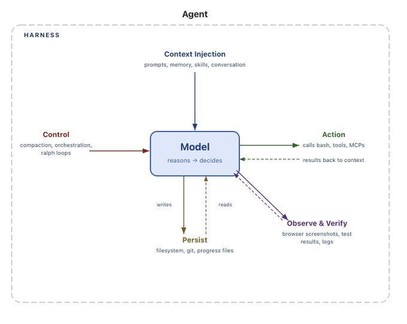

# DingRing中的Agent设计实践

## 写在前面

之前在公司，我经常和同事在群里交流技术；现在失业了，一个人学习，很难有一个可以讨论沟通的人。而跟单个 Agent 沟通又很枯燥——一个窗口，你问"什么是 XXXX"，AI 丢给你一大串答案，剩下的全靠自己消化，这很 bad。所以我最初的想法就是：模拟一个钉钉群，和一群 AI "同事"讨论技术和工作。但后来我又想：为什么不把自己当成群里的主角？其他所有 Agent 都是服务于我的。当我在群里问"什么是 Harness？"，我的意图其实很明显——我想搞懂 Harness 这个概念。Agent 感知到这个意图，就会建一个 Topic；在这个 Topic 关闭之前，群里有一个共识：我们围绕它讨论。
这和单窗口的一问一答是两种体验。群里的多个 Agent 可以被赋予不同的角色——甚至"蒸馏"出一个前同事？——每个角色各有所长：擅长源码的、擅长提问的、擅长面试的……这种设定让讨论更发散、观点更多碰撞，至少摆脱了机械式的单窗口问答。

<br />

就这样，我开始了Vibe coding之旅～

<br />

## 为什么绕不开LLM？

> 决定 Harness LLM 之前，有一个疑惑是：DingRing真的离得开 LLM 吗？

DingRing的设计环节， 我罗列了一个表格：

| 问题                                              | 问题对应的功能 | 传统工程的解决方案               |
| :---------------------------------------------- | :------ | :---------------------- |
| Q1：当我在群里问“什么是Harness？”， 我们要聊的Topic应该是什么？        | Topic抽取 | 正则/关键字                  |
| Q2：当我在群里问“今天天气如何？”，我的意图是讨论“天气”这个知识？还是说就是纯粹“闲聊”？ | 意图分类    | 关键词表/分类器（只要出现“天气”判定为闲聊） |
| Q3：对于Topic的讨论，什么时候应该完结？                         | 对话状态判断  | 轮次阈值/状态机                |
| Q4：Topic完结，进行Topic的知识沉淀，并且生成复习卡片，如果没有LLM，怎么做？   | 摘要+内容生成 | 抽取式摘要/模版                |

Q1-Q4 都是 DingRing 需要直面的真实问题。从传统工程的角度来看，这些问题并不是完全无法解决：我们可以通过正则、关键词、分类器、状态机、模板等方式，为不同的问题建立对应的处理逻辑。

但问题在于，**DingRing 面对的并不是固定格式的输入，而是一段持续变化、上下文相关的群聊。**

例如：“好的”

在不同的语境，“好的”的含义也不同，是Topic完结需要进行知识沉淀？还是说对上一句话的回答？对于传统规则，系统需要提前定义大量判断条件：出现什么关键词 → 创建 Topic、什么情况下 → 关闭 Topic。随着用户表达方式和讨论场景不断增加，规则也会越来越复杂。

所以，传统方案并不是不能处理自然语言，而是通常需要在预先定义的范围内处理问题。这很bad！

那，**传统工程的解决方案在LLM时代一无是处吗？**

从个人的理解来看，并非如此，如果对于一个需要面向真实客户的产品，那对于确定性的传统方案还是应该保留（比如说：商品的叶子类目名称是否敏感？这决定外呼消费者时是否可以真实吐露，我们不应该把决策权完全交给LLM）

<br />

## 谁来Harness LLM？

经过调研，我发现三种形式：

| 方案                                        | 详细说明                                | 优点                                     | 缺点                                                                   |
| :---------------------------------------- | :---------------------------------- | :------------------------------------- | :------------------------------------------------------------------- |
| 方案一：自己构建Harness层                          | 自己从0构建，自己去直接调用LLM                   | 1、灵活可控（人设/共识等）                         | 1、开发成本高（上下文压缩、工具协议、错误恢复都要自己完成）                                       |
| 方案二：CLI Hub——集成Claude Code CLI或者Qoder CLI | DingRing相当于多个CLI的HUB，管理多个CLI之间的调度关系 | 1、业界CLI开盒即用，便利                         | 1、SystemPrompt需要按照各家CLI的方式去注入，不是那么的灵活        2、CLI过于黑盒，上下文割裂，不是特别好管理 |
| 方案三：构建自己的Harness + 三方的CLI                 | 自己从0构建，第三方的CLI可以当成Agent的Tool        | 1、自己构建的Harness管讨论和沉淀；CLI管干活的部分（读文件写文件） | 1、CLI的权限，中间推理过程目前没有办法获悉。         2、多一层配置管理                           |

ps：对于使用业界CLI来构建个人智能体应用可以使用对应的SDK包的方案，但是在Java生态中还没有SDK包可以使用

<br />

基于调研的三个方案，我优先选择了方案一，因为从产品的角度出发，个人认为更多的只是要chat对话的能力，而目前CLI产品，更多的优势是在于“代码工程能力”，这些能力的优先级不那么高。

<br />

## Harness要不要基于框架？

在上一个“谁来Harness LLM”标题中，已经决策出要自行从0到1的去建一个Harness壳，可是这真的现实吗？

一张关于Harness的图，以此说明Agent = LLM + Harness：

> [Can Someone Please Define a "Harness"?](https://www.langchain.com/blog/the-anatomy-of-an-agent-harness)langchain官网有指出Agent = Model + Harness



OK，整体看下来，大致应该需要：屏蔽不同模型厂商所提供API调用上的差异、Tool机制、控制和可观测性——Hook机制、checkpointing。（参考了Claude Code官网：[How the agent loop works](https://code.claude.com/docs/zh-CN/agent-sdk/agent-loop)）

工作量挺大的！为了避免重复造轮，基于现有框架去完成收益是大的。

<br />

主要做了三个框架的调研：

| 对比维度                     | Spring AI                                                     | Spring AI Alibaba                                        | AgentScope Java                                                 |
| ------------------------ | ------------------------------------------------------------- | -------------------------------------------------------- | --------------------------------------------------------------- |
| **项目定位**                 | Spring 官方 AI 工程化基座                                            | 基于构建于 Spring AI 之上的工作流编排型应用框架                            | 不依赖 Spring 的 Agentic 型独立框架                                      |
| **设计理念**                 | 请求管道（ChatClient + Advisor 链）                                  | Workflow-centric：Graph 图编排，确定性流程                         | Agentic-centric：最大化模型自主性 + 框架工程兜底                               |
| **维护方**                  | Spring 官方团队                                                   | 阿里云团队 + Spring/Alibaba 开源社区                              | AgentScope 团队（阿里通义实验室）+ SAA 团队共建                                |
| **开源时间**                 | 2023-06（仓库创建）                                                 | 2024-09                                                  | 2025-09                                                         |
| **当前稳定版**                | 2.0.1（2026-08-21）                                             | 1.1.2.2（2026-03-10，2.0 尚在 M1.1）                          | 2.0.0 GA（2026-07-10）                                            |
| **技术基线**                 | Spring Boot 4.0/4.1 + Framework 7 + Jackson 3                 | Spring AI 1.1.2 + Spring Boot 3.5.x                      | JDK 17+，不依赖 Spring，可嵌入 Spring Boot 微服务                          |
| **核心 Agent 抽象**          | ChatClient + Advisor 链（工具循环即 Advisor）                         | ReactAgent + Flow Agents + StateGraph                    | ReActAgent（核心循环）+ HarnessAgent（工程包装）                            |
| **多智能体模式**               | ⚠️ 社区扩展（spring-ai-agent-utils）                                | ✅ Supervisor / Routing / Handoffs / Subagent / AgentTool | ✅ 声明式子智能体（agent\_spawn / agent\_send，跨副本路由）                     |
| **图工作流引擎**               | ❌ 无内置                                                         | ✅ StateGraph：并行条件边、AllOf/AnyOf 聚合、持久化、中断恢复               | ⚠️ 无显式图引擎，以 Plan Mode + 自主规划承载                                  |
| **A2A 协议**               | ❌ 未内置                                                         | ✅ A2A + Nacos 服务发现与负载均衡                                  | ✅ A2A / AG-UI 协议                                                |
| **会话 / 长期记忆**            | ✅ ChatMemory（社区扩展：事件溯源 + 压缩）                                  | ✅ Checkpointer（Memory/Redis）+ MemoryStore                | ✅ 三层记忆 + AgentStateStore（MySQL/Redis/PG/OSS/COS）                |
| **上下文工程**                | ✅ ToolSearch 渐进披露、结构化输出自纠错                                    | ✅ 动态提示、裁剪/摘要、PII 检测 Interceptor                          | ✅ 结构化压缩、大工具结果落盘、ContextOverflow 兜底                              |
| **RAG**                  | ✅ VectorStore + ETL 管道（基座标准件）                                 | ✅ 两步 / Agentic / 混合 RAG 三形态                              | ⚠️ 支持（路线图），以 Workspace 知识 + Agentic 检索为主                        |
| **MCP 支持**               | ✅ 官方 MCP Java SDK 维护者，@McpTool 注解，Streamable HTTP 默认          | ✅ Graph MCP 节点 + MCP Registry + Admin 管理                 | ✅ MCP 工具调用 + Workspace 白名单                                      |
| **HITL 人工介入**            | ⚠️ 无内置审批流                                                     | ✅ HumanInTheLoopHook（approve/edit/reject）                | ✅ 权限三态引擎（允许/审批/拒绝），框架内生                                         |
| **沙箱执行**                 | ❌ 无内置                                                         | ✅ SAA Sandbox 模块                                         | ✅ 本地子进程 / Docker / K8s / AgentRun 云沙箱 + 快照恢复                    |
| **多租户隔离**                | ❌ 应用层自理                                                       | ⚠️ 未作为框架级显式能力                                            | ✅ session/user/agent/org 四维贯穿                                   |
| **分布式能力**                | ⚠️ 应用无状态，靠 Spring 生产栈组合                                       | ✅ Graph 持久化 + A2A/Nacos                                  | ✅ 无状态水平扩展、跨副本会话恢复、滚动发布零停机                                       |
| **平台工具**                 | ⚠️ start.spring.io 脚手架                                        | ✅ Studio 调试 UI + Admin 一站式平台（提示词/可观测/评估）                 | ⚠️ Studio 在路线图中，主线为 Harness/分布式                                 |
| **IM 渠道**                | ❌ 未内置                                                         | ⚠️ 示例级（语音 Agent）                                         | ✅ Channel 模块（钉钉/飞书/企微）                                          |
| **模型接入**                 | OpenAI、Anthropic、Bedrock、Google GenAI、Mistral、DeepSeek、Ollama | DashScope（Qwen）深度集成 + 开源模型                               | Qwen、OpenAI、Anthropic、Gemini、DeepSeek、Grok、Moonshot、Ollama（模块化） |
| **模型容错降级**               | ❌ 自行组合 Spring Retry                                           | ⚠️ 散见网络层优化                                               | ✅ FallbackModel 声明式容错链                                          |
| **GitHub Stars / Forks** | ★ 9,387 / 2,865                                               | ★ 10,744 / 2,382                                         | ★ 5,429 / 1,294                                                 |
| **许可证**                  | Apache 2.0                                                    | Apache 2.0                                               | Apache 2.0                                                      |
| **文档语言**                 | 英文为主                                                          | 中文 + 钉钉社区                                                | 中英双语 + Discord/钉钉/微信                                            |
| **适合场景**                 | 已有 Spring 应用快速接入 AI 基础能力                                      | 确定性工作流 + 阿里云生态（Qwen/Nacos/Higress）                       | 自主智能体 + 多租户 SaaS + 分布式长时运行                                      |

回到DingRing，它当前并不是一个纯粹追求 Agent 自主性的系统，而是一个“业务流程 + Agent 推理”结合的应用。

所以，首先排除了agentscope-Java， 因为它更偏向的是Agentic（更多的自主探索）。

&#x20;其次排除了Spring AI， 因为SAA可以认为是Spring AI的加强版，SAA提供了很多开箱即用的功能，同时还具备workflow能力，所以，最终选择了SAA，它适配DingRing的证据如下：\
1、DingRing基本流：“用户消息-->意图识别-->Topic建题/Topic完结--->群聊上下文/人设注入--->RAG检索--->ReAct”, SAA的Graph编排可以满足。

2、提示词管理上，SAA的nacos支持热管理

3、SAA支持渐进式SKILL，为后续的一些高技能场景打下基础

<br />

## 朝上下文工程出发

> 真正动手后才发现：**难点不在“怎么调LLM”，而在每一次调用时，往上下文窗口里装什么。**

回头再看最初的Q1-Q4：Topic抽取、意图分类、对话状态判断、摘要生成——它们的共同前提是：模型得先“看见”正确的上下文。

在DingRing之前，我对提示词的理解还停留在Prompt Engineering：把一条指令写好、写精。但群里一条消息进来，落到某个Agent面前时，它面对的远不止一条指令：

```
SystemPrompt（人设：擅长源码的、擅长提问的、擅长面试的……）
+ 当前Topic的元信息（标题、状态、讨论进度）
+ 群聊最近的消息（原文）
+ Topic早期的讨论摘要
+ RAG检索回来的知识片段
+ 用户这条消息
```

这套“装配”动作，就是Context Engineering——不再是“写好一段话”，而是**为每一次调用，动态地组装出正确的上下文**。（参考了Anthropic官网：[Effective context engineering for AI agents](https://www.anthropic.com/engineering/effective-context-engineering-for-ai-agents)）

<br />

单窗口Chat的上下文就是“用户历史 + 当前输入”，而DingRing的群聊场景却稍显复杂：

| 问题                 | 具体表现                                       | 带来的后果                      |
| :----------------- | :----------------------------------------- | :------------------------- |
| 上下文膨胀              | 一个Topic聊到50楼，原文全量塞进窗口早就超限                  | 被迫硬截断，Topic主线断裂            |
| 多Agent重复装配         | 群里n个Agent，每个都带一份几乎相同的上下文                   | token成本×n，还没算ReAct循环里的重复膨胀 |
| Lost in the Middle | 就算塞得下，模型对中间位置内容的注意力也是最弱的（2026年主流模型仍存在该类问题） | 关键信息排中间 ≈ 白说               |

举个具体的例子：一个Topic聊到30楼，有人问“它和Agent是什么关系？”——如果上下文硬截断只保留最近5条，Agent根本不知道“它”指的是Harness，回答直接跑偏。**这种指代断裂，单靠截断是救不回来的。**

而且这里有个反直觉的点：**上下文不是多多益善**。无关的信息不只是浪费token，还会稀释模型的注意力——**窗口里的东西越多，单条信息分到的注意力就越薄。**

一边是塞不下，一边是塞多了反而稀释。所以上下文工程的核心从来不是“塞满”，而是“精选”。经过调研，组装/压缩大致有四种策略：

| 策略      | 详细说明             | 优点           | 缺点               |
| :------ | :--------------- | :----------- | :--------------- |
| 硬截断     | 只保留最近K条消息        | 实现简单，零额外成本   | 早期讨论丢失，指代断裂      |
| 摘要压缩    | 用LLM把历史消息压成一段摘要  | 保留语义主线       | 每次压缩都有延迟和token开销 |
| 滑动窗口+摘要 | 近期消息给原文，早期消息给摘要  | 细节与主线兼顾      | 摘要质量依赖模型         |
| 检索式注入   | 历史消息落库，按当前问题检索召回 | 按需取用，token可控 | 检索质量决定上限，实时性不足   |

ps：SAA本身提供了裁剪/摘要的Interceptor作为基础能力，但“什么时候裁、裁多少、摘要往哪存”，还是得结合DingRing的产品形态自己设计。

<br />

基于调研的四种策略，我没有单选某一种，而是让**Topic的生命周期来决定压缩的时机**——毕竟DingRing的目的本来就是“讨论 -> 收束 -> 知识沉淀 -> 复习卡片”：

1、活跃的Topic：滑动窗口+摘要。近期群消息保留原文，保证讨论的连贯；

2、关闭的Topic：知识沉淀时生成结构化摘要——它既是复习卡片的素材，也是后续讨论的上下文来源；

3、更早的Topic：整体沉淀进知识库，需要时通过RAG检索注入。

也就是说，上下文工程在DingRing里不是一项孤立的技术选型，而是和产品形态长在一起的：**知识沉淀既是产品功能，也是上下文的压缩手段**——一次设计，两个收益。

至于Lost in the Middle怎么“解”（各段信息在窗口里怎么排布），以及“更早的Topic怎么检索”，就留给后面展开。

<br />

## RAG检索的权衡

在迭代的过程中，发现了DingRing的弱点：\
1、你如何知道DeepSeek Harness？  它是26年8月份才发布的

2、你没有办法把私有知识喂给它——我的学习笔记、沉淀下来的Topic知识、上传的技术文档，这些永远不会出现在任何模型的训练集里

<br />

一个是**时效性**（训练截止日期之后的知识，模型一无所知），一个是**私有性**（个人知识永远进不了任何训练集）。针对时效性，我给LLM装了可以网络检索的Tool，但这两个弱点还指向同一个解法：**RAG——把“模型不知道的”，变成“模型看得见的”。**

<br />

但真正动手做RAG，才发现它远不是“接个向量库”那么简单——检索链路上的每一步，都是一道选择题：

| 问题      | 具体表现                             | 带来的后果             |
| :------ | :------------------------------- | :---------------- |
| 切多细？    | chunk太大，检索回来一半是噪音；太小，语义被切得四分五裂   | 检索质量从源头就被决定       |
| 怎么找？    | 向量检索懂语义，但认不出专有名词；关键词检索精确，但不懂“同义” | 单一召回方式总有盲区        |
| 找回来怎么排？ | 召回10条候选，真正相关的可能排在第7位             | 排序差 ≈ 白检索         |
| 注入多少？   | 检索结果全文塞进上下文，token瞬间爆炸            | 绕了一圈，又回到上下文膨胀的老问题 |
| 检索哪里？   | 全库检索，A群的私有知识漏进B群的讨论              | 私有性从根上就破了         |

<br />

**切分：结构就是语义**

| 策略     | 详细说明                         | 优点         | 缺点                 |
| :----- | :--------------------------- | :--------- | :----------------- |
| 固定长度切分 | 按token数硬切                    | 实现简单，行为可预期 | 代码块、表格被拦腰斩断，语义四分五裂 |
| 语义切分   | 按Markdown结构（标题层级/表格/代码块）聚合切分 | chunk语义完整  | 实现复杂，依赖文档本身的规范性    |

DingRing的语料选择是Markdown文档（技术博客、官方文档、学习笔记），而Markdown的结构信息——标题层级、代码围栏、表格——本身就是最好的切分线索。所以没有用框架自带的TokenTextSplitter，而是自己写了基于状态机的MarkdownStructureParser + MarkdownSemanticChunker：front matter、代码围栏、表格、列表逐块解析，表格切分时重复表头，超长块做确定性切分，再用absoluteMaxTokens硬上限兜底。策略留了开关（dingring.rag.chunk.strategy），fixed和md-semantic之间可以随时切换——切分出问题，能快速回滚。

ps：切分之前还有一步容易被忽略的**文档清洗**：上传的原始文档里混着目录、页眉页脚、乱码，切得再好也是垃圾进垃圾出。所以摄入管道先走LLM清洗，再对清洗后的版本做切分和向量化。

<br />

**检索：不赌单边**

| 方案     | 详细说明             | 优点                    | 缺点             |
| :----- | :--------------- | :-------------------- | :------------- |
| 纯向量检索  | embedding语义相似度召回 | 懂语义，“脚手架”能召回“Harness” | 专有名词、代码标识符容易失手 |
| 纯关键词检索 | 全文/关键词检索召回       | 术语精确命中                | 不懂同义改写，召回面窄    |
| 混合检索   | 两路并行召回，融合排序      | 盲区互补                  | 链路变长，融合策略要设计   |

举个实际的例子：群里聊“Harness”，有人问“那个脚手架是怎么回事”——向量检索靠语义接得住；但要搜"agent\_loop"这种代码标识符，向量检索大概率失手，反而是pg\_trgm关键词检索精确命中。**单一召回总有自己的盲区**，所以DingRing选了混合：pgvector稠密检索和pg\_trgm关键词检索并行召回，RRF融合——RRF只用两路的排名倒数算分，不用调权重，简单且稳。

检索之前，query本身还要先“洗”一遍。上一节那个“它和Agent是什么关系？”——直接拿“它”去检索，什么也召回不了。所以先做归一化，检测到指代词时，用小模型结合Topic标题把query改写成自包含的（“它”→“Harness”），改写失败就回退原query。

<br />

**重排：召回 ≠ 相关**

RRF融合出来的只是“两路都觉得还行”的顺序，不等于真正的相关性。所以融合之后还有三道工序：

1、邻居扩展：命中的chunk往往太小、上下文不足，把前后兄弟chunk补进候选池，把语义完整的片段找回来；

2、精排：Qwen3-Reranker对候选重排——外部精排API挂了就降级用RRF顺序，检索链路不能死在外部依赖上；

3、MMR去冗余：10条候选里8条说的是同一件事，全塞进上下文就是自己给自己稀释注意力。MMR在相关性和多样性之间取平衡——和“上下文要精选”是同一个道理。

而且整条链路每个通道都是独立降级的：lexical挂了走单dense，精排挂了用RRF顺序，Redis挂了直查PG——**检索可以退化，但不能阻塞群聊主流程**。

<br />

**注入：小而精，而非大而全**

检索回来的内容怎么进上下文？这又绕回了上一节的结论：上下文不是多多益善。Anthropic那篇context engineering里有个说法我很认同：与其一次性塞一大坨检索结果，不如little and often——**按需、小份、多次**。

DingRing的做法是两级注入（渐进式披露）：

| 层级      | 内容                               | 预算           | 作用             |
| :------ | :------------------------------- | :----------- | :------------- |
| Level 1 | 检索目录：相关性排序的条目列表（分数/文件/章节/摘要）     | ≤500 token   | 让模型低成本地知道“有什么” |
| Level 2 | kb\_read\_in\_redis工具按需读取chunk全文 | 单次4096 token | 模型判断需要深挖时，自己调用 |

目录保prompt低成本，全文保深读能力，chunkId把两级关联起来。注入时机也有讲究：放在Agent运行前执行一次，而不是模型每次调用前——否则ReAct循环里每一轮都重复检索、重复注入，token白白烧掉。

<br />

**门控：不该检索的，一次也不检索**

最后是两个“收敛”：

1、**意图门控**：闲聊（CHAT）双源全跳过——闲聊不需要知识注入；讨论（DISCUSS）走kb+topic双源；工作（WORK）只要kb源（任务要的是资料，历史话题无关）；收束（CONCLUDE）只要topic源（总结本话题，相似历史结论作参考）。不为不需要的能力付出上下文的代价；

2、**范围门控**：kb源只检索群绑定的知识库（chat\_group.knowledge\_base\_config.kbIds），没绑定知识库的群压根不发起向量检索——既是私有性隔离，也省一次无意义的调用。

至于上一节留下的“更早的Topic怎么检索”——答案就在topic源里：**Topic关闭做知识沉淀时，结论会向量化入库；**之后新的讨论开始时，用Topic标题检索相似的历史Topic，把它们的结论注入上下文。

<br />

于是链路闭环了：**讨论 → 沉淀 → 入库 → 检索 → 继续讨论**。上周聊透的Harness，这周聊Agent循环时被检索回来接着用——知识库在DingRing里同样是一次设计、两个收益：既是RAG的语料来源，也是这个学习产品本身的知识资产。**学习这件事，也形成了复利。**
