# JVM的基础理解

## JVM初认识

JVM广义上指的是一种规范。狭义上的是JDK中的JVM虚拟机（比如：oracle的hotspot、zing、taobao.vm）

**那Java和JVM的关系是什么呢？** &#x20;

实际上，JVM上运行的是字节码指令，只要最终是符合JVM规范的字节码，不管是Java还是Go亦或者是Kotilin，JVM其实都不关心。官网上也指出：

> The Java Virtual Machine knows nothing of the Java programming language, only of a particular binary format, the `class` file format. A `class` file contains Java Virtual Machine instructions (or *bytecodes*) and a symbol table, as well as other ancillary information.[1.2. The Java Virtual Machine](https://docs.oracle.com/javase/specs/jvms/se25/html/jvms-1.html)

**为什么说JVM是平台无关的？**

JVM只关心字节码，这也是一种“架构中立”的设计思想，本身就是为了解决在不同的硬件平台上运行的移植困境（换种说法是binary-distribution problem）

> The solution that the Java system adopts to solve the binary-distribution problem is a "binary code format" that's independent of hardware architectures, operating system interfaces, and window systems. The format of this system-independent binary code is *architecture neutral*. If the Java run-time platform is made available for a given hardware and software environment, an application written in Java can then execute in that environment without the need to perform any special porting work for that application.
> [Architecture Neutral, Portable, and Robust](https://www.oracle.com/java/technologies/architecture-neutral-portable-robust.html)

<br />

## JVM组件架构

### 架构图

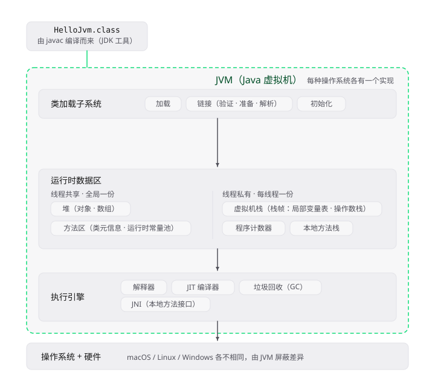

### 类加载子系统

#### 1）类加载的三个阶段（过程）

> The Java Virtual Machine dynamically loads, links and initializes classes and interfaces. Loading is the process of finding the binary representation of a class or interface type with a particular name and creating a class or interface from that binary representation. Linking is the process of taking a class or interface and combining it into the run-time state of the Java Virtual Machine so that it can be executed. Initialization of a class or interface consists of executing the class or interface initialization method `<clinit>`
> [Chapter 5. Loading, Linking, and Initializing](https://docs.oracle.com/javase/specs/jvms/se21/html/jvms-5.html)

类加载子系统是JVM里“把.class字节流变成可用的Class对象”的机制——规范规定了“加载——>链接——>初始化”三个步骤。

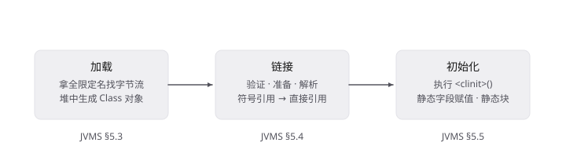

具体的三个阶段：

1、类加载——找到字节码文件并创建成类或接口的过程。（有类对象了，Class对象）

2、链接——将类或接口并入到JVM运行时状态的过程，以便可以被执行。

3、初始化—— 执行类或接口的初始化方法的过程。

#### 2）类加载的时机

1、遇到new、getstatic、putstatic和invokestatic这四条指令时，如果对应的类没有初始化，则要对对应的类先进行初始化。

2、使用java.lang.reflect包方法时，对类进行反射调用的时候。

```Java
Classc=Class.forname("com.hero.Student");
```

3、初始化一个类的时候发现其父类还没初始化，要先初始化其父类

4、当虚拟机开始启动时，用户需要指定一个主类（main），虚拟机会先执行这个主类的初始化

#### 3）类加载器

##### 3.1）类加载的顺序

加载顺序符合“双亲委派机制”，这种机制符合下面一句话：

> Given the same name, a good class loader should always return the same`Class` object

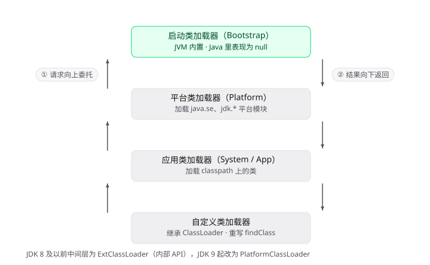这种机制，确保了两件事：

1、确保一些核心的关键类由顶层的类加载器加载，

2、相同的类，不会被加载两次。

##### 3.2）打破双亲委派机制

先弄清“类加载器”和“类加载”的差异：

首先，类加载器是一名词，从Java来看，ClassLoader是类加载器的抽象模板，其子类是“类加载器”，  类加载器的职责是“查找字节流”（“创建类，链接，初始化”在JVM实现层）

其次，类加载是一个process，会根据全限定名找字节流，然后创建类

所以类加载的组成横跨Java代码层和JVM。类加载器是协助类加载这个process的。换句话说，类或接口的创建由JVM和类加载器共同完成。

<br />

**打破双亲委派的途径和具体的Case：**

1、继承ClassLoader重写loadClass方法，打破总是委派给父加载器加载的逻辑——这个方法是委派骨架，ClassLoader中的委派逻辑是“已加载的类中没有本次要加载的类，总是先委派给父加载器加载”

简单而言，就是改变查找类的顺序。


Tomcat为了隔离webapp之间的冲突，打破双亲委派，做法是用不同的类加载器（实际就是WebappClassLoader的两个不同实例）直接加载相同全限定名（并没有委派给父加载器），实际是两个不同的类信息——原因：`<同名, Ld1>` 和`<同名, Ld2>`这才是在JVM中类唯一性的依据。（Ld1和Ld2是两个不同的定义加载器）

<br />

2、SPI机制——并不是打破loadClass的委派逻辑，而是定义加载器找不到，也没法子继续委派，从而指定加载器去找

在JDBC中，DriverManager会由App加载器发起向上委派，DriverManager会由bootstrap加载器定义，然后DriverManner中注册了Mysql的驱动类，按照委派逻辑，这个驱动类就需要由bootstrap加载器定义，但是这个驱动类是在classpath路径上的，bootstrap没办法加载，这个时候委派逻辑是满足不了的

所以，有两个方面的总结：

一方面，驱动类的加载没办法继续由bootstrap委派（bootstrap已经到顶了，它没有父加载器了）

另一方面，这个驱动类不是由App加载器发起的，也办法按照委派机制最终由App加载器执行findClass

综合以上，需要打破双亲委派，有关驱动类的加载，会直接指定App加载器加载

> 一些委派逻辑和定义加载器的概念参考自[5.3. Creation and Loading](https://docs.oracle.com/javase/specs/jvms/se21/html/jvms-5.html#jvms-5.3)

<br />

3、热部署

为了满足热部署、不停机更新需求。OSGI就是利用自定义的类加载器机制来完成模块化热部署，而它实现的类加载机制就没有完全遵循自下而上的委托，有很多平级之间的类加载器查找。

<br />

##### 3.3）类加载器的隔离性

1、世界由“定义加载器”划分。 类的唯一性是`<N, Ld>` ——名字相同、定义加载器不同，就是两个类、两个世界。

2、依赖跟着引用者的世界走。 A 由 L1 定义、A 引用 B → B 在 L1 的世界里解析，得到的是 L1 世界里的那个 B。如果同一份 A 字节码被 L2 再定义一遍，它引用的 B 就是 L2 世界的 B——哪怕字节码一字不差，两个 B 互不相认。

3、跨世界传对象 =`ClassCastException` 。 因为“是不是同一个类”由`<N, Ld>` 决定，赋值兼容检查按这个来。

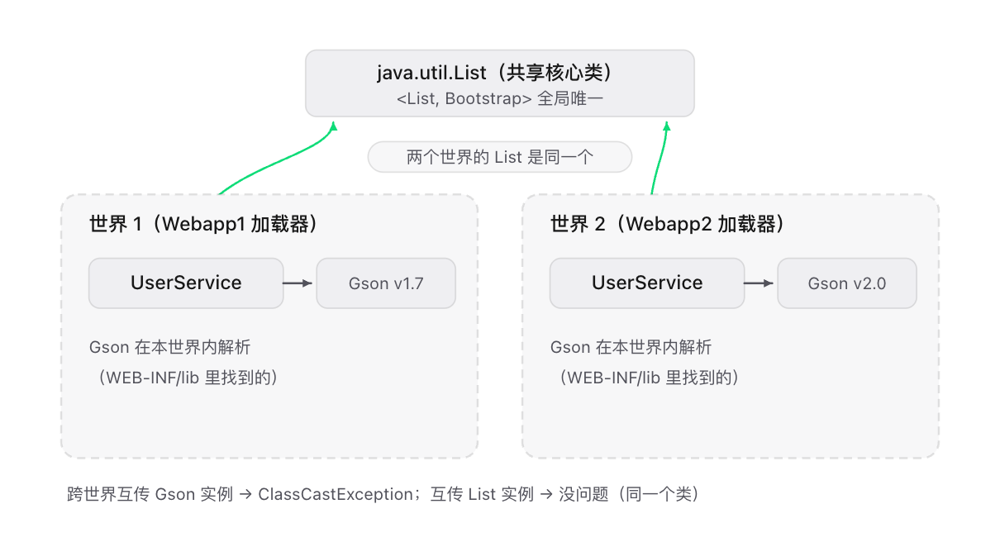

### 运行时数据区

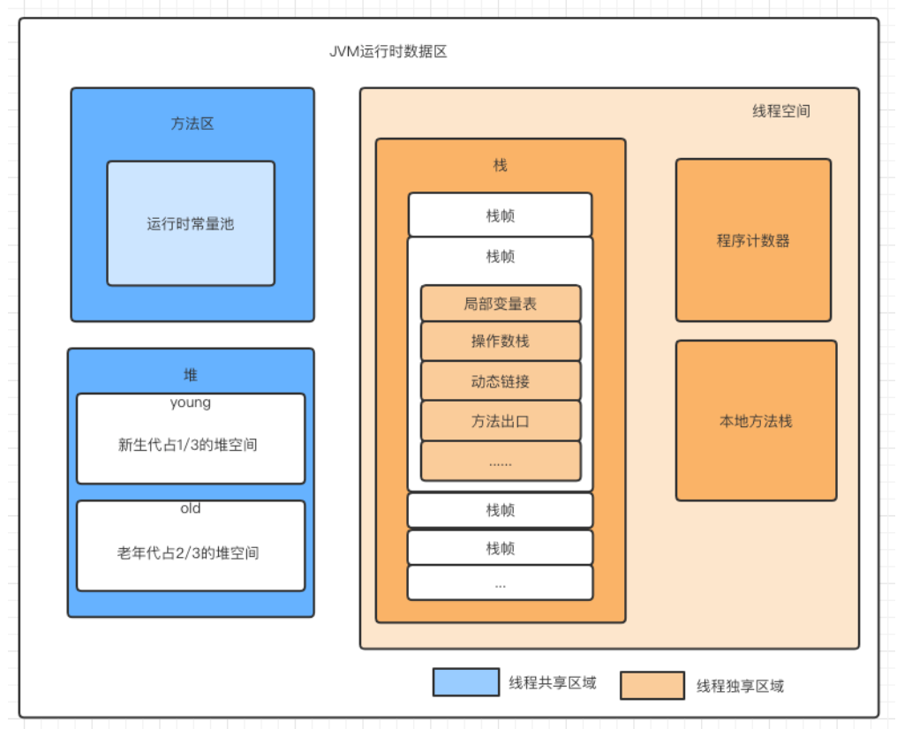

#### 堆&方法区——线程共享

Java堆在JVM启动时创建内存区域去实现对象、数组与运行时常量的内存分配，它是虚拟机管理最大
的，也是垃圾回收的主要内存区域。

关于堆内存的划分（**主要是回答了为什么要划分新生代和老年代的问题**），是基于以下分代假说去优化的：

1、\*\*弱分代假说（Weak Generational Hypothesis）：\*\*绝大多数对象都是朝生夕灭的。

2、\*\*强分代假说（Strong Generational Hypothesis）：\*\*熬过越多次垃圾收集过程的对象就越难以消亡。

<br />

##### 方法区

**方法区是一种规范，永久代和元空间是对应的具体实现，对于具体实现的版本变迁，如下图：**\
**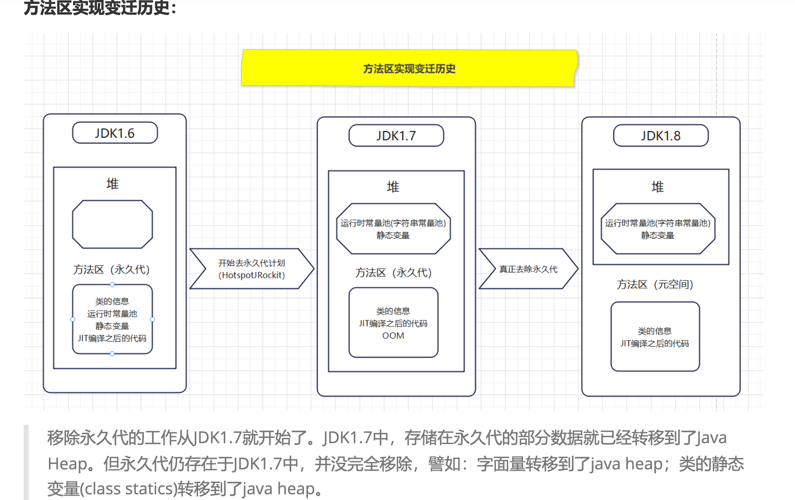方法区会存储以下内容信息：**

第一：Class

1.类型信息，比如Class（com.hero.User类）

2.方法信息，比如Method（方法名称、方法参数列表、方法返回值信息）

3.字段信息，比如Field（字段类型，字段名称需要特殊设置才能保存的住）

4.类变量（静态变量）：JDK1.7之后，转移到堆中存储

5.方法表（方法调用的时候）在A类的main方法中去调用B类的method1方法，是根据B类的方法表去查找合适的方法，进行调用的。——这个说法可能不对，后续看到有时间再研究下

第二：运行时常量池（字符串常量池）：从class中的常量池加载而来，JDK1.7之后，转移到堆中存储字面量类型引用类型-->内存地址

第三：JIT编译器编译之后的代码缓存

<br />

<br />

**永久代和元空间的区别是什么？**

1、JDK1.8之前使用的方法区实现是永久代，JDK1.8及以后使用的方法区实现是元空间。

2、存储位置不同：
永久代所使用的内存区域是JVM进程所使用的区域，它的大小受整个JVM的大小所限制。
元空间所使用的内存区域是物理内存区域。那么元空间的使用大小只会受物理内存大小的限
制。

3、存储内容不同：
永久代存储的信息基本上就是上面方法区存储内容中的数据。
**元空间只存储类的元信息，而静态变量和运行时常量池都挪到堆中**

<br />

**为什么要使用元空间来替换永久代？**

1、字符串存在永久代中，容易出现性能问题和永久代内存溢出。

2、类及方法的信息等比较难确定其大小，因此对于永久代的大小指定比较困难，太小容易出现永久代
溢出，太大则容易导致老年代溢出。

3、永久代会为GC带来不必要的复杂度，并且回收效率偏低。

4、Oracle计划将HotSpot与JRockit合二为一。

<br />

**常量池的概念？**

【JVM运行时数据区架构详解 - TRAE】<https://share.traecontent.cn/share/7.K-NXZ7-V1AWY?enter_from=pc>

以下按1.8来：

| <br />     | 概念                                    | 时机                                                                    | 存储位置               |
| :--------- | :------------------------------------ | :-------------------------------------------------------------------- | :----------------- |
| class文件常量池 | .class文件里的一张静态表                       | javac编译器产出                                                            | 磁盘                 |
| 运行时常量池     | `class 文件常量池` （磁盘清单）-->类加载-->`运行时常量池` | 类加载                                                                   | 元空间（元空间在物理内存，非堆内存） |
| 字符串常量池     | 字符文本的集合，StringTable的数据结构              | 1、StringTable本身在JVM启动创建。2、运行时首次执行字符字面量才会intern(). 3、显示String.intern() | 堆                  |

```Textile
.class 文件
├── 魔数 + 版本号
├── 常量池（constant_pool 表）   ← "class文件常量池"只是这一节
├── 访问标志
├── 字段表
├── 方法表
└── 属性表
```

这里后续再看到需要补一个具体类的case，拆下详细的结构

<br />

#### 虚拟机栈&本地方法栈&程序计数器——线程私有

\*\*程序计数器：\*\*每个线程独有的“行号记录仪”，记住当前执行到哪条字节码指令

**虚拟机栈：每个线程私有的“调用记录堆叠”，每调用一个方法就压入一个栈帧，方法返回就弹出；栈深超限报`StackOverflowError`** **，栈内存扩展失败报`OutOfMemoryError`** **。其中，栈帧**是支持虚拟机进行方法执行的数据结构。存储了方法的局部变量表、操作数栈、动态连接和方法返回地址等信息。每一个方法从调用至执行完成的过程，都对应着一个栈帧在虚拟机栈里从入栈到出栈的过程。虚拟机栈的生命周期是：随线程创建/销毁

\*\*本地方法栈：\*\*为 native 方法（JNI 方法，即用 C/C++ 实现、不是字节码的方法）服务的栈，行为规范与虚拟机栈几乎同款，异常也一样。

<br />

<br />

## 对象的生命周期

### 对象的创建流程

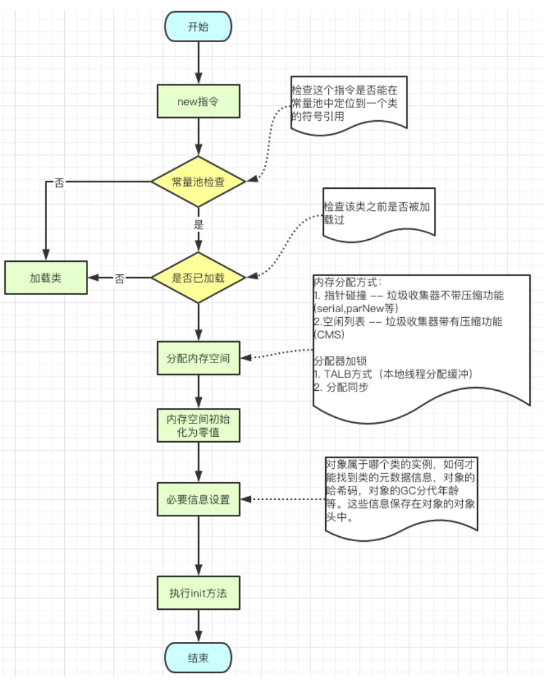

#### 堆中的内存分配

TODO：差个实验，后续补上实验信息

先要区分一些概念问题：

| 概念对                     | 核心区别                                      | 其他说明                     |
| :---------------------- | :---------------------------------------- | :----------------------- |
| 堆（规范） vs 分代（具体实现）       | 堆是JVM规范要求的对象分配区；分代是HotSpot对堆的内部划分         | 规范说“必须有堆”，没说“必须分代”       |
| TLAB vs Eden            | TLAB时线程私有的分配缓冲区，物理上就在Eden里；Eden是所有线程共享的区域 | TLAB 是 Eden 上按线程切的“专属格子” |
| TLAB内分配 vs 堆分配          | 前者无锁指针碰撞；后者走慢路径（可能加锁、触发GC）                | 新对象99%走TLAB              |
| “对象分配在堆上” vs 逃逸分析       | 前者是默认行为；后者是JIT优化，可让对象不分配                  | 逃逸分析是优化项，不是规范承诺          |
| Minor GC 晋升 vs 大对象直入老年代 | 前者是活下来的对象熬出来的；后者出生时就没走年轻代                 | 大对象是“出生即老年代”，不是“熬成老年代”   |

<br />

**对象内存分配方式：**

内存分配的方法有两种：不同垃圾收集器不一样

| 分配方式                   | 逻辑说明                                | 使用条件                      |
| :--------------------- | :---------------------------------- | :------------------------ |
| 指针碰撞(Bump the Pointer) | 维护一个分配指针，直接从空闲区域的起始位置划出所需内存，然后移动指针。 | 内存规整，已使用区域和空闲区域之间有明确分界。   |
| 空闲列表(Free List）        | JVM 维护可用内存块的信息，分配对象时寻找能够容纳对象的空闲块。   | 内存可能存在不连续的空闲区域，例如未整理的堆空间。 |

这两种方式的区别，主要取决于堆内存是否规整，而这又与垃圾收集器的内存整理策略有关。

| GC算法  | 内存布局特点      | 常见分配方式 |
| :---- | :---------- | :----- |
| 标记-整理 | 整理后内存规整     | 指针碰撞   |
| 复制算法  | 存活对象复制到连续区域 | 指针碰撞   |
| 标记-清除 | 可能会产生内存碎片   | 空闲列表   |

<br />

**多线程分配时如何保证安全？**

假设两个线程同时读取到同一个分配指针位置，如果都认为自己可以从这里分配，就会出现冲突。

常见解决方案（**并发分配优化方案**）：

1、\*\*CAS 或同步机制：\*\*通过原子操作或同步机制更新共享分配指针，避免两个线程分配到同一块内存。

2、\*\*TLAB（Thread-Local Allocation Buffer）：\*\*JVM 为线程预留一块专属的堆内存。线程优先在自己的 TLAB 中分配对象，减少对共享分配路径的竞争。

<br />

ps：TLAB如果不足如何处理？ 这块后面再梳理

<br />

### 新对象晋升流程

\*\*新生代：\*\*新对象大多数都默认进入新生代的Eden区

进入老年代的条件：四种情况

**1、对象年龄达到阈值：存活年龄太大**，默认超过15次【-XX:MaxTenuringThreshold】

\*\*2、动态年龄判断：\*\*MinorGC之后，发现Survivor区中的一批对象的总大小大于了这块Survivor区
的50%，那么就会将此时大于等于这批对象年龄最大值的所有对象，直接进入老年代。

举个栗子：Survivor区中有一批对象，年龄分别为年龄1+年龄2+年龄n的多个对象，对象总和大小超过了Survivor区域的50%，此时就会把年龄n及以上的对象都放入老年代。

为什么会这样？希望那些可能是长期存活的对象，尽早进入老年代。
-XX:TargetSurvivorRatio可以指定

\*\*3、大对象直接进入老年代：\*\*前提是Serial和ParNew收集器

举个栗子：字符串或数组
-XX:PretenureSizeThreshold（用于设置直接在老年代分配对象的大小阈值）一般设置为1M，\*\*为什么会这样？\*\*为了避免大对象在分配内存时的复制操作降低效率。避免了Eden和Survivor区的复制

4、\*\*Survivor 空间不足：\*\*MinorGC后，存活对象太多无法放入Survivor

<br />

**空间担保机制：**
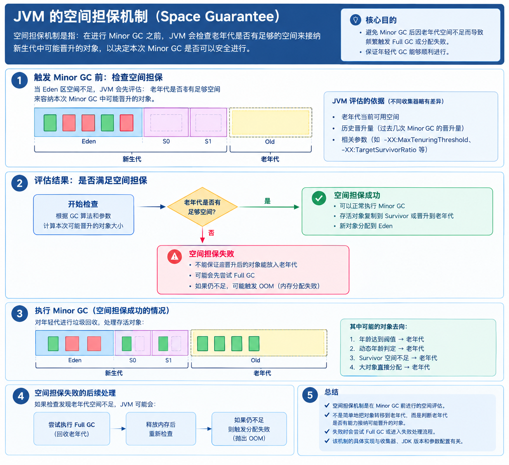

<br />

### 对象内存布局

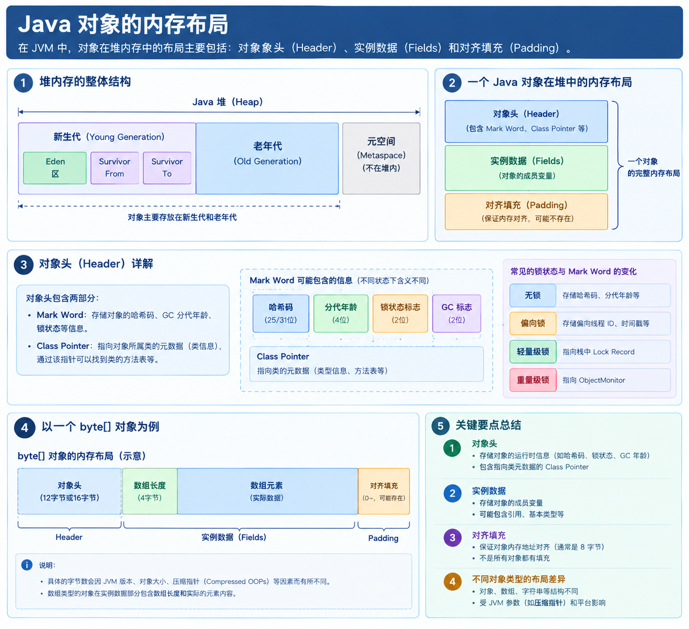

### GC基本原理

**GC Roots机制：**为了识别哪些对象是有用的，这种有用性应当是业务有用（应用层），使用GC Roots机制去识别出有用对象，无用对象则会被进行垃圾回收。本质应当是把有用性的判断转换成图遍历问题（对象之间的依赖图）。——另外，引用计数法无法解决循环依赖，所以弃用。

**STW：**还有一个STW（Stop-The-World）的概念，意思是在进行gc的时候，JVM世界被冻结，只让部分工作线程执行（非应用线程），主要原因是：垃圾回收需要获得一个足够一致的对象引用视图，避免应用线程在回收过程中修改对象引用，导致存活对象被误判为垃圾。

另外，关于【**为什么要STW**】的理解，可从三个层面：—— （作为了解即可，后续有时间可以深挖）

- 对象图一致性： 应用线程修改引用关系时，GC 需要防止存活对象被漏标。
- 运行时安全： 某些根引用枚举、对象移动和引用更新操作，需要在受控的线程状态下完成。
- 工程权衡： 完全并发的 GC 需要额外的屏障、元数据和同步机制，因此很多收集器选择只让部分阶段并发执行。

**可作为GCRoots的对象有：**

| 根引用来源           | 为什么可以作为根               |
| :-------------- | :--------------------- |
| 活动 Java 线程栈中的引用 | 方法执行期间，局部变量等引用可能继续使用对象 |
| 类的静态字段引用        | 类的静态字段可能持有程序仍需要的对象     |
| JNI 局部引用、全局引用等  | 原生代码可能仍持有 Java 对象      |
| JVM 内部的一些引用     | 虚拟机运行机制可能仍需要这些对象       |

<br />

**对象引用类型：**

| 引用类型 | 强度类型      | 被垃圾回收的时机                                | 主要用途                                                | 生存时间                          |
| :--- | :-------- | :-------------------------------------- | :-------------------------------------------------- | :---------------------------- |
| 强引用  | 最强        | 只要对象仍通过强引用链从 GC Roots 可达，就不能作为普通垃圾回收    | 普通对象引用、业务对象、集合元素                                    | 取决于强引用链何时断开，以及是否还存在其他强引用      |
| 软引用  | 较强        | 对象仅软可达时，GC 可**根据内存需求**清除软引用并回收对象        | 内存敏感型缓存                                             | 通常可存活到 GC 因内存需求清理软引用，但具体时机不确定 |
| 弱引用  | 较弱        | 对象仅弱可达时，GC 发现后可以清除弱引用并回收对象              | `WeakHashMap`、不希望引用本身延长对象生命周期的关联关系（Case：TreadLocal） | 通常可存活到下一次相关 GC 处理弱引用时         |
| 虚引用  | 不可通过其获取对象 | 对象达到虚可达状态后，GC 可在相应处理流程中清理对象，并通过引用队列通知程序 | 跟踪对象回收状态、配合引用队列管理堆外资源清理流程                           | 取决于对象的可达性变化、GC 处理和引用队列的处理情况   |

<br />

强引用看可达性，软引用看内存需求，弱引用看 GC 处理，虚引用看回收通知。

<br />

#### **垃圾清理算法：**&#xA;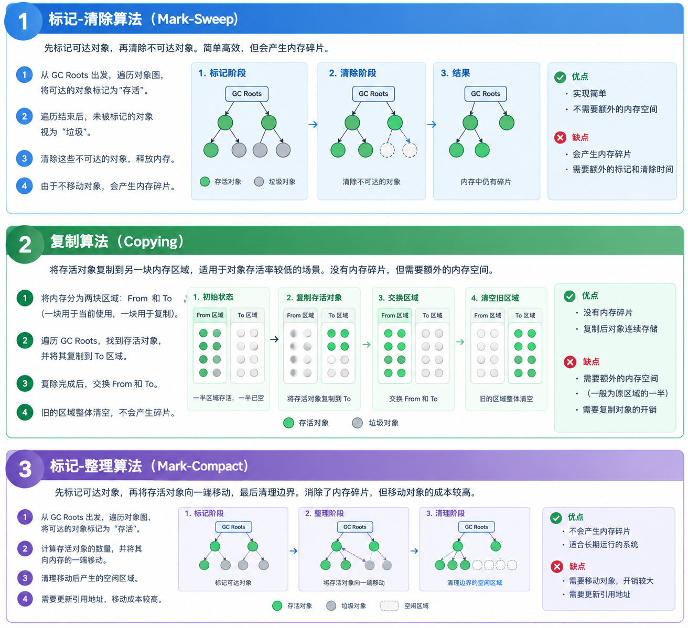

#### 垃圾收集器：

图中关于ZGC，Shenandoah采用的标记-整理算法并非传统意义上，这块机制复杂暂不展开（涉及有彩色指针（Colored Pointers）、加载屏障（Load Barrier）和转发表（Forwarding Table））

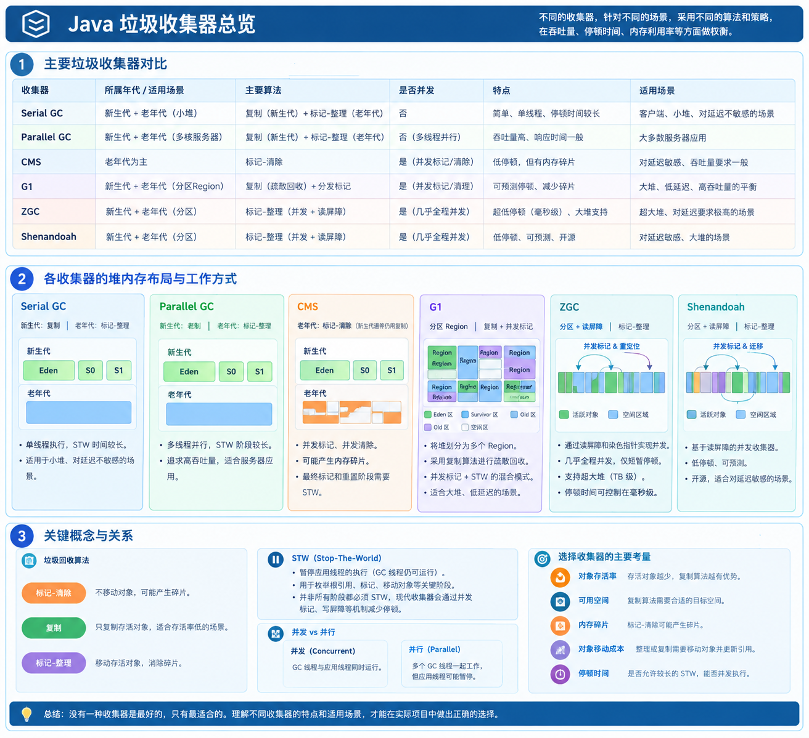**对于新生代，为什么【标记-复制】算法更合适？**  从两个方面来看：

1、**弱分代假说：**新生代对象通常具有较高的死亡率（**对象的朝生夕死**），因此复制算法只需要复制少量存活对象，回收成本相对较低。

2、**内部碎片：**标记-复制算法避免了内存碎片问题，使对象分配（这里是说内存分配）能够高效地采用指针碰撞，减少了外部内存碎片带来的空间管理问题

<br />

**对于老年代，为什么【标记-清理/整理】算法更合适？**

**强分代假说：**对象从新生代晋升至老年代，往往意味着后续还会继续存活，那在老年代中，有用对象就多，因为要移动的对象会很多，此时标记-复制并没有优势，更适合用**标记-清理/整理**算法

<br />

**垃圾收集器的设计都是围绕降低STW时间和频率来设计的？**

1、降低停顿时间（Latency）

2、提高吞吐量（Throughput）

3、控制内存占用与分配效率

4、控制 GC 的整体成本与可预测性

<br />

<br />

<br />

