# JUC篇

## 前言

关于并发控制，synchronized和volatile是语言层的方案，而JUC是类库层的，补充了synchronized所不具备的并发控制能力。

<br />

## 大纲

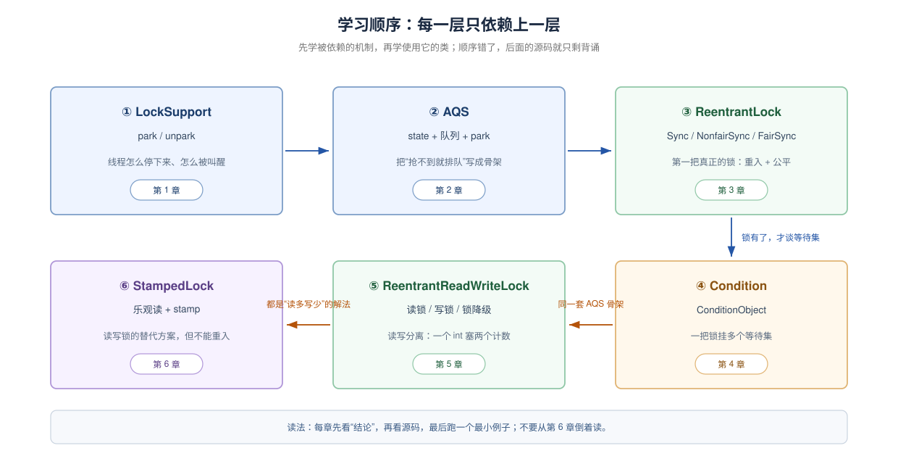

## 1.LockSupport：所有阻塞的地基

LockSupport 提供了让**指定线程**阻塞和恢复执行的基础能力，AQS 等同步器可以利用它实现线程排队、等待与唤醒。

### 1.1 官方文档怎么说

每个线程一张许可，最多一张、park消费、unpark发放

`park()`：没有获得通行许可时，你先停下来等待。

`unpark(thread)`：给指定线程一个通行许可。

> "Basic thread blocking primitives for creating locks and other synchronization classes.
>
> This class associates, with each thread that uses it, a permit (in the sense of the Semaphore class). A call to park will return immediately if the permit is available, consuming it in the process; otherwise it may block. A call to unpark makes the permit available, if it was not already available. (Unlike with Semaphores though, permits do not accumulate. There is at most one.)"
> （用于创建锁和其他同步类的基础线程阻塞原语。
>
> 本类为每个使用它的线程关联一个许可（语义类似 `Semaphore`）。如果许可可用，`park` 会立即返回并在过程中消费它；否则可能阻塞。`unpark` 使许可变为可用（如果它原本不可用）。但与 `Semaphore` 不同，许可不会累积，最多只有一个。）

**什么是permit?**  每个使用 LockSupport 的线程，都关联一个许可状态。可以把它粗略理解成一个最多只能存放一张通行证的小盒子。

<br />

为什么能替代Thread.suspend/resume? 

> "Methods park and unpark provide efficient means of blocking and unblocking threads that do not encounter the problems that cause the deprecated methods Thread.suspend and Thread.resume to be unusable for such purposes: Races between one thread invoking park and another thread trying to unpark it will preserve liveness, due to the permit."
> （`park` 和 `unpark` 提供了高效的阻塞/解除阻塞手段，避开了已废弃的 `Thread.suspend/resume` 在此类用途上不可用的问题：一个线程调用 `park`、另一个线程尝试 `unpark` 之间的竞争，由于许可的存在，不会丢失活性。）

<br />

park的方法javadoc写了三种返回原因：

> "If the permit is available then it is consumed and the call returns immediately; otherwise the current thread becomes disabled for thread scheduling purposes and lies dormant until one of three things happens:
>
> - Some other thread invokes unpark with the current thread as the target; or
> - Some other thread interrupts the current thread; or
> - The call spuriously (that is, for no reason) returns.
>
> This method does not report which of these caused the method to return. Callers should re-check the conditions which caused the thread to park in the first place. ..."
> （如果许可可用，则消费它并立即返回；否则当前线程因调度目的被禁用并休眠，直到三种情况之一发生：其他线程以当前线程为目标调用 `unpark`；或其他线程中断当前线程；或调用虚假地（即无故）返回。该方法不报告是哪种原因导致返回，调用方应重新检查最初导致线程 `park` 的条件。）
> —— 同上

<br />

park/unpark的使用场景？

> "Additionally, park will return if the caller's thread was interrupted, and timeout versions are supported. The park method may also return at any other time, for "no reason", so in general must be invoked within a loop that rechecks conditions upon return."
> （此外，如果调用线程被中断，`park` 会返回，并且支持超时版本。`park` 也可能在任何其他时间“无故”返回，因此通常必须放在一个返回后重新检查条件的循环里调用。）

> "These methods are designed to be used as tools for creating higher-level synchronization utilities, and are not in themselves useful for most concurrency control applications. The park method is designed for use only in constructions of the form:
>
> while (!canProceed()) { ... LockSupport.park(this); }
>
> ... Because only one permit is associated with each thread, any intermediary uses of park could interfere with its intended effects."
> （这些方法被设计为创建更高层同步工具的“零件”，它们本身对大多数并发控制应用并不直接有用。`park` 只应在如下结构中使用：`while (!canProceed()) { ... LockSupport.park(this); }`……因为每个线程只关联一个许可，任何中途插入的 `park` 都可能干扰它原本的用途。）
> —— 同上

<br />

关于blocker参数：

> "The three forms of park each also support a blocker object parameter. This object is recorded while the thread is blocked to permit monitoring and diagnostic tools to identify the reasons that threads are blocked. ... The normal argument to supply as a blocker within a lock implementation is this."
> （三种 `park` 形式都支持一个 `blocker` 对象参数。线程阻塞期间会记录该对象，便于监控和诊断工具识别线程阻塞的原因。……锁实现里通常传入 `this`。）

<br />

<br />

### 1.2 为什么需要Locksupport？

原因：JDK5之前没有一个“不持锁，能点名、还不丢唤醒”的阻塞原语；

#### 1.2.1 旧方案一：`Thread.suspend()/resume()` —— @deprecated

废弃原因是因为会“死锁”，具体详细的死锁原因不在这里分析。
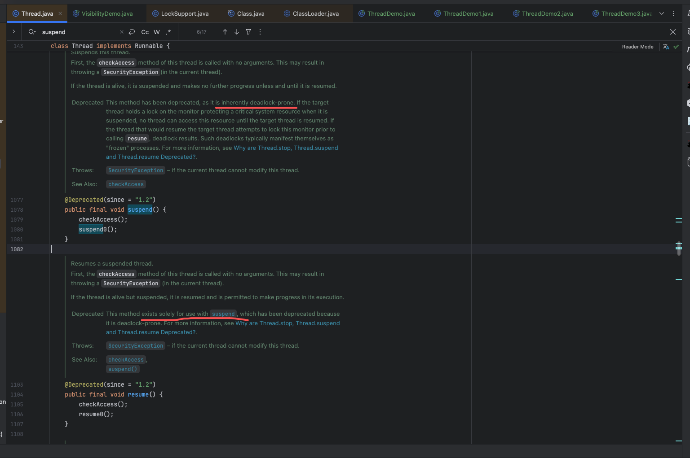suspend()有两个结构性问题：它**不释放线程已持有的锁**；被挂起的线程也**不能因为某个事件被唤醒**，只能等 `resume()`。所以它无法用来实现“抢不到锁就睡，锁释放了再醒”。

以下是实验代码：

```Java
import java.util.concurrent.locks.LockSupport;

public class LostWakeup {
    static void sleep(long ms) {
        try { Thread.sleep(ms); } catch (InterruptedException e) { }
    }

    public static void main(String[] args) throws Exception {
        System.out.println("=== 场景 A：suspend/resume，resume 先到 ===");
        Thread t = new Thread(() -> {
            sleep(100);                              // 保证 main 的 resume 先执行
            System.out.println("[suspend 版] 线程准备挂起");
            Thread.currentThread().suspend();        // 这次 resume 已被用掉，没人再叫它
            System.out.println("[suspend 版] 被唤醒（这一行永远不会打印）");
        }, "suspend-demo");
        t.setDaemon(true);
        t.start();
        sleep(20);
        t.resume();                                  // t 此刻还没 suspend，这次 resume 直接丢失
        sleep(500);
        System.out.println("[suspend 版] 500 ms 后：线程还活着 = " + t.isAlive()
                + "，getState() = " + t.getState());

        System.out.println();
        System.out.println("=== 场景 B：park/unpark，完全相同的交错 ===");
        Thread p = new Thread(() -> {
            sleep(100);
            System.out.println("[park 版] 线程准备 park");
            long t0 = System.nanoTime();
            LockSupport.park();                      // 许可在 20 ms 时已存下，立即返回
            System.out.println("[park 版] park 返回，耗时 "
                    + (System.nanoTime() - t0) / 1_000_000 + " ms");
        }, "park-demo");
        p.start();
        sleep(20);
        LockSupport.unpark(p);                       // p 还没 park，先把许可记上
        p.join();
        System.exit(0);                              // suspend 版线程是 daemon，直接退出
    }
}
```

输出结果：

```
=== 场景 A：suspend/resume，resume 先到 ===
[suspend 版] 线程准备挂起
[suspend 版] 500 ms 后：线程还活着 = true，getState() = RUNNABLE

=== 场景 B：park/unpark，完全相同的交错 ===
[park 版] 线程准备 park
[park 版] park 返回，耗时 0 ms
```

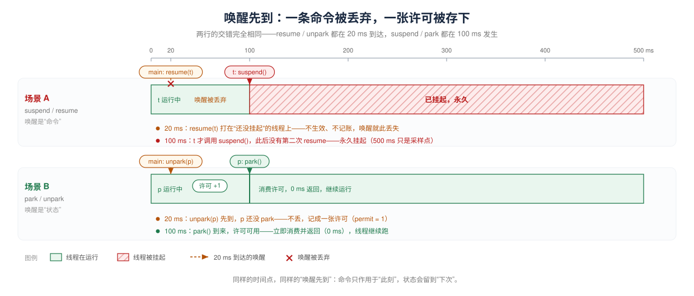注意点：被 `suspend()` 挂起的线程，`getState()` 仍返回 `RUNNABLE`，只看线程状态根本发现不了它已经卡死。

<br />

<br />

#### 1.2.2 旧方案二：Object.wait()/notify()——能等，但绑死了 monitor

【官方文档】`Object.wait()` 的第一句（L303）：

> "The current thread must own this object's monitor."
>
> （当前线程必须拥有该对象的监视器。）

`Object.notify()`（L240–243）：

> "Wakes up a single thread that is waiting on this object's monitor. If any threads are waiting on this object, one of them is chosen to be awakened. The choice is arbitrary and occurs at the discretion of the implementation."
> （唤醒在该对象监视器上等待的一个线程。如果有线程在等待，选哪一个由实现任意决定。）
> 三个限制随之而来：

1. **必须先拿到 monitor**：AQS 的队列节点只是普通链表节点，没有监视器可拿；硬要用 `wait/notify`，就得给每个节点额外配一把锁。
2. **唤醒不能点名**：`notify` 只能在这个对象上“随便挑一个”，而 AQS 要唤醒的是确定的 `head.next`。
3. **通知会丢**：`notify` 时没人在等，这次通知就没了；等待方如果先检查条件、还没来得及 `wait`，通知就可能错过。官方 technote 在讲替代方案时专门提到要消除这种竞争，否则“miss a notify and remain suspended indefinitely”（错过一次 `notify` 就永久挂起）——[Why are Thread.stop, Thread.suspend and Thread.resume Deprecated?](https://docs.oracle.com/javase/8/docs/technotes/guides/concurrency/threadPrimitiveDeprecation.html)

<br />

三点放在一起看：
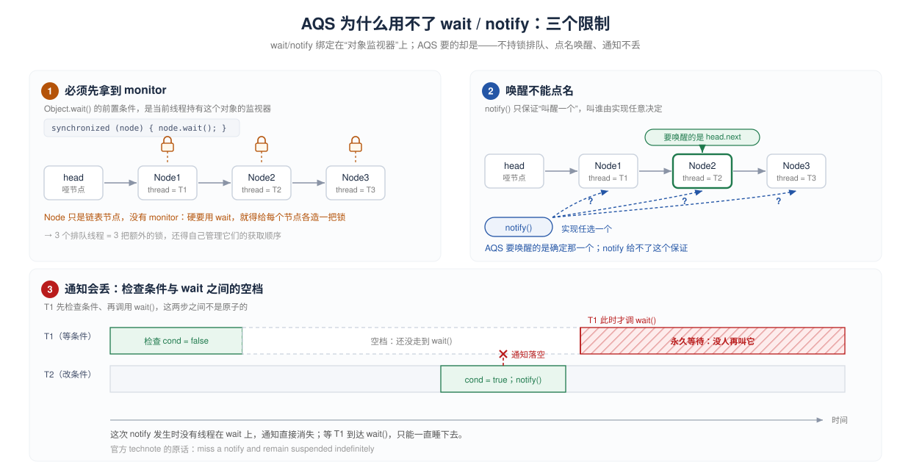

- 图 ①：`wait` 的前提是持有该对象的 monitor，而 `Node` 没有 monitor，于是每排一个线程就要多造一把锁；
- 图 ②：`notify` 只能“叫醒一个”，叫谁由实现决定，而 AQS 每次要唤醒的都是确定的 `head.next`；
- 图 ③：检查条件和 `wait` 之间存在空档，`notify` 落进空档就丢了，等待方随后永久阻塞。

<br />

#### 1.2.3 旧方案三：Thread.sleep() —— 只能等时间

sleep 只能等到时间结束；唯一能提前打断它的是 interrupt()，而 interrupt() 会让它抛 InterruptedException。AQS 需要的是“**先忽略中断继续排队，拿到锁后再补上报**”，sleep 的异常语义直接堵死了这条路。

<br />

#### 1.2.4  `LockSupport` 补上的正是这些洞

| 旧方案的洞                                                  | `LockSupport` 的解法                 |
| :----------------------------------------------------- | :-------------------------------- |
| `suspend/resume` 死锁、不能按事件唤醒                            | 不碰 monitor，纯粹等一张许可；`unpark` 可随时发券 |
| `wait` 必须先持 monitor                                    | `park` 不要求任何锁                     |
| `notify` 只能任意挑一个                                       | `unpark(Thread)` 精确到线程            |
| 唤醒先到会丢（`resume` 早于 `suspend`、`notify` 早于 `wait`）→ 永久挂起 | 许可可以预存；`unpark` 先于 `park` 也不丢     |
| sleep中断只能抛异常                                           | `park` 只返回，中断标志保留                 |

<br />

这也是它和 wait/notify 最本质的区别\*\*：wait/notify 靠“通知”，通知没接住就没了；park/unpark 靠“状态”，状态存住了就丢不了\*\*。

<br />

#### 1.2.5 它的定位：“造锁的零件”

官方那句 “tools for creating higher-level synchronization utilities” 已经把定位说清楚了。它不提供互斥、不排队、也不管公平性，只做一件事：**让一个线程可靠地睡下，并让另一个线程能精确地把它叫醒**。互斥、队列、重入、公平，这些是 AQS 在它上面搭的；AQS 又成了 `ReentrantLock`、`ReadWriteLock`、`Semaphore`、`CountDownLatch`、`Condition` 的底座。

所以更准确的说法是：**`LockSupport`** **是 JUC 里“阻塞”这一半的地基**，而不是整个 JUC 的地基。另一半——`AtomicInteger`、`ConcurrentHashMap` 这类无锁结构——站在 CAS 和 `volatile` 上，跟 `park` 没有关系。两条线在 `ThreadPoolExecutor` 才汇合：worker 从队列取任务时靠它阻塞，计数器靠 CAS。

<br />

### 1.3 官方示例——用 `park/unpark` 实现一把 FIFO、不可重入的锁

【官方示例】`LockSupport` javadoc 的 Sample Usage（源码 L88–118，[OpenJDK jdk8u 源码](https://github.com/openjdk/jdk8u/blob/master/jdk/src/share/classes/java/util/concurrent/locks/LockSupport.java)）：

```Java
class FIFOMutex {
    private final AtomicBoolean locked = new AtomicBoolean(false);
    private final Queue<Thread> waiters = new ConcurrentLinkedQueue<Thread>();

    public void lock() {
        boolean wasInterrupted = false;
        Thread current = Thread.currentThread();
        waiters.add(current);

        // 不是队首，或者 CAS 抢不到，就睡
        while (waiters.peek() != current ||
               !locked.compareAndSet(false, true)) {
            LockSupport.park(this);
            if (Thread.interrupted())      // 等待期间先记下中断，不往外抛
                wasInterrupted = true;
        }

        waiters.remove();                  // 自己已是队首，出队
        if (wasInterrupted)                // 拿到锁后补回中断标志
            current.interrupt();
    }

    public void unlock() {
        locked.set(false);
        LockSupport.unpark(waiters.peek()); // 点名叫醒队首
    }
}
```

它就是 AQS 的雏形。把两边逐项对上：

| 官方示例                                     | AQS 里的对应物                            |
| :--------------------------------------- | :----------------------------------- |
| `waiters` 队列                             | 同步队列（CLH 变体）                         |
| `waiters.peek() != current`              | 前驱是 `head` 才有资格抢（`p == head`）        |
| `locked.compareAndSet(false, true)`      | `tryAcquire` 里的 CAS                  |
| `LockSupport.park(this)`                 | `parkAndCheckInterrupt()`            |
| `unlock()` 里的 `unpark(waiters.peek())`   | `unparkSuccessor(h)`                 |
| `wasInterrupted` + `current.interrupt()` | `interrupted` 标志 + `selfInterrupt()` |

**看完这段应该得出的结论**：`park/unpark` 只提供“睡”和“醒”；排队规则、唤醒对象、中断补偿，全都要使用者自己维护。AQS 做的事，就是把这套写法工程化。

<br />

### 1.4 代码实验——permit只有一张

需要验证的两条官方原文:

> "its next call to park is guaranteed not to block"
> （`unpark` 先到，下一次 `park` 一定不会阻塞）
>
> "permits do not accumulate. There is at most one."
> （许可不累积，最多只有一张）

\*\*场景构造：\*\*在同一个线程里顺序做四步。第 1、2 步是同线程顺序执行，`unpark` 必然发生在 `park` 之前，不需要靠 `sleep` 去凑时序：

1. 先对自己 `unpark` **两次**——故意多发一张，看它会不会攒成两张；
2. 紧接着 `parkNanos(200 ms)`：许可如果被存住了，这次应当**立刻返回**；
3. 再 `parkNanos(200 ms)`：许可已在第 2 步被消费，这次应当**睡满 200 ms**；
4. 用 `System.nanoTime()` 分别量出两次的耗时。

```Java
import java.util.concurrent.locks.LockSupport;

public class LockSupportDemo {
    public static void main(String[] args) throws Exception {
        Thread t = new Thread(() -> {
            LockSupport.unpark(Thread.currentThread());
            LockSupport.unpark(Thread.currentThread());   // 第二张许可被丢弃
            long t0 = System.nanoTime();
            LockSupport.parkNanos(200_000_000L);
            long t1 = System.nanoTime();
            LockSupport.parkNanos(200_000_000L);
            long t2 = System.nanoTime();
            System.out.println("第一次 park 耗时 = " + (t1 - t0) / 1_000_000 + " ms");
            System.out.println("第二次 park 耗时 = " + (t2 - t1) / 1_000_000 + " ms");
        }, "park-demo");
        t.start();
        t.join();
    }
}
```

输出结果：

(203`而不是精确的`200\`：线程醒来后还要等操作系统调度上 CPU，不影响结论)

```
第一次 park 耗时 = 0 ms
第二次 park 耗时 = 203 ms
```

**许可若可累积**，两次都会是 `0 ms`；**`unpark`** **若不保存、错过即丢**，第一次会是约 `200 ms` 而不是 `0 ms`。

<br />

### 1.5 概念辨析——`park` vs `wait` vs `sleep`

| 维度       | `Object.wait()`                 | `Thread.sleep()`                | `LockSupport.park()` |
| -------- | ------------------------------- | ------------------------------- | -------------------- |
| 是否必须持锁   | 必须持有该对象的 monitor                | 不需要                             | 不需要                  |
| 谁负责唤醒    | `notify/notifyAll`              | 只能等时间到                          | `unpark(线程)`         |
| 有没有“许可”  | 无                               | 无                               | 有，最多一个               |
| 能否先唤醒后等待 | 不能（通知会丢）                        | 不适用                             | 能（许可先存着）             |
| 中断表现     | 抛 `InterruptedException`，清除中断标志 | 抛 `InterruptedException`，清除中断标志 | **只返回，不抛异常**，中断标志保留  |
| 唤醒精度     | 只能唤醒该对象上的任意/全部                  | 无                               | 精确到指定线程              |
| 虚假唤醒     | 允许，必须 `while`                   | 不涉及                             | 允许，必须 `while`        |

一句话记忆：**`wait`** **绑对象，`sleep`** **绑时间，`park`** **绑线程。**

<br />

<br />

## 2. `AbstractQueuedSynchronizer`：排队、阻塞、唤醒的骨架

**名词解释：**

| 名字                                    | 是什么                                                                 | 谁提供                       |
| :------------------------------------ | :------------------------------------------------------------------ | :------------------------ |
| `state`                               | 一个 `volatile int`，表示“资源还在不在、被占了几层”                                  | AQS 的字段，**含义由子类定**（2.2.1） |
| 等待队列                                  | 一条双向链表，每个在等的线程占一个 `Node`；`head` 是哨兵（`thread == null`），`tail` 是队尾    | AQS 内部（2.2.2）             |
| `waitStatus`                          | `Node` 上的一个 `int`，表示**这个节点的后继**要不要被唤醒；`SIGNAL` = “记得叫醒我后面那个”        | AQS 内部（2.2.2）             |
| `park` / `unpark`                     | 第 1 章的阻塞原语；AQS 只靠这一对方法“睡下”和“叫醒”                                     | `LockSupport`（第 1 章）      |
| `acquire(int)` / `release(int)`       | AQS 的两个**骨架方法**：`acquire` 是 `lock()` 的底层，`release` 是 `unlock()` 的底层 | AQS 实现，`final`（2.3）       |
| `tryAcquire(int)` / `tryRelease(int)` | 上面两个方法回调的**钩子**：真正判断“能不能拿 / 能不能还”的是它们                               | **子类**实现（2.3 起逐个看）        |

它们的关系：**`acquire`** **负责“拿不到就排队并** **`park`”，`release`** **负责“还回去并** **`unpark`** **一个后继”；至于什么叫“拿到 / 还掉”，问子类的** **`tryAcquire`** **/** **`tryRelease`。**

### 2.1 AQS是什么、不是什么

**AQS 不实现锁，它实现“排队”；锁的语义由子类实现的** **`tryAcquire`** **/** **`tryRelease`** **决定。**

换成一句更土的话：AQS 是银行的**叫号系统**，负责“取号、让人坐下等、轮到时叫醒”；至于“什么条件算轮到你办业务”，是每个窗口自己定的规则。

【官方文档】JDK 8 的类注释第一句：

> "Provides a framework for implementing blocking locks and related synchronizers (semaphores, events, etc) that rely on first-in-first-out (FIFO) wait queues."
> （提供一个框架，用于实现依赖先进先出（FIFO）等待队列的阻塞锁和相关同步器（信号量、事件等）。）
> —— `AbstractQueuedSynchronizer` javadoc，[JDK 8 官方文档](https://docs.oracle.com/javase/8/docs/api/java/util/concurrent/locks/AbstractQueuedSynchronizer.html)

第二句说清了数据模型：

> "This class is designed to be a useful basis for most kinds of synchronizers that rely on a single atomic int value to represent state."
> （本类被设计为大多数同步器的一个有用基础，这些同步器依赖单个原子 `int` 值来表示状态。）

第三句最容易被忽略，却规定了使用方式：

> "Defining these methods is the *only* supported means of using this class. All other methods are declared `final` because they cannot be independently varied."
> （定义这些方法（`tryAcquire` 等）是使用本类**唯一**受支持的方式。其他所有方法都声明为 `final`，因为它们不能被独立变化。）

所以 AQS 是**模板方法模式**：`acquire`、`release` 的流程写死，子类只在固定的钩子点上填语义。

【作者言论】Doug Lea 在设计论文里写明了它不做什么（CSJP 2004，第 1 页）：

> "The heart of the framework is maintenance of queues of blocked threads, which are restricted here to FIFO queues. Thus, the framework does not support priority-based synchronization."
> （框架的核心是维护被阻塞线程的队列，这里限定为 FIFO 队列。因此框架不支持基于优先级的同步。）
> —— Doug Lea, *The java.util.concurrent Synchronizer Framework*，[论文 PDF](https://gee.cs.oswego.edu/dl/papers/aqs.pdf)

作者言论解释的是**设计动机**；具体行为承诺仍以 javadoc 与源码为准。

**它不是什么**：

| 常见误解                        | 事实                                        |
| :-------------------------- | :---------------------------------------- |
| “AQS 是一把锁”                  | 不是。它没有实现 `Lock` 接口，也没有 `lock()/unlock()`。 |
| “继承 AQS 就自动可重入 / 公平 / 有所有权” | 不会。这些语义要在 `tryAcquire/tryRelease` 里自己写。   |
| “队列是 FIFO，所以一定先到先得”         | 队列是 FIFO，但默认获取策略允许插队（barging），见 2.6。      |
| “AQS 支持优先级调度”               | 不支持，见上面的作者原话。                             |

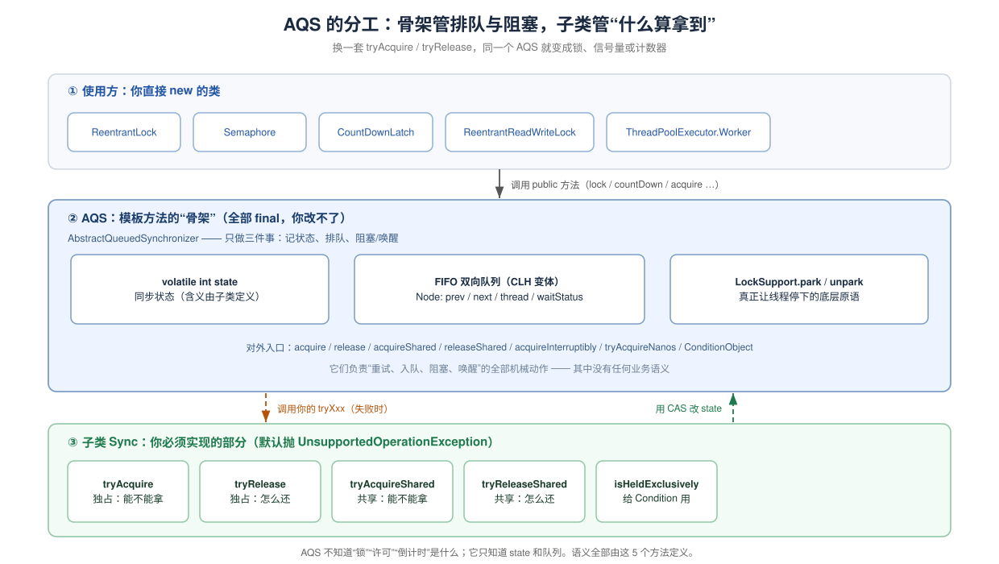**图中元素**：① 是你直接 `new` 的类；② 是 AQS，三个白块是它仅有的家当；③ 是子类 `Sync`。橙色虚线是 AQS **回调**子类，绿色虚线是子类用 CAS 改 `state` 回报结果。

**看完这张图应该得出的结论**：AQS 的代码量集中在“怎么排队”，而不是“锁是什么”；理解 AQS 的关键，是理解它在你写的 `tryAcquire` 外面套了一个什么样的循环。

<br />

#### 2.1.1 完整的”队列“时序

场景：T1 先到并拿到资源，T2 后到、拿不到。四步走完，资源从 T1 转到 T2：

1. **T1 拿到资源**：`lock()` 先直接试着拿一次（非公平锁的插队，2.6 讲），拿到就返回，此时 `state = 1`。队列还是空的——连哨兵 `head` 都没建。
2. **T2 拿不到，去排队睡觉**：`lock()` 走 `acquire(1)`，子类的 `tryAcquire(1)` 返回 `false`。AQS 给 T2 建一个 `Node` 挂到队尾，然后让 T2 `park()` 睡下。睡之前它先在**前驱**（此处是哨兵 `head`）的 `waitStatus` 上写 `SIGNAL`，意思是“轮到你的时候记得叫我”。
3. **T1 还资源**：`unlock()` 走 `release(1)`，子类的 `tryRelease(1)` 返回 `true`，`state` 回到 0。AQS 看到 `head.waitStatus` 是 `SIGNAL`，就 `unpark(T2)`。
4. **T2 被叫醒，重新竞争**：`park()` 返回，**但这不等于拿到资源**。T2 回到自己的循环，发现前驱正是 `head`，于是再调一次 `tryAcquire(1)`；成功后把自己变成新的 `head`（原哨兵出队），资源这才真正转到 T2 手上。

<br />

三条竖线从左到右分别是 T1、队列的哑头节点 `head`、T2——前两个是线程，`head` 是一块内存（所以它的生命线从“创建”那一步才开始画）。竖线往下是时间，横向箭头是“谁对谁做了什么”，箭尾是发起方。左侧三个圆角标签标出 `state` 在什么时候变，T1/T2 竖线上的浅色带表示“持有资源”和“睡下”的区间。

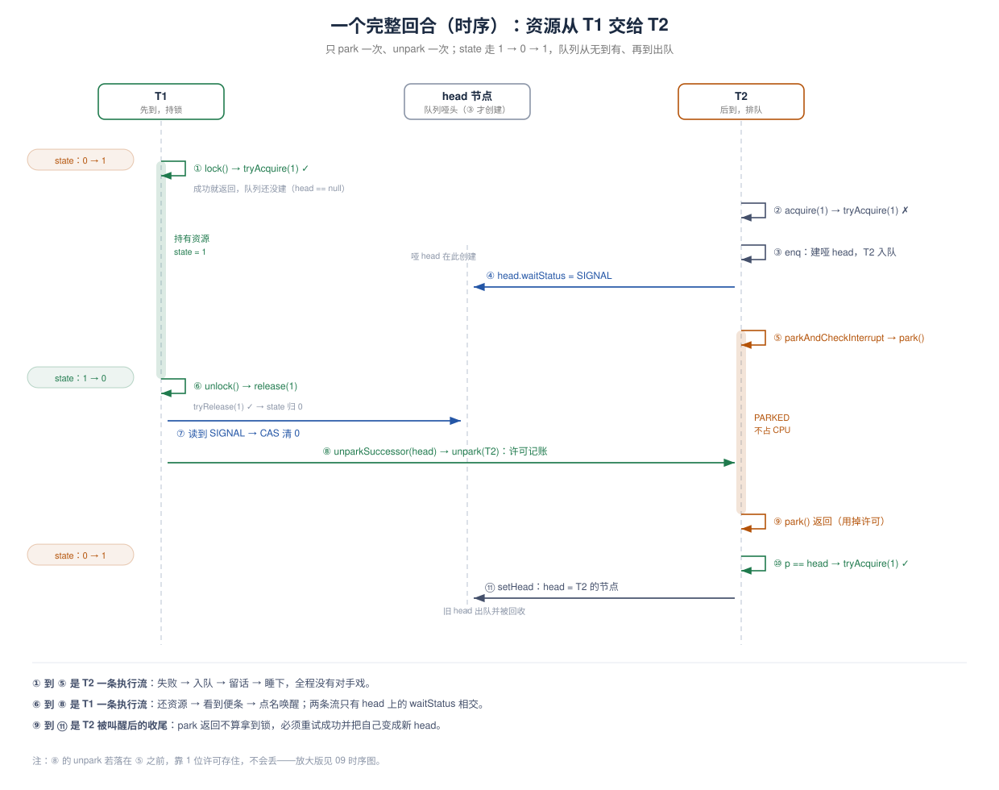release只有两件事：**问子类“还得了吗”，还得了就“叫醒一个后继”**

```Java
public final boolean release(int arg) {   // L1264–1272
    if (tryRelease(arg)) {                // 子类：资源真的还回去了吗
        Node h = head;
        if (h != null && h.waitStatus != 0)
            unparkSuccessor(h);           // AQS：那就叫醒队头后面那个
        return true;
    }
    return false;
}
```

<br />

### 2.2 三件套：`state`、队列、`park`

**AQS 的全部实现只依赖三样东西——一个** **`volatile int`** **状态、一条双向链表、一对** **`park/unpark`。**

#### 2.2.1 `state`：唯一的同步状态

【源码】字段声明只有一行注释（L531–534） · [GitHub 原文](https://github.com/openjdk/jdk8u/blob/jdk8u452-b09/jdk/src/share/classes/java/util/concurrent/locks/AbstractQueuedSynchronizer.java#L530-L533)：

```java
/**
 * The synchronization state.
 */
private volatile int state;
```

子类只能通过三个方法碰它：`getState()`、`setState(int)`、`compareAndSetState(int, int)`。`volatile` **保证可见性**，**CAS 保证“读-改-写”的原子性。**

`state` 的**含义由子类定义**，这是 AQS 最反直觉、也最关键的一点：

| 类                           | `state` 的含义            | 出处                                                                                                                                               |
| :-------------------------- | :--------------------- | :----------------------------------------------------------------------------------------------------------------------------------------------- |
| `ReentrantLock`             | 重入次数（0 = 未持有）          | [ReentrantLock 源码](https://github.com/openjdk/jdk8u/blob/master/jdk/src/share/classes/java/util/concurrent/locks/ReentrantLock.java)（L129–148）   |
| `Semaphore`                 | 当前可用许可数                | [Semaphore 源码](https://github.com/openjdk/jdk8u/blob/master/jdk/src/share/classes/java/util/concurrent/Semaphore.java)（构造器里 `setState(permits)`） |
| `CountDownLatch`            | 剩余计数（0 = 放行）           | [CountDownLatch 源码](https://github.com/openjdk/jdk8u/blob/master/jdk/src/share/classes/java/util/concurrent/CountDownLatch.java)（L161–187）       |
| `ReentrantReadWriteLock`    | 高 16 位读锁计数、低 16 位写锁计数  | [RRWL 源码](https://github.com/openjdk/jdk8u/blob/master/jdk/src/share/classes/java/util/concurrent/locks/ReentrantReadWriteLock.java)（L262–270）   |
| `ThreadPoolExecutor.Worker` | -1 未启动（抑制中断）、0 空闲、1 忙碌 | [ThreadPoolExecutor 源码](https://github.com/openjdk/jdk8u/blob/master/jdk/src/share/classes/java/util/concurrent/ThreadPoolExecutor.java)         |

#### 2.2.2 队列：CLH 的变体

【源码】AQS javadoc 对队列的自述：

> "The wait queue is a variant of a "CLH" (Craig, Landin, and Hagersten) lock queue. CLH locks are normally used for spinlocks. We instead use them for blocking synchronizers, but use the same basic tactic of holding some of the control information about a thread in the predecessor of its node."
> （等待队列是 "CLH" 锁队列的变体。CLH 锁通常用于自旋锁；我们把它用于阻塞式同步器，但沿用同样的基本策略：把一个线程的控制信息放在它前驱的节点里。）
> —— AQS 源码类注释（L305–312），[jdk8u 源码](https://github.com/openjdk/jdk8u/blob/master/jdk/src/share/classes/java/util/concurrent/locks/AbstractQueuedSynchronizer.java)

最后半句是理解整个队列的钥匙：**“我该不该被唤醒”这个信息，不存在我自己身上，而存在我前驱的** **`waitStatus`** **里。** 所以唤醒逻辑操作的永远是“前驱”。

【源码】`Node.waitStatus` 的取值（L388–397）：

```java
static final int CANCELLED =  1;   // 节点已取消（超时/中断）
static final int SIGNAL    = -1;   // 后继需要被唤醒
static final int CONDITION = -2;   // 节点在条件队列里等待
static final int PROPAGATE = -3;   // 共享模式下，唤醒需要继续传播
// 0 是默认值：新节点入队时的初始状态
```

**图前说明**：这是一张**内存结构图**，说明队列长什么样、`head` 是什么、`waitStatus` 有哪些取值。

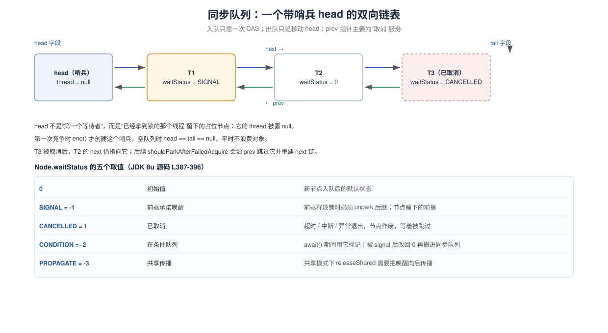**图中元素**：蓝色箭头是 `next`（head → tail），绿色箭头是 `prev`（反向）；虚线框表示已取消节点；`head.thread = null` 是哨兵节点的标志。
**看完这张图应该得出的结论**：队列里第一个节点不是“第一个等待者”，而是“刚释放锁的人留下的占位节点”；真正等待的线程从 `head.next` 开始。

两个实现细节（都来自源码注释）：

1. **哨兵是懒创建的**：“CLH queues need a dummy header node to get started. But we don't create them on construction, because it would be wasted effort if there is never contention.”（CLH 队列需要一个哑头节点才能启动；但我们不在构造时创建，因为如果没有竞争就是白费。）——源码 L362–366。
2. **入队只做一次 CAS**：“Insertion into a CLH queue requires only a single atomic operation on 'tail', so there is a simple atomic point of demarcation from unqueued to queued.”——源码 L328–330。

<br />

#### 2.2.3 `park/unpark`：让线程真正停下

T1 持锁，T2、T3 在后面排队。T1 调 `release()` 的那一刻，AQS 必须同时做到四件事：

| #  | AQS 必须做到          | 换成旧原语会怎样                                                               | 源码位置                                      |
| :- | :---------------- | :--------------------------------------------------------------------- | :---------------------------------------- |
| ①  | 不拿 monitor 也能让线程停 | `wait` 要求先 `synchronized(node)`；`Node` 没有 monitor，只能给每个节点各造一把锁         | `parkAndCheckInterrupt()` L836–839        |
| ②  | 只叫醒指定的那一个         | `notify` 只能在该对象上随机挑一个；挑错了，该跑的 T2 继续睡，而锁已经放了                            | `unparkSuccessor(h)` L639–664             |
| ③  | 叫醒早到也不能丢          | `resume` / `notify` 早于对方睡下时就作废，对方永久挂起                                  | `shouldParkAfterFailedAcquire()` L796–822 |
| ④  | 被中断时不抛异常          | `sleep` / `wait` 抛 `InterruptedException`，`acquire` 就做不到“先排队、拿到锁后再补上报” | `parkAndCheckInterrupt()` L836–839        |

四件事的分工：**① 解决“怎么睡”，② 解决“叫谁”，③ 解决“什么时候叫”，④ 解决“被外力打断怎么办”。**

<br />

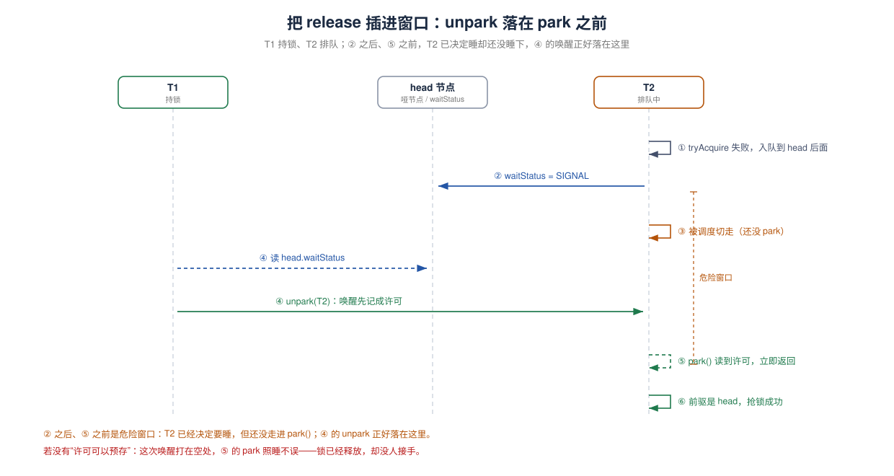tryAcquire:只表示“试一次”：成功返回 `true`，失败返回 `false`，**不阻塞、不入队**。

<br />

### 2.3 独占模式：acquire / release 源码链路

先试一次，失败就排队；排队时只认“前驱是不是 head”，是就再试，不是就睡。

#### 2.3.1 入口acquire

【源码】JDK 8u，整个方法只有三行（L1200–1204） · [GitHub 原文](https://github.com/openjdk/jdk8u/blob/jdk8u452-b09/jdk/src/share/classes/java/util/concurrent/locks/AbstractQueuedSynchronizer.java#L1197-L1201)：

```Java
public final void acquire(int arg) {
    if (!tryAcquire(arg) &&
        acquireQueued(addWaiter(Node.EXCLUSIVE), arg))
        selfInterrupt();
}
```

逐句翻译：

1. `tryAcquire(arg)`：先试一次（快速路径，不排队）。成功就返回。
2. 失败：`addWaiter(Node.EXCLUSIVE)` 建节点入队，交给 `acquireQueued` 循环抢锁。
3. 如果 `acquireQueued` 返回 `true`（等待期间被中断过），`selfInterrupt()` 把中断标志补回来。

<br />

#### 2.3.2 入队：`addWaiter` 与 `enq`

【源码】L606–619 · [GitHub 原文](https://github.com/openjdk/jdk8u/blob/jdk8u452-b09/jdk/src/share/classes/java/util/concurrent/locks/AbstractQueuedSynchronizer.java#L605-L618)：

```Java
private Node addWaiter(Node mode) {
    Node node = new Node(Thread.currentThread(), mode);
    // Try the fast path of enq; backup to full enq on failure
    Node pred = tail;
    if (pred != null) {
        node.prev = pred;
        if (compareAndSetTail(pred, node)) {
            pred.next = node;
            return node;
        }
    }
    enq(node);
    return node;
}
```

enq负责两件麻烦事：队列没初始化时先建哨兵；**CAS 失败时自旋重试**（L584–598） · [GitHub 原文](https://github.com/openjdk/jdk8u/blob/jdk8u452-b09/jdk/src/share/classes/java/util/concurrent/locks/AbstractQueuedSynchronizer.java#L583-L597)：

enq就是入队的意思：\*\*Inserts node into queue, initializing if necessary.&#x20;

```Java
private Node enq(final Node node) {
    for (;;) {
        Node t = tail;
        if (t == null) { // Must initialize
            if (compareAndSetHead(new Node()))
                tail = head;
        } else {
            node.prev = t;
            if (compareAndSetTail(t, node)) {
                t.next = node;
                return t;
            }
        }
    }
}
```

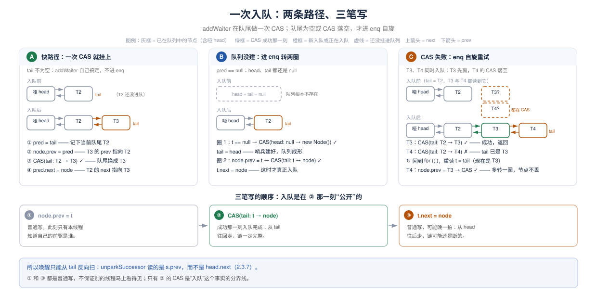

#### 2.3.3 排队抢锁：`acquireQueued`

【源码】L859–879 · [GitHub 原文](https://github.com/openjdk/jdk8u/blob/jdk8u452-b09/jdk/src/share/classes/java/util/concurrent/locks/AbstractQueuedSynchronizer.java#L857-L877)：

```Java
final boolean acquireQueued(final Node node, int arg) {
    boolean failed = true;
    try {
        boolean interrupted = false;
        for (;;) {
            final Node p = node.predecessor();
            if (p == head && tryAcquire(arg)) {   // 只有前驱是 head 才有资格抢
                setHead(node);                    // 出队：自己变成哨兵
                p.next = null; // help GC
                failed = false;
                return interrupted;
            }
            if (shouldParkAfterFailedAcquire(p, node) &&
                parkAndCheckInterrupt())
                interrupted = true;
        }
    } finally {
        if (failed)
            cancelAcquire(node);
    }
}
```

三个关键点：

1. **`p == head`** **才尝试**：保证已在队列里的线程不会互相乱抢，只跟“新来的插队者”竞争。
2. **`setHead(node)`** **出队**：不是删节点，而是把 `head` 指向自己，然后 `node.thread = null; node.prev = null`，自己变成新的哨兵。
3. **`finally`** **里** **`cancelAcquire`**：如果 `tryAcquire` 抛异常（比如你的实现有 bug），节点会被取消，不会把队列卡死。

<br />

#### 2.3.4 睡前最后一步：`shouldParkAfterFailedAcquire`

```Java
private static boolean shouldParkAfterFailedAcquire(Node pred, Node node) {
    int ws = pred.waitStatus;
    if (ws == Node.SIGNAL)
        return true;                       // 前驱已承诺唤醒 → 可以睡
    if (ws > 0) {
        do {                               // 前驱已取消 → 跳过它
            node.prev = pred = pred.prev;
        } while (pred.waitStatus > 0);
        pred.next = node;
    } else {
        compareAndSetWaitStatus(pred, ws, Node.SIGNAL);  // 让前驱承诺唤醒我
    }
    return false;                          // 先别睡，回去再试一次抢锁
}
```

<br />

#### 2.3.5 阻塞：`parkAndCheckInterrupt`

【源码】L836–839 · [GitHub 原文](https://github.com/openjdk/jdk8u/blob/jdk8u452-b09/jdk/src/share/classes/java/util/concurrent/locks/AbstractQueuedSynchronizer.java#L835-L838)：

```java
private final boolean parkAndCheckInterrupt() {
    LockSupport.park(this);
    return Thread.interrupted();
}
```

`Thread.interrupted()` 会**清除**中断标志并返回旧值。所以 `acquireQueued` 用它判断“等待期间是否被中断过”，把结果带回 `acquire`，由 `selfInterrupt()` 重新设置。

<br />

#### 2.3.6 释放：release

源码】L1264–1272 · [GitHub 原文](https://github.com/openjdk/jdk8u/blob/jdk8u452-b09/jdk/src/share/classes/java/util/concurrent/locks/AbstractQueuedSynchronizer.java#L1260-L1268)：

```java
public final boolean release(int arg) {
    if (tryRelease(arg)) {
        Node h = head;
        if (h != null && h.waitStatus != 0)
            unparkSuccessor(h);
        return true;
    }
    return false;
}
```

`h.waitStatus != 0` 是个优化：如果 head 的状态是 0，说明没有后继把“我需要唤醒”写进 head（要么没人排队，要么后继已经被唤醒、正在抢锁），没必要做一次昂贵的唤醒。

对照 2.1.1 第 3 步：这个方法只做两件事。

**第一件：问子类“这次释放之后，资源是不是真的空出来了”**——就是 `tryRelease(arg)`，`true` / `false` 由子类自己算：

- `Mutex`：把 `state` 置回 0，一次就还干净，返回 `true`；
- `ReentrantLock`：把重入计数减 1，**只有减到 0 才返回** **`true`**。如果现在是第 2 层重入，减成 1 之后返回 `false`——锁还在自己手里，AQS 这时**不叫醒任何人**（源码在第 3 章）。

**第二件：只有拿到** **`true`，才叫醒队头后面那个**（`unparkSuccessor(head)`）。

`ReentrantLock.unlock()` 那一行 `sync.release(1)`，落实的就是这里。

<br />

#### 2.3.7 唤醒：`unparkSuccessor`

【源码】L639–664 · [GitHub 原文](https://github.com/openjdk/jdk8u/blob/jdk8u452-b09/jdk/src/share/classes/java/util/concurrent/locks/AbstractQueuedSynchronizer.java#L638-L663)：

```java
private void unparkSuccessor(Node node) {
    int ws = node.waitStatus;
    if (ws < 0)
        compareAndSetWaitStatus(node, ws, 0);   // 先清掉 SIGNAL

    Node s = node.next;
    if (s == null || s.waitStatus > 0) {        // next 不可靠时，从尾部往前找
        s = null;
        for (Node t = tail; t != null && t != node; t = t.prev)
            if (t.waitStatus <= 0)
                s = t;
    }
    if (s != null)
        LockSupport.unpark(s.thread);
}
```

<br />

### 2.4 中断、超时、取消——三种”不想等了“的出口

`acquire` 忽略中断；`acquireInterruptibly` 抛 `InterruptedException`；`tryAcquireNanos` 超时返回 `false`；后两者失败时都会把队列节点标记为 CANCELLED。

| 方法                     | 等不到时         | 被中断时                     | 对应 `Lock` 方法             |
| :--------------------- | :----------- | :----------------------- | :----------------------- |
| `acquire`              | 一直等          | **不抛**，拿到锁后恢复中断标志        | `lock()`                 |
| `acquireInterruptibly` | 一直等          | 抛 `InterruptedException` | `lockInterruptibly()`    |
| `tryAcquireNanos`      | 超时返回 `false` | 抛 `InterruptedException` | `tryLock(timeout, unit)` |
| `tryAcquire`（子类方法）     | 立即返回 `false` | 不涉及                      | `tryLock()`              |

【源码】中断版循环与普通版几乎一样，唯一差别是 `parkAndCheckInterrupt()` 返回 `true` 时直接抛异常（L885–906） · [GitHub 原文](https://github.com/openjdk/jdk8u/blob/jdk8u452-b09/jdk/src/share/classes/java/util/concurrent/locks/AbstractQueuedSynchronizer.java#L883-L904)：

```java
private void doAcquireInterruptibly(int arg)
    throws InterruptedException {
    final Node node = addWaiter(Node.EXCLUSIVE);
    boolean failed = true;
    try {
        for (;;) {
            final Node p = node.predecessor();
            if (p == head && tryAcquire(arg)) {
                setHead(node);
                p.next = null; // help GC
                failed = false;
                return;
            }
            if (shouldParkAfterFailedAcquire(p, node) &&
                parkAndCheckInterrupt())
                throw new InterruptedException();
        }
    } finally {
        if (failed)
            cancelAcquire(node);
    }
}
```

<br />

### 2.5 共享模式：一次可以放行多个

共享模式和独占模式的骨架几乎一样，差别只有两处——`tryAcquireShared` 用返回值表达“还能不能继续”，以及成功后要“向后传播”唤醒

```java
public final void acquireShared(int arg) {
    if (tryAcquireShared(arg) < 0)
        doAcquireShared(arg);
}

public final boolean releaseShared(int arg) {
    if (tryReleaseShared(arg)) {
        doReleaseShared();
        return true;
    }
    return false;
}
```

`tryAcquireShared` 的返回值约定：**负数 = 失败；0 = 成功但后续再尝试也会失败；正数 = 成功且后续可能还有资源**。AQS 用这个值决定要不要继续唤醒后面的人。

<br />

【源码】`doAcquireShared`（L950–976） · [GitHub 原文](https://github.com/openjdk/jdk8u/blob/jdk8u452-b09/jdk/src/share/classes/java/util/concurrent/locks/AbstractQueuedSynchronizer.java#L948-L974)：

```java
private void doAcquireShared(int arg) {
    final Node node = addWaiter(Node.SHARED);
    boolean failed = true;
    try {
        boolean interrupted = false;
        for (;;) {
            final Node p = node.predecessor();
            if (p == head) {
                int r = tryAcquireShared(arg);
                if (r >= 0) {
                    setHeadAndPropagate(node, r);
                    p.next = null; // help GC
                    if (interrupted)
                        selfInterrupt();
                    failed = false;
                    return;
                }
            }
            if (shouldParkAfterFailedAcquire(p, node) &&
                parkAndCheckInterrupt())
                interrupted = true;
        }
    } finally {
        if (failed)
            cancelAcquire(node);
    }
}
```

<br />

注意 `r >= 0` 就代表成功，然后交给 `setHeadAndPropagate` 决定要不要继续叫醒后面的人（L709–734，为节省篇幅删去源码中的英文注释块） · [GitHub 原文](https://github.com/openjdk/jdk8u/blob/jdk8u452-b09/jdk/src/share/classes/java/util/concurrent/locks/AbstractQueuedSynchronizer.java#L708-L733)：

```java
private void setHeadAndPropagate(Node node, int propagate) {
    Node h = head; // Record old head for check below
    setHead(node);
    if (propagate > 0 || h == null || h.waitStatus < 0 ||
        (h = head) == null || h.waitStatus < 0) {
        Node s = node.next;
        if (s == null || s.isShared())
            doReleaseShared();
    }
}
```

`doReleaseShared`（L671–699）则负责把唤醒沿队列传下去：如果 head 是 `SIGNAL` 就唤醒后继；如果 head 是 0，就把它 CAS 成 `PROPAGATE`，防止“释放发生在唤醒传播的缝隙里”导致丢唤醒。

【官方文档】AQS javadoc 对共享模式的描述：

> "when a shared mode acquire succeeds, the next waiting thread (if one exists) must also determine whether it can acquire as well."
> （当共享模式获取成功时，下一个等待线程（如果存在）也必须判断它是否也能获取。）

<br />

<br />

## 3. `ReentrantLock`：把 AQS 变成一把真正的锁

**`ReentrantLock`** **= AQS 的排队骨架 + 一个“重入计数” + 一个“持有者” + 一个可选的公平策略；所有公开方法都只是委托给内部** **`Sync`。**

`Mutex` 已经能互斥，但它不可重入、不校验释放者、没有公平性。`ReentrantLock` 补的就是这三块，而补的方式非常克制：**只实现** **`tryAcquire/tryRelease/isHeldExclusively`，其余全部复用 AQS。**

<br />

### 3.1 类结构：一个 `Sync`，两个子类

【源码】`ReentrantLock` 的骨架（L107–124、L201、L224、L271–273；方法体有省略，仅示意结构） · [GitHub 原文](https://github.com/openjdk/jdk8u/blob/jdk8u452-b09/jdk/src/share/classes/java/util/concurrent/locks/ReentrantLock.java#L106-L123)：

```java
public class ReentrantLock implements Lock, java.io.Serializable {
    private final Sync sync;

    abstract static class Sync extends AbstractQueuedSynchronizer {
        abstract void lock();          // 公平/非公平的唯一入口差异
        // nonfairTryAcquire / tryRelease / isHeldExclusively / newCondition ...
    }

    static final class NonfairSync extends Sync { ... }
    static final class FairSync extends Sync { ... }

    public ReentrantLock() {
        sync = new NonfairSync();      // 默认非公平
    }

    public ReentrantLock(boolean fair) {
        sync = fair ? new FairSync() : new NonfairSync();
    }
}
```

为什么 `Sync` 是抽象类、`lock()` 是抽象方法？因为**只有非公平锁需要“先插队试一次”的快速路径**，公平锁直接 `acquire(1)` 进 AQS 排队。这个差异放在子类里，公共逻辑（重入、释放）放在父类 `Sync` 里。

公开方法全是三行以内的委托（L289–291、L369–371、L461–463、L504–506） · [GitHub 原文](https://github.com/openjdk/jdk8u/blob/jdk8u452-b09/jdk/src/share/classes/java/util/concurrent/locks/ReentrantLock.java#L284-L286)：

```java
public void lock() {
    sync.lock();
}

public boolean tryLock() {
    return sync.nonfairTryAcquire(1);
}

public void unlock() {
    sync.release(1);
}

public Condition newCondition() {
    return sync.newCondition();
}
```

注意 `unlock()` 调的是 AQS 的 `release(1)`，释放流程、唤醒后继全部由 AQS 完成；`tryLock()` 却**绕过 AQS**，直接调 `nonfairTryAcquire(1)`——这一点在 3.6 会展开。

<br />

### 3.2 重入与所有权：`state` 是层数，owner 是身份证

`ReentrantLock` 把 AQS 的 `state` 解释为**当前线程的重入层数**，把“谁持有”记在父类 `AbstractOwnableSynchronizer` （是AbstractQueuedSynchronizer的父类）的 `exclusiveOwnerThread` 字段里。

【源码】`Sync.nonfairTryAcquire`（L131–148，为聚焦逻辑删去 `@ReservedStackAccess` 注解） · [GitHub 原文](https://github.com/openjdk/jdk8u/blob/jdk8u452-b09/jdk/src/share/classes/java/util/concurrent/locks/ReentrantLock.java#L129-L146)：

```Java
final boolean nonfairTryAcquire(int acquires) {
    final Thread current = Thread.currentThread();
    int c = getState();

    // 分支一：锁空闲（state == 0），用 CAS 抢。
    // CAS 成功和 setExclusiveOwnerThread 不是一步原子的，但只有 CAS 的赢家会写 owner，
    // 输家直接往下走，所以两笔写之间不需要再同步。
    if (c == 0) {
        if (compareAndSetState(0, acquires)) {
            setExclusiveOwnerThread(current);
            return true;
        }
    }
    // 分支二：重入。state 已经不是 0，但持有者正是自己，于是把层数加上去。
    // 这里用 setState 而不是 CAS：只有持有者能走到这个分支，不存在并发写。
    else if (current == getExclusiveOwnerThread()) {
        int nextc = c + acquires;
        if (nextc < 0) // overflow
            throw new Error("Maximum lock count exceeded");
        setState(nextc);
        return true;
    }
    // 分支三：别人持有，抢不到。返回 false，由 AQS 接着排队。
    return false;
}
```

【源码】`Sync.tryRelease`（L151–162） · [GitHub 原文](https://github.com/openjdk/jdk8u/blob/jdk8u452-b09/jdk/src/share/classes/java/util/concurrent/locks/ReentrantLock.java#L148-L159)：

```Java
protected final boolean tryRelease(int releases) {
    int c = getState() - releases;
    if (Thread.currentThread() != getExclusiveOwnerThread())
        // 不是持有者却来释放：直接抛，防止别的线程把锁“解开”。
        throw new IllegalMonitorStateException();
    boolean free = false;
    // 只有减到 0 才算真正释放：重入 3 层的线程 unlock 一次，c 从 3 变 2，free 保持 false，
    // AQS 的 release 因此不会唤醒任何等待者——锁还握着，只是少了一层。
    if (c == 0) {
        free = true;
        setExclusiveOwnerThread(null);
    }
    // setState 而不是 CAS：只有持有者能执行到这里，不存在并发写。
    // 这个便利来自独占语义，不能推广到共享模式。
    setState(c);
    return free;
}
```

两处 `setState` 的“免 CAS 特权”都建立在同一个前提上：**同一时刻只有一个持有者**。共享模式没有这个前提（2.5 会看到 `tryReleaseShared` 必须写 CAS 循环）。

`isHeldExclusively()` 和 `getHoldCount()` 是配套的查询（L164–182） · [GitHub 原文](https://github.com/openjdk/jdk8u/blob/jdk8u452-b09/jdk/src/share/classes/java/util/concurrent/locks/ReentrantLock.java#L161-L179)：

```Java
protected final boolean isHeldExclusively() {
    // While we must in general read state before owner,
    // we don't need to do so to check if current thread is owner
    return getExclusiveOwnerThread() == Thread.currentThread();
}

final int getHoldCount() {
    return isHeldExclusively() ? getState() : 0;
}
```

`isHeldExclusively()` 被 `Condition` 用来做所有权检查：`signal()` 第一句就是 `if (!isHeldExclusively()) throw new IllegalMonitorStateException();`。

<br />

### 3.3 非公平锁：先插队，再排队

【源码】`NonfairSync`（L201–219） · [GitHub 原文](https://github.com/openjdk/jdk8u/blob/jdk8u452-b09/jdk/src/share/classes/java/util/concurrent/locks/ReentrantLock.java#L198-L215)：

```Java
static final class NonfairSync extends Sync {
    final void lock() {
        if (compareAndSetState(0, 1))              // 直接抢，完全不管队列
            setExclusiveOwnerThread(Thread.currentThread());
        else
            acquire(1);                            // 抢不到才走 AQS
    }

    protected final boolean tryAcquire(int acquires) {
        return nonfairTryAcquire(acquires);
    }
}
```

`lock()` 的第一行就是“插队”：哪怕队列里已经排了十个人，只要此刻 `state == 0`，新来的线程也能直接 CAS 拿走。**这不是 bug，是吞吐量取舍**

注意 `acquire(1)` 内部还会再调一次 `tryAcquire`，而 `tryAcquire` 又是 `nonfairTryAcquire`。所以一个非公平线程从 `lock()` 到真正 park，抢锁动作其实有三次机会：

1. `lock()` 里的第一个 `compareAndSetState(0, 1)`——锁空闲就一步到位；
2. `acquire(1)` → `tryAcquire(1)` → `nonfairTryAcquire(1)`——若第 1 步 CAS 失败，这里再试一次；
3. 若第 2 步也失败，进入 `acquireQueued`，只要前驱是 `head`（说明马上轮到自己），循环里还会再调一次 `tryAcquire`。

第 3 次是“入队后但仍有机会不让出 CPU”的最后尝试；三次都失败，才 `park`。

<br />

### 3.4 公平锁：多一个 `hasQueuedPredecessors`

【源码】`FairSync`（L224–254） · [GitHub 原文](https://github.com/openjdk/jdk8u/blob/jdk8u452-b09/jdk/src/share/classes/java/util/concurrent/locks/ReentrantLock.java#L220-L249)：

```Java
static final class FairSync extends Sync {
    final void lock() {
        acquire(1);                                // 没有快速路径，直接进 AQS
    }

    protected final boolean tryAcquire(int acquires) {
        final Thread current = Thread.currentThread();
        int c = getState();
        if (c == 0) {
            if (!hasQueuedPredecessors() &&        // 队列里有人 → 不抢
                compareAndSetState(0, acquires)) {
                setExclusiveOwnerThread(current);
                return true;
            }
        }
        else if (current == getExclusiveOwnerThread()) {
            // 重入不受公平性影响：已经持有锁的线程再进是合法的
            int nextc = c + acquires;
            if (nextc < 0)
                throw new Error("Maximum lock count exceeded");
            setState(nextc);
            return true;
        }
        return false;
    }
}
```

公平与非公平的唯一区别，就是 `c == 0` 分支里多了一个 `!hasQueuedPredecessors()`。其余代码逐字相同。

| 维度               | `NonfairSync`          | `FairSync`                   |
| ---------------- | ---------------------- | ---------------------------- |
| `lock()` 入口      | 先 CAS 插队，失败再 `acquire` | 直接 `acquire`                 |
| `tryAcquire` 抢锁前 | 不看队列                   | 检查 `hasQueuedPredecessors()` |
| 重入               | 不检查队列                  | 不检查队列（同一份逻辑）                 |
| 吞吐               | 高                      | 低（每次交接都要等唤醒的线程上 CPU）         |
| 饥饿风险             | 队列线程可能长时间抢不到           | 基本按入队顺序                      |

### 3.5 公平锁不等于“绝对先到先得”

`ReentrantLock` javadoc 自己承认了两点，加上实现层面的第三点，一共三个漏洞：

> "Note however, that fairness of locks does not guarantee fairness of thread scheduling. Thus, one of many threads using a fair lock may obtain it multiple times in succession while other active threads are not progressing and not currently holding the lock."
> （但请注意，锁的公平并不保证线程调度的公平。因此，多个使用公平锁的线程中，某一个线程可能连续多次获得锁，而其他活动线程没有进展且当前也没有持有锁。）

> "Also note that the untimed `tryLock()` method does not honor the fairness setting. It will succeed if the lock is available even if other threads are waiting."
> （另请注意，不带超时的 `tryLock()` 方法不遵守公平设置；只要锁可用它就会成功，即使其他线程正在等待。）
> —— [ReentrantLock javadoc (JDK 8)](https://docs.oracle.com/javase/8/docs/api/java/util/concurrent/locks/ReentrantLock.html)

三个漏洞：

1. **锁的授予顺序公平 ≠ 线程调度公平**：被唤醒的线程可能迟迟得不到 CPU，而另一个正在运行的线程又回来抢到了锁。
2. **重入不受公平约束**：`FairSync.tryAcquire` 的 `else if` 分支不检查队列，持有者可以一直重入。
3. **无超时的** **`tryLock()`** **直接走** **`nonfairTryAcquire`**：源码见 3.2 的 `public boolean tryLock()`，它根本不经过 `FairSync`。

**但是有超时的** **`tryLock(timeout, unit)`** **是遵守公平的**，javadoc 专门做了对比：

> "If this lock has been set to use a fair ordering policy then an available lock *will not* be acquired if any other threads are waiting for the lock. This is in contrast to the `tryLock()` method."
> （如果本锁被设置为公平排序策略，那么当有其他线程在等待时，即使锁可用也**不会**获取。这与 `tryLock()` 方法形成对比。）
> —— 同上

<br />

### 3.6 重入计数Demo

lock.getHoldCount()实际会返回state（AQS中的state）的数值

```java

import java.util.concurrent.locks.ReentrantLock;

public class ReentrantLockDemo {
    public static void main(String[] args) {
        ReentrantLock lock = new ReentrantLock();
        lock.lock();
        lock.lock();
        System.out.println("lock 两次后 getHoldCount() = " + lock.getHoldCount());
        lock.unlock();
        System.out.println("unlock 一次后 getHoldCount() = " + lock.getHoldCount());
        lock.unlock();
        System.out.println("unlock 两次后 isLocked() = " + lock.isLocked());
    }
}
```

输出结果：

```
lock 两次后 getHoldCount() = 2
unlock 一次后 getHoldCount() = 1
unlock 两次后 isLocked() = false
```

<br />

### 3.7 与 `synchronized` 怎么选

| 需求       | `synchronized`  | `ReentrantLock`             |
| :------- | :-------------- | :-------------------------- |
| 普通互斥     | 够用，写法最简单        | 也可以，但要 `try/finally`        |
| 尝试获取     | 不支持             | `tryLock()`                 |
| 超时放弃     | 不支持             | `tryLock(time, unit)`       |
| 等待可中断    | 进入 monitor 不可中断 | `lockInterruptibly()`       |
| 公平排队     | 不支持             | `new ReentrantLock(true)`   |
| 多个等待集    | 一个对象一个 wait set | `newCondition()` 多次         |
| 跨方法传递/组合 | 是语法块，不是对象       | 是普通对象                       |
| 自动释放     | 是               | 否，必须 `finally` 里 `unlock()` |

**没有特殊需求就用** **`synchronized`**（JVM 会优化，代码也短）；需要超时、可中断、公平、多条件队列时用 `ReentrantLock`。

<br />

## 4. `Condition`：一把锁挂多个等待集

### 4.1 什么是 `Condition`？

**`Condition`** **是 AQS 里的第二条队列：`await`** **把线程挂到条件队列并**完全释放锁；`signal` 再把节点搬回同步队列——只是搬回去，不是立刻运行。

【官方文档】`Condition` 的 javadoc 把这个设计说得很清楚：

> "Condition factors out the Object monitor methods (wait, notify, and notifyAll) into distinct objects to give the effect of having multiple wait-sets per object, by combining them with the use of arbitrary Lock implementations. Where a Lock replaces the use of synchronized methods and statements, a Condition replaces the use of the Object monitor methods."
> （Condition 把 Object 监视器方法（wait、notify、notifyAll）分解到独立对象中，再与任意 `Lock` 实现结合，从而产生“每个对象有多个等待集”的效果。`Lock` 替代 `synchronized` 方法和语句，`Condition` 替代 Object 监视器方法。）
> —— [Condition javadoc (JDK 8)](https://docs.oracle.com/javase/8/docs/api/java/util/concurrent/locks/Condition.html)

<br />

理解它要抓住两个“不是”：

- `await()` **不是** `wait()` 的语法糖：它操作的是一条独立的条件队列，不在对象头上。
- `signal()` **不是**“让线程立刻继续”：它只负责把节点从条件队列搬到同步队列，线程还要重新抢锁。

### 4.2 两个队列，同一个 `Node`

展示一个线程在“同步队列”和“条件队列”之间的往返：
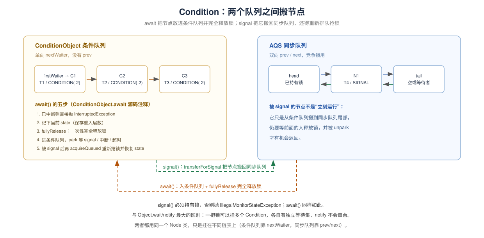
`signal()` 之后线程并不会立刻从 `await()` 返回，它还要重新排队、重新抢锁。
两条链表的差异：

| 维度     | 条件队列                                           | 同步队列                                 |
| ------ | ---------------------------------------------- | ------------------------------------ |
| 链接方式   | `nextWaiter` 单向                                | `prev/next` 双向                       |
| 头尾字段   | `firstWaiter/lastWaiter`（属于 `ConditionObject`） | `head/tail`（属于 AQS）                  |
| 节点状态   | `CONDITION(-2)`                                | `0 / SIGNAL / CANCELLED / PROPAGATE` |
| 入队时机   | `await()`                                      | `signal()` 搬运、或直接 `acquire` 失败       |
| 是否需要持锁 | 是（操作条件队列时）                                     | 是（AQS 内部保证）                          |

<br />

### 4.3 `await()`：五步

【源码】JDK 8u 的 `await`（L2037–2054） · [GitHub 原文](https://github.com/openjdk/jdk8u/blob/jdk8u452-b09/jdk/src/share/classes/java/util/concurrent/locks/AbstractQueuedSynchronizer.java#L2032-L2049)：

```java
public final void await() throws InterruptedException {
    if (Thread.interrupted())
        throw new InterruptedException();
    Node node = addConditionWaiter();          // 1. 进条件队列（waitStatus = CONDITION）
    int savedState = fullyRelease(node);       // 2. 完全释放锁，返回释放前的 state
    int interruptMode = 0;
    while (!isOnSyncQueue(node)) {             // 3. 还不在同步队列 → 继续睡
        LockSupport.park(this);
        if ((interruptMode = checkInterruptWhileWaiting(node)) != 0)
            break;
    }
    if (acquireQueued(node, savedState) && interruptMode != THROW_IE)
        interruptMode = REINTERRUPT;           // 4. 重新抢锁，并恢复重入层数
    if (node.nextWaiter != null)               // 5. 清理取消的等待者
        unlinkCancelledWaiters();
    if (interruptMode != 0)
        reportInterruptAfterWait(interruptMode);
}
```

1. **`fullyRelease`** **释放的是全部重入次数**（L1724–1738）：
   ```java
   final int fullyRelease(Node node) {
       boolean failed = true;
       try {
           int savedState = getState();
           if (release(savedState)) {
               failed = false;
               return savedState;
           } else {
               throw new IllegalMonitorStateException();
           }
       } finally {
           if (failed)
               node.waitStatus = Node.CANCELLED;
       }
   }
   ```
   返回的 `savedState` 会在 `acquireQueued(node, savedState)` 里一次性恢复。所以重入 3 层的线程 `await()` 后，别人可以拿锁；醒来后它又回到 3 层。`ReentrantLock.newCondition()` 的 javadoc 明确承诺了这一点：
   > "When the condition waiting methods are called the lock is released and, before they return, the lock is reacquired and the lock hold count restored to what it was when the method was called."
   > （调用条件等待方法时锁被释放；在它们返回之前，锁被重新获取，持有计数恢复到调用时的值。）
2. **`await`** **必须持有锁**：否则 `fullyRelease` 里的 `release(savedState)` 返回 `false`，抛 `IllegalMonitorStateException`。
3. **`while (!isOnSyncQueue(node))`** **是防意外唤醒的兜底**：不是每次 `park` 返回都意味着被 `signal` 了。`isOnSyncQueue`（L1636–1650）本身的判断也体现了并发细节：
   ```java
   final boolean isOnSyncQueue(Node node) {
       if (node.waitStatus == Node.CONDITION || node.prev == null)
           return false;
       if (node.next != null) // If has successor, it must be on queue
           return true;
       return findNodeFromTail(node);
   }
   ```
   `prev != null` 还不足以下结论（`enq` 里 CAS 可能失败），所以最后要从 tail 往前找一遍。

### 4.4 `signal()`：把节点搬回同步队列

【源码】`signal` 与 `doSignal`（L1942–1948、L1875–1882） · [GitHub 原文](https://github.com/openjdk/jdk8u/blob/jdk8u452-b09/jdk/src/share/classes/java/util/concurrent/locks/AbstractQueuedSynchronizer.java#L1870-L1943)：

```java
public final void signal() {
    if (!isHeldExclusively())                  // 不持锁调用 → 直接抛
        throw new IllegalMonitorStateException();
    Node first = firstWaiter;
    if (first != null)
        doSignal(first);
}

private void doSignal(Node first) {
    do {
        if ( (firstWaiter = first.nextWaiter) == null)
            lastWaiter = null;
        first.nextWaiter = null;
    } while (!transferForSignal(first) &&
             (first = firstWaiter) != null);
}
```

`doSignal` 会跳过已经取消的节点（`transferForSignal` 返回 `false` 就取下一个）。

真正的搬运在 `transferForSignal`（L1675–1693） · [GitHub 原文](https://github.com/openjdk/jdk8u/blob/jdk8u452-b09/jdk/src/share/classes/java/util/concurrent/locks/AbstractQueuedSynchronizer.java#L1670-L1688)：

```java
final boolean transferForSignal(Node node) {
    if (!compareAndSetWaitStatus(node, Node.CONDITION, 0))
        return false;                          // 节点已取消

    Node p = enq(node);                        // 挂到同步队列尾部
    int ws = p.waitStatus;
    if (ws > 0 || !compareAndSetWaitStatus(p, ws, Node.SIGNAL))
        LockSupport.unpark(node.thread);
    return true;
}
```

它把 `CONDITION` 改成 0，再 `enq` 到同步队列尾部。大多数情况下**不在这里** **`unpark`**：节点已经挂到同步队列，等它的前驱释放锁时自然会叫醒它；只有前驱已取消、或设置 `SIGNAL` 失败时，才主动 `unpark`，让线程自己重新同步状态。

<br />

### 4.5 官方示例：两个等待集的有界缓冲区

【官方文档】`Condition` javadoc 自带 `BoundedBuffer` 示例，这是“为什么需要多个 Condition”的标准答案（[Condition javadoc](https://docs.oracle.com/javase/8/docs/api/java/util/concurrent/locks/Condition.html)）。

一个容量 100 的**环形缓冲区**——`items` 数组当环用，`putptr` 是写游标、`takeptr` 是读游标，走到数组末尾就回绕到 0，`count` 记当前元素个数。生产者和消费者共用同一把锁，但各自在自己的 `Condition` 上等：

- `put(x)`：满了（`count == items.length`）就挂在 `notFull` 上等；有空位就写入、写游标后移、`count++`，最后 `notEmpty.signal()` 叫醒一个消费者。
- `take()`：空了（`count == 0`）就挂在 `notEmpty` 上等；有货就取出、读游标后移、`count--`，最后 `notFull.signal()` 叫醒一个生产者。

两边都是同一套动作：**持锁 → 条件不满足就** **`await`** **→ 满足后改状态 →** **`signal`** **另一方 →** **`finally`** **里还锁**。

```java
class BoundedBuffer {
  // 一把锁 + 两个等待集：生产者挂在 notFull 上，消费者挂在 notEmpty 上
  final Lock lock = new ReentrantLock();
  final Condition notFull  = lock.newCondition();
  final Condition notEmpty = lock.newCondition();

  // 环形缓冲区本体：数组 + 两个游标 + 当前元素个数
  // 这些字段只在持有 lock 时读写，所以不需要 volatile/原子类
  final Object[] items = new Object[100];
  int putptr, takeptr, count;

  public void put(Object x) throws InterruptedException {
    lock.lock();
    try {
      // 满了就等：挂在 notFull 上，等消费者 signal。
      // 用 while 而不是 if —— 被唤醒后条件可能已被别人改掉，必须重新检查（4.6）
      while (count == items.length)
        notFull.await();
      // 有空位：写入当前写游标的位置，游标后移；走到末尾就回绕到 0
      items[putptr] = x;
      if (++putptr == items.length) putptr = 0;
      ++count;
      // 只叫醒一个消费者；notEmpty 这个等待集里不会混进生产者
      notEmpty.signal();
    } finally {
      // 正常返回、await 被中断抛异常，都要还锁
      lock.unlock();
    }
  }

  public Object take() throws InterruptedException {
    lock.lock();
    try {
      // 空了就等：挂在 notEmpty 上，等生产者 signal；同样必须用 while
      while (count == 0)
        notEmpty.await();
      // 有货：取出读游标位置的数据，游标后移并回绕，元素个数减一
      Object x = items[takeptr];
      if (++takeptr == items.length) takeptr = 0;
      --count;
      // 只叫醒一个生产者，告诉它腾出了一个空位
      notFull.signal();
      return x;
    } finally {
      lock.unlock();
    }
  }
}
```

**为什么用两个** **`Condition`**：生产者只关心“满没满”，消费者只关心“空没空”。用两个等待集，`notEmpty.signal()` 只会叫醒消费者，不会误叫另一个生产者；如果用 `synchronized + notify`，只有一个 wait set，`notify` 可能叫醒“自己人”，只能靠 `notifyAll` 兜底，效率更低。

javadoc 还补了一句：`ArrayBlockingQueue` 已经提供这个功能，所以这个类只是示例。**生产代码不要自己写一遍。**
<br />
### 4.6 必须用 `while`，不能用 `if`

【官方文档】`Condition` javadoc 的原文：

> "When waiting upon a Condition, a 'spurious wakeup' is permitted to occur, in general, as a concession to the underlying platform semantics. ... it is recommended that applications programmers always assume that they can occur and so always wait in a loop."
> （在 Condition 上等待时，通常允许发生“虚假唤醒”，这是对底层平台语义的让步。……建议应用程序员始终假定它会发生，因此总是在循环中等待。）
> —— [Condition javadoc (JDK 8)](https://docs.oracle.com/javase/8/docs/api/java/util/concurrent/locks/Condition.html)

就算没有虚假唤醒，`await()` 返回后条件也可能被另一个线程改掉。标准写法永远是：

```java
lock.lock();
try {
    while (!condition) {
        notEmpty.await();
    }
    // 使用资源
} finally {
    lock.unlock();
}
```

上面 `BoundedBuffer` 里的 `while (count == items.length)` 就是同一件事。
<br />
### 4.7 与 `Object.wait/notify` 对照

| 维度 | `Object.wait/notify` | `Condition` |
|---|---|---|
| 等待集数量 | 一个对象一个 | 一把锁可以多个（`newCondition()`） |
| 是否必须持锁 | 必须持 monitor | 必须持 `Lock`，否则 `IllegalMonitorStateException` |
| `notify` 选谁 | 任意（由实现决定，无公平保证） | 条件队列 FIFO，`signal` 取队首 |
| 唤醒后 | 重新竞争 monitor | 重新进同步队列抢锁 |
| 超时 / 中断 / 不响应中断 | `wait(timeout)` / 可中断 / 无 | `await(time)` / `await()` / `awaitUninterruptibly()` |
| 锁的释放粒度 | 完全释放 monitor（`wait` 语义） | 完全释放重入层数（`fullyRelease`） |
| 典型用途 | 简单等待-通知 | 有界缓冲区：`notFull` 和 `notEmpty` 两个等待集 |

<br />

## 5. `ReentrantReadWriteLock`：一个 `int` 塞两个计数

### 5.1 读写锁特性

**读写锁把 AQS 的 `state` 劈成两半：高 16 位记读锁总数，低 16 位记写锁重入次数；读锁走共享模式，写锁走独占模式，两把锁共用同一个 AQS 队列。**

三条使用规则先记住：

1. 读读共享、读写互斥、写写互斥。
2. 写锁可以**降级**为读锁；读锁**不能升级**为写锁。
3. 读锁不支持 `Condition`，只有写锁支持。

### 5.2 位布局：`state` 的 32 位怎么分（4字节）
【源码】常量与解码函数（L262–270） · [GitHub 原文](https://github.com/openjdk/jdk8u/blob/jdk8u452-b09/jdk/src/share/classes/java/util/concurrent/locks/ReentrantReadWriteLock.java#L262-L270)：

```java
static final int SHARED_SHIFT   = 16;
static final int SHARED_UNIT    = (1 << SHARED_SHIFT);
static final int MAX_COUNT      = (1 << SHARED_SHIFT) - 1;
static final int EXCLUSIVE_MASK = (1 << SHARED_SHIFT) - 1;

/** Returns the number of shared holds represented in count  */
static int sharedCount(int c)    { return c >>> SHARED_SHIFT; }
/** Returns the number of exclusive holds represented in count  */
static int exclusiveCount(int c) { return c & EXCLUSIVE_MASK; }
```

这是一张**内存位布局图**。它回答：一个 `int` 怎么同时装下两个计数，以及加一次读锁/写锁分别改哪几位。
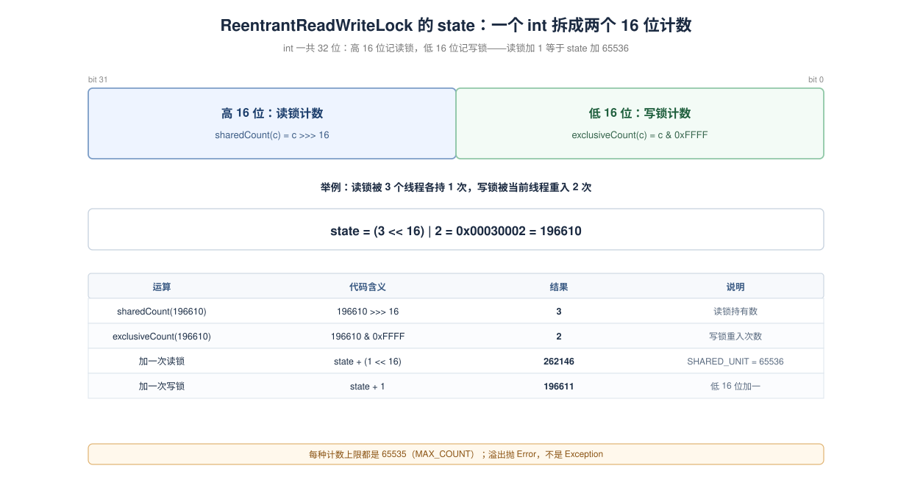
**图中元素**：左半段是高 16 位（读锁计数），右半段是低 16 位（写锁计数）；下方表格用 `state = (3 << 16) | 2` 演示解码与加锁运算。
**看完这张图应该得出的结论**：读锁加一不是 `state + 1`，而是 `state + 65536`；写锁加一才是 `state + 1`。

<br />
### 5.3 写锁：独占模式

写锁就是“标准 AQS 独占锁 + 一个额外检查：有没有人持读锁”。

【源码】`Sync.tryAcquire`（L380–410，英文注释是源码原文） · [GitHub 原文](https://github.com/openjdk/jdk8u/blob/jdk8u452-b09/jdk/src/share/classes/java/util/concurrent/locks/ReentrantReadWriteLock.java#L380-L410)：

```java
protected final boolean tryAcquire(int acquires) {
    /*
     * Walkthrough:
     * 1. If read count nonzero or write count nonzero
     *    and owner is a different thread, fail.
     * 2. If count would saturate, fail. (This can only
     *    happen if count is already nonzero.)
     * 3. Otherwise, this thread is eligible for lock if
     *    it is either a reentrant acquire or
     *    queue policy allows it. If so, update state
     *    and set owner.
     */
    Thread current = Thread.currentThread();
    int c = getState();
    // 取低 16 位：这就是写锁的重入次数（高 16 位是读锁总数，5.2 的位布局）
    int w = exclusiveCount(c);
    // c != 0：state 已经被人改过，至少存在读锁或写锁
    if (c != 0) {
        // (Note: if c != 0 and w == 0 then shared count != 0)
        // w == 0：低 16 位全空，说明 c 的高位有值——有人持读锁。
        //          读写互斥，写锁直接失败，回去排队。
        // owner 不是自己：写锁已经被别的线程持有，同样失败。
        if (w == 0 || current != getExclusiveOwnerThread())
            return false;
        // 走到这里只剩一种可能：写锁正被自己持有，也就是重入。
        // 先挡上限：低 16 位只有 65535 个格子，加满就再也加不动了（抛 Error，不是 Exception）
        if (w + exclusiveCount(acquires) > MAX_COUNT)
            throw new Error("Maximum lock count exceeded");
        // Reentrant acquire
        // 重入：直接加 1。只有写锁持有者能走到这里，不存在并发写，所以不需要 CAS；
        // 上面已确认低位没满，c + 1 不会进位去污染高位的读锁计数
        setState(c + acquires);
        return true;
    }
    // 到这里 c == 0：读锁、写锁都没人拿，才轮到抢写锁
    // writerShouldBlock()：公平锁看队列里有没有人排队（hasQueuedPredecessors）；
    // 非公平锁恒为 false，允许插队
    // 没被策略挡住才轮到 CAS；CAS 失败说明刚好有人抢先，返回 false 交给 AQS 排队
    if (writerShouldBlock() ||
        !compareAndSetState(c, c + acquires))
        return false;
    // 真正抢到了才记 owner。重入分支不用走这里——owner 本来就是自己
    setExclusiveOwnerThread(current);
    return true;
}
```
<br />
【源码】`tryRelease`（L369–378） · [GitHub 原文](https://github.com/openjdk/jdk8u/blob/jdk8u452-b09/jdk/src/share/classes/java/util/concurrent/locks/ReentrantReadWriteLock.java#L369-L378)：

```java
protected final boolean tryRelease(int releases) {
    if (!isHeldExclusively())
        throw new IllegalMonitorStateException();
    int nextc = getState() - releases;
    boolean free = exclusiveCount(nextc) == 0;
    if (free)
        setExclusiveOwnerThread(null);
    setState(nextc);
    return free;
}
```
<br />

### 5.4 读锁：共享模式 + 每线程持有计数

读锁的难点不在“读读共享”，而在**重入**：AQS 的 `state` 只记“总共被读了多少次”，记不住“哪个线程读了几次”。没有这个信息，就无法校验 `unlock()` 是否配对。

`ReentrantReadWriteLock` 的解法是：`state` 高 16 位记总数，另外用 `ThreadLocal<HoldCounter>` 记每个线程自己的次数，再加两个缓存优化。

【源码】`HoldCounter` 与 `ThreadLocalHoldCounter`（L276–291） · [GitHub 原文](https://github.com/openjdk/jdk8u/blob/jdk8u452-b09/jdk/src/share/classes/java/util/concurrent/locks/ReentrantReadWriteLock.java#L276-L291)：

```java
static final class HoldCounter {
    int count = 0;                                  // 本线程持有读锁的层数，新计数器从 0 开始
    // Use id, not reference, to avoid garbage retention
    // 存线程 id 而不是 Thread 对象：ThreadLocal 条目会活到线程死亡，
    // 存引用的话，已经结束的线程就永远回收不掉
    final long tid = getThreadId(Thread.currentThread());
}

static final class ThreadLocalHoldCounter
    extends ThreadLocal<HoldCounter> {
    // 每个线程第一次 get() 时自动造一个计数器；
    // 释放到最后一层时源码会 remove()，下次再加读锁会重新走到这里
    public HoldCounter initialValue() {
        return new HoldCounter();
    }
}
```

`HoldCounter` 存的是 `tid`（线程 id）而不是 `Thread` 引用，避免线程结束后仍被 ThreadLocal 拖着无法回收。

两个优化字段（L298、L314、L334–335） · [GitHub 原文](https://github.com/openjdk/jdk8u/blob/jdk8u452-b09/jdk/src/share/classes/java/util/concurrent/locks/ReentrantReadWriteLock.java#L298-L335)：

```java
// 每个线程的读锁层数。初始值由上面的 ThreadLocalHoldCounter 提供；
// 线程释放完最后一层时会被 remove()，避免长期占内存
private transient ThreadLocalHoldCounter readHolds;
// 缓存“最近一次成功获取读锁”的计数器：释放时大概率还是同一个线程，
// 命中就不用去查 ThreadLocal
private transient HoldCounter cachedHoldCounter;
// 第一个把读计数从 0 变 1 的线程。读锁最常见的场景是“只有一个读者”，
// 这时直接读写这两个字段，完全不碰 ThreadLocal
private transient Thread firstReader = null;
private transient int firstReaderHoldCount;
```
【源码】`tryAcquireShared`（L448–489） · [GitHub 原文](https://github.com/openjdk/jdk8u/blob/jdk8u452-b09/jdk/src/share/classes/java/util/concurrent/locks/ReentrantReadWriteLock.java#L448-L489)：

```java
protected final int tryAcquireShared(int unused) {
    Thread current = Thread.currentThread();
    int c = getState();
    // 已经有写锁：只有写锁持有者自己能再拿读锁（锁降级的前提），
    // 别的线程一律失败（返回 -1），回去排队
    if (exclusiveCount(c) != 0 &&
        getExclusiveOwnerThread() != current)
        return -1;                            // 别人持有写锁 → 失败
    int r = sharedCount(c);
    // 快速路径，三个条件必须同时成立：
    // 1) readerShouldBlock() 为 false：公平/防饥饿策略不要求让路
    // 2) r < MAX_COUNT：读计数没到 65535，低位还有格子
    // 3) CAS 把高 16 位加 1（SHARED_UNIT = 1 << 16）成功
    if (!readerShouldBlock() &&
        r < MAX_COUNT &&
        compareAndSetState(c, c + SHARED_UNIT)) {
        // 情况一：之前一个读者都没有 —— 记下“第一读者”，后续最省事
        if (r == 0) {
            firstReader = current;
            firstReaderHoldCount = 1;
        } else if (firstReader == current) {
            // 情况二：自己就是第一读者 —— 直接加字段
            firstReaderHoldCount++;
        } else {
            // 情况三：别的线程在读 —— 走每线程计数器
            HoldCounter rh = cachedHoldCounter;
            if (rh == null || rh.tid != getThreadId(current))
                // 缓存对不上：从 ThreadLocal 取自己的（没有就新建）
                cachedHoldCounter = rh = readHolds.get();
            else if (rh.count == 0)
                // 缓存命中了但计数为 0：说明上次释放时被 remove 过，
                // 必须重新登记回 ThreadLocal，否则这次的计数没人记
                readHolds.set(rh);
            rh.count++;
        }
        return 1;                              // 正数 = 成功
    }
    // 快速路径没走通（要阻塞 / 计数满 / CAS 失败）：交给自旋重试版本
    return fullTryAcquireShared(current);
}
```

两个细节：

1. **写锁持有者可以再拿读锁**（`getExclusiveOwnerThread() == current` 时不返回 -1），这是“锁降级”的源码依据。
2. 快速路径失败（CAS 失败、读计数满、公平策略要求阻塞）时，退化到 `fullTryAcquireShared` 的自旋重试版本（L495–548）。那个版本还要额外处理“重入读锁在排队时不能阻塞自己”的情况，否则会死锁。

【源码】`tryReleaseShared`（L412–441） · [GitHub 原文](https://github.com/openjdk/jdk8u/blob/jdk8u452-b09/jdk/src/share/classes/java/util/concurrent/locks/ReentrantReadWriteLock.java#L412-L441)：

```java
protected final boolean tryReleaseShared(int unused) {
    Thread current = Thread.currentThread();
    // 第一读者快速路径：直接改字段，不碰 ThreadLocal
    if (firstReader == current) {
        // assert firstReaderHoldCount > 0;
        if (firstReaderHoldCount == 1)
            firstReader = null;                // 正好放完，清掉“第一读者”
        else
            firstReaderHoldCount--;
    } else {
        // 其他读者：先查缓存，缓存对不上再查 ThreadLocal
        HoldCounter rh = cachedHoldCounter;
        if (rh == null || rh.tid != getThreadId(current))
            rh = readHolds.get();
        int count = rh.count;
        if (count <= 1) {
            // 这是本线程持有的最后一层：把 ThreadLocal 条目删掉，避免残留
            readHolds.remove();
            if (count <= 0)
                // 0 或负数说明 unlock 次数多于 lock 次数，属于调用方写错了
                throw unmatchedUnlockException();
        }
        --rh.count;
    }
    // 总计数只能 CAS 循环：多个读者可能同时释放
    for (;;) {
        int c = getState();
        int nextc = c - SHARED_UNIT;           // 高 16 位减 1
        if (compareAndSetState(c, nextc))
            // Releasing the read lock has no effect on readers,
            // but it may allow waiting writers to proceed if
            // both read and write locks are now free.
            // 只有读写计数全归零才返回 true，AQS 才会去唤醒后继（写者）
            return nextc == 0;
    }
}
```

注意最后 `return nextc == 0`：只有读、写计数都归零才返回 `true`，AQS 才会唤醒后继。普通地释放一个读锁不会唤醒任何人——其他读者本来就能进。

### 5.5 `ReadLock` / `WriteLock` 只是两个壳

【源码】两个内部锁的 `lock/unlock` 全部是一行委托（L726–728、L880–882、L942–944、L1130–1132） · [GitHub 原文](https://github.com/openjdk/jdk8u/blob/jdk8u452-b09/jdk/src/share/classes/java/util/concurrent/locks/ReentrantReadWriteLock.java#L726-L728)：

```java
// ReadLock：共享模式，参数 1 只是形式，真正加减的是 SHARED_UNIT
public void lock() {
    sync.acquireShared(1);
}
public void unlock() {
    sync.releaseShared(1);
}

// WriteLock：独占模式，和 ReentrantLock 完全一样
public void lock() {
    sync.acquire(1);
}
public void unlock() {
    sync.release(1);
}
```

`ReadLock.newCondition()` 直接抛异常（L890–892） · [GitHub 原文](https://github.com/openjdk/jdk8u/blob/jdk8u452-b09/jdk/src/share/classes/java/util/concurrent/locks/ReentrantReadWriteLock.java#L890-L892)：

```java
public Condition newCondition() {
    // 读锁天生是共享的，而 Condition 的所有权检查依赖“独占持有者”，
    // 共享模式下没有这个东西，所以直接拒绝
    throw new UnsupportedOperationException();
}
```

因为 `Condition` 依赖“独占持有者”做所有权检查，而读锁天生是共享的。

### 5.6 公平策略：写锁可以插队，读锁要防写饥饿

非公平模式下，读写锁的策略不是简单的“都允许插队”：

【源码】`NonfairSync`（L669–684） · [GitHub 原文](https://github.com/openjdk/jdk8u/blob/jdk8u452-b09/jdk/src/share/classes/java/util/concurrent/locks/ReentrantReadWriteLock.java#L669-L684)：

```java
static final class NonfairSync extends Sync {
    final boolean writerShouldBlock() {
        // 写锁永远允许插队：新写者不看队列，直接去 CAS
        return false; // writers can always barge
    }
    final boolean readerShouldBlock() {
        /* As a heuristic to avoid indefinite writer starvation,
         * block if the thread that momentarily appears to be head
         * of queue, if one exists, is a waiting writer.  This is
         * only a probabilistic effect since a new reader will not
         * block if there is a waiting writer behind other enabled
         * readers that have not yet drained from the queue.
         */
        // 防写饥饿的启发式：只要队列第一个等待者看起来是写线程，新读者就让路；
        // 否则源源不断的读者会把写者一直压在队里
        return apparentlyFirstQueuedIsExclusive();
    }
}
```

公平模式下两个都检查队列（L689–697） · [GitHub 原文](https://github.com/openjdk/jdk8u/blob/jdk8u452-b09/jdk/src/share/classes/java/util/concurrent/locks/ReentrantReadWriteLock.java#L689-L697)：

```java
static final class FairSync extends Sync {
    // 公平模式两边都守规矩：队列里有前驱（有人排在自己前面）就让路
    final boolean writerShouldBlock() {
        return hasQueuedPredecessors();
    }
    final boolean readerShouldBlock() {
        return hasQueuedPredecessors();
    }
}
```

### 5.7 锁降级：写锁 → 读锁

【官方文档】RRWL javadoc 的原话：

> "Reentrancy also allows downgrading from the write lock to a read lock, by acquiring the write lock, then the read lock and then releasing the write lock. However, upgrading from a read lock to the write lock is not possible."
> （可重入性还允许从写锁降级为读锁：先获取写锁，再获取读锁，然后释放写锁。但是，从读锁升级为写锁是不可能的。）
> —— [ReentrantReadWriteLock javadoc (JDK 8)](https://docs.oracle.com/javase/8/docs/api/java/util/concurrent/locks/ReentrantReadWriteLock.html)

javadoc 自带的缓存示例（原文）：

```java
class CachedData {
  Object data;
  // 缓存是否有效。volatile：读缓存时并不加锁，靠它保证“写者改完立即可见”
  volatile boolean cacheValid;
  final ReentrantReadWriteLock rwl = new ReentrantReadWriteLock();

  void processCachedData() {
    // 先按“只读”进来：拿读锁，多个读线程可以同时进入
    rwl.readLock().lock();
    if (!cacheValid) {
      // Must release read lock before acquiring write lock
      // 要升级成写锁：必须先把读锁放掉，否则自己等自己（5.8）
      rwl.readLock().unlock();
      rwl.writeLock().lock();
      try {
        // Recheck state because another thread might have
        // acquired write lock and changed state before we did.
        // 重新检查：从“放读锁”到“拿到写锁”之间，别人可能已经算好并置了 cacheValid
        if (!cacheValid) {
          data = ...                          // 只有真没算过才计算
          cacheValid = true;
        }
        // Downgrade by acquiring read lock before releasing write lock
        // 降级：先拿读锁、再放写锁，中间没有“无锁空窗”，别的写线程插不进来
        rwl.readLock().lock();
      } finally {
        rwl.writeLock().unlock(); // Unlock write, still hold read
      }
    }

    try {
      // 到这里至少持有读锁（也可能是降级后那把），可以安全读 data
      use(data);
    } finally {
      // 释放进入方法时拿的那把读锁
      rwl.readLock().unlock();
    }
  }
}
```

### 5.8 为什么不能锁升级

先说清一个经常被讲错的版本：“A 等 B 放读锁、B 等 A 放读锁”。按这个说法，谁把自己的读锁放掉就完事了，根本不该死。真正的死锁不是“互相客气”，而是**每个线程都把自己钉在 `writeLock()` 里面，谁都执行不到自己的 `unlock()`**：

1. `writeLock().lock()` 内部是 `sync.acquire(1)` → `Sync.tryAcquire(1)`（5.3 的源码）；
2. `tryAcquire` 只要看到 `c != 0 && w == 0`（有人持读锁）就 `return false`。注意它**不检查这些读者里有没有当前线程**——自己手里那把读锁同样一票否决；
3. 拿到 `false` 后，AQS 把当前线程入队并 `park`；
4. 线程从此停在 `lock()` 里面，后面的 `finally { readLock().unlock(); }` 永远执行不到；
5. 读计数不降 → 写锁永远不成立 → 线程永远醒不来。死锁闭环。

所以问题不是“为什么要等对方放”，而是**“升级这个写法本身让每个人都放不了”**。单线程就能复现：同一个线程先 `readLock().lock()` 再 `writeLock().lock()`，一样永久阻塞，没有第二个线程可以怪。

**自行编写的验证代码**：

```java
import java.util.concurrent.CountDownLatch;
import java.util.concurrent.locks.ReentrantReadWriteLock;

public class UpgradeDemo {
    public static void main(String[] args) throws Exception {
        // 情况一：只有它自己一个线程，也照样卡死
        ReentrantReadWriteLock soloLock = new ReentrantReadWriteLock();
        Thread solo = new Thread(() -> {
            soloLock.readLock().lock();
            System.out.println("C 单独持有读锁，尝试升级写锁");
            // 写锁要求读计数为 0，而 C 自己就是那个读者：这一步永远不返回
            soloLock.writeLock().lock();
            System.out.println("C 升级成功");   // 打印不到
        }, "C");
        solo.start();
        Thread.sleep(300);
        // 读计数还是 1，说明 C 并没有“放掉读锁再等”，而是攥着读锁停在了 lock() 里
        System.out.println("300ms 后：读锁计数 = " + soloLock.getReadLockCount()
                + "，C 状态 = " + solo.getState());

        // 情况二：A、B 都先拿到读锁，然后才各自尝试升级
        ReentrantReadWriteLock rwl = new ReentrantReadWriteLock();
        CountDownLatch bothRead = new CountDownLatch(2);
        CountDownLatch aPrinted = new CountDownLatch(1);
        Thread a = new Thread(() -> upgrade(rwl, bothRead, aPrinted, true), "A");
        Thread b = new Thread(() -> upgrade(rwl, bothRead, aPrinted, false), "B");
        a.start();
        b.start();
        Thread.sleep(300);
        // 两个线程都 park 在 writeLock() 里，谁也没走到各自的 unlock()，所以计数一直是 2
        System.out.println("再等 300ms：读锁计数 = " + rwl.getReadLockCount());
        System.out.println("A 状态 = " + a.getState() + "，B 状态 = " + b.getState());
        System.exit(0);   // 这些线程永远醒不来，只能强制退出
    }

    static void upgrade(ReentrantReadWriteLock rwl, CountDownLatch bothRead,
                        CountDownLatch aPrinted, boolean isA) {
        rwl.readLock().lock();
        // 两个线程都拿到读锁后才继续，排除“一方还没进来”的干扰
        bothRead.countDown();
        try {
            bothRead.await();
            if (!isA) aPrinted.await();   // 让 A 先打印，输出顺序才稳定
        } catch (InterruptedException e) {
            return;
        }
        System.out.println(Thread.currentThread().getName() + " 已持读锁，尝试升级写锁");
        if (isA) aPrinted.countDown();
        // 卡在这里：写锁要等读计数归零，而读计数归零又要求这个线程先执行到 unlock()
        rwl.writeLock().lock();
        System.out.println(Thread.currentThread().getName() + " 升级成功"); // 打印不到
    }
}
```

真实输出：

```text
C 单独持有读锁，尝试升级写锁
300ms 后：读锁计数 = 1，C 状态 = WAITING
A 已持读锁，尝试升级写锁
B 已持读锁，尝试升级写锁
再等 300ms：读锁计数 = 2
A 状态 = WAITING，B 状态 = WAITING
```

**输出说明了什么**：

- 情况一只有一个线程 C：读计数恒为 1、状态 `WAITING`。单独一个读者也能把自己锁死，说明这不是“谁该先放锁”的协调问题。
- 情况二 A、B 都拿到了读锁再升级：两个线程都停在 `WAITING`，读计数恒为 2。它们都卡在 `writeLock()` 里，一个都没走到 `unlock()`，所以读计数没有机会下降。

那“自己先把读锁放了再抢写锁”行不行？行，但那已经不是升级了：从放读锁到拿到写锁之间有一段**空窗**，别的线程可能已经把数据改掉，所以拿到写锁后必须重新检查。5.7 的 `CachedData` 就是这么写的（放读 → 拿写 → 重查 `cacheValid`）。

想在“确认没人改过”的前提下完成转换，只有两种做法，而且都不是阻塞式升级：

- **先放读、再抢写、再重查**：可行，但必须自己承担重查成本；
- **`StampedLock.tryConvertToWriteLock(stamp)`**：名字像升级，实际只在“没有其他读者”时才成功，失败立刻返回 0，让你自己决定要不要放读锁重来——它不会让线程卡在 `lock()` 里等。

`ReentrantReadWriteLock` 两种都不提供，规则就一句话：**要写就一开始拿写锁，别拿着读锁再想升级。**


<br />

<br />

