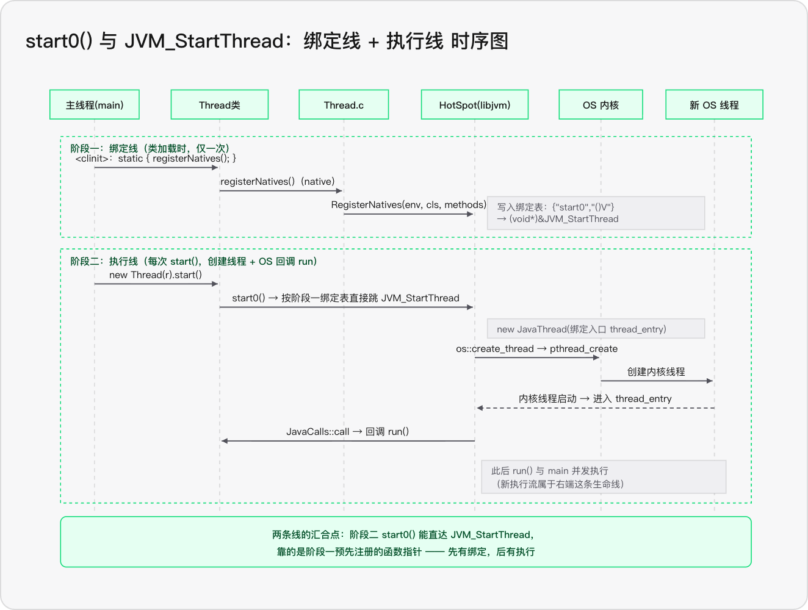
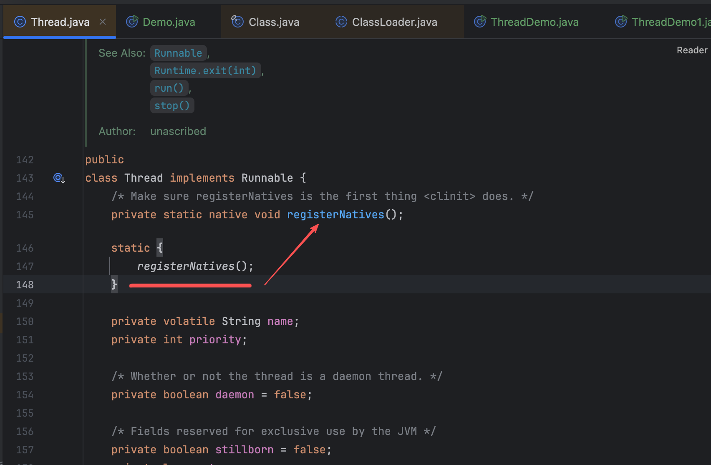
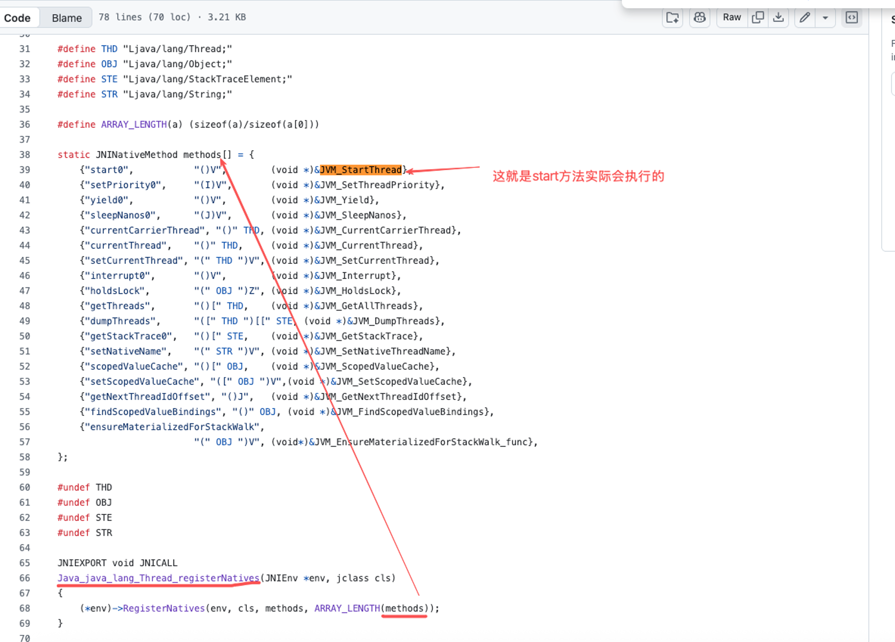
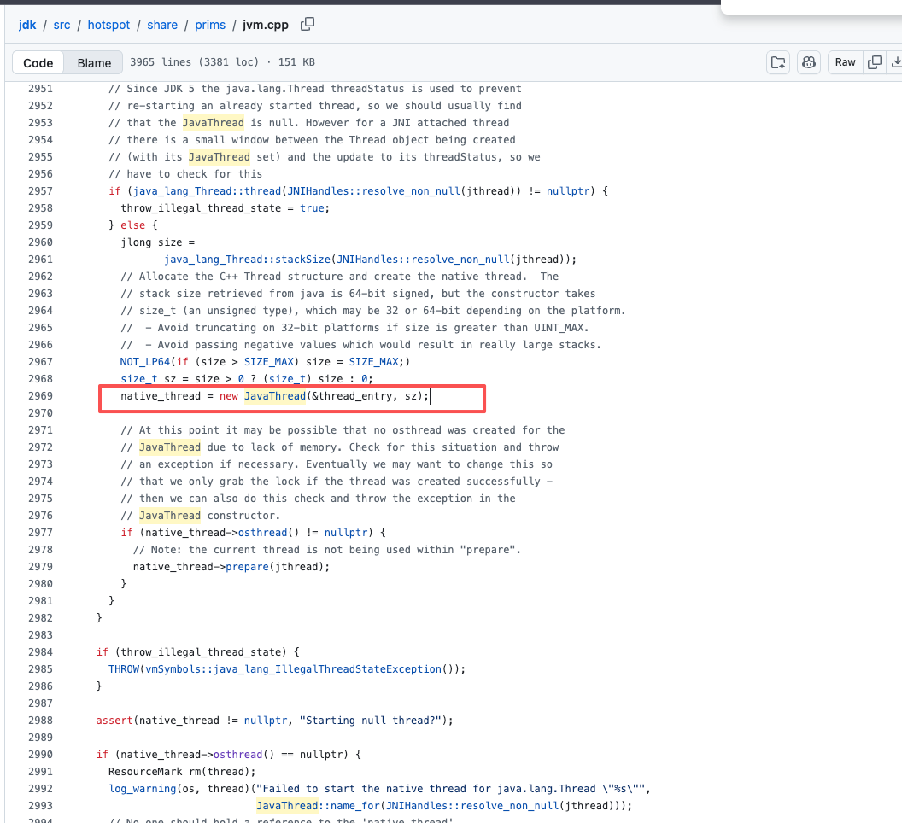
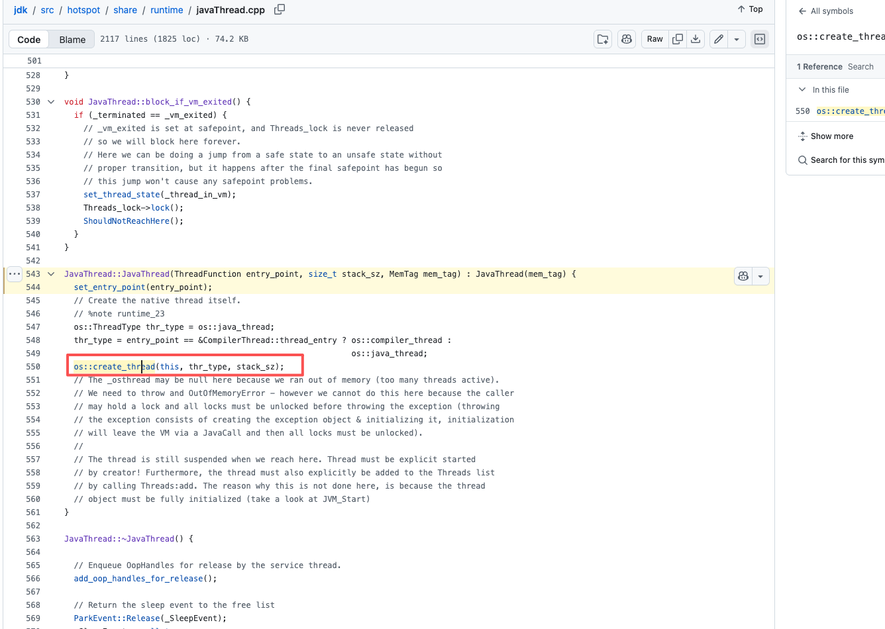
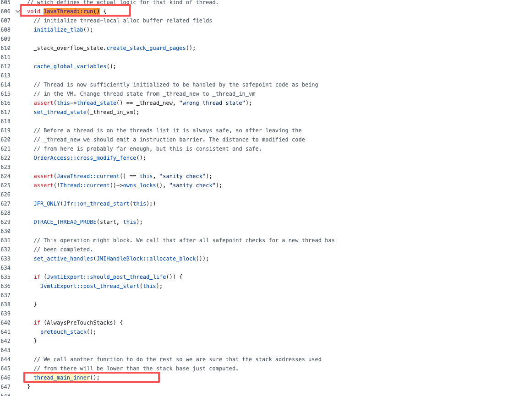

# Java多线程原理机制分析

该篇主要是探讨线程的使用方式有哪些，以及这些方式之间的差异是什么，然后再深入了解下线程创建原理机制。

## 线程的使用方式

对于标题的解释：实际从线程创建来看，只有**new Thread().strart()**这一种方式才对， 网络上的一些文章，提到的继承Thread类、实现某某接口，应当只是使用方式，不应该和“创建”混为一谈

### 1、继承Threa类

继承Thread类，重写run()方法，再调用start()启动流程

```Java
public class ThreadDemo1 extends Thread{
    @Override
    public void run() {
        System.out.println("Hello, Thread!");
    }

    public static void main(String[] args) {
        new ThreadDemo1().start();
    }
}
```

<br />

### 2、实现Runable接口

将任务逻辑与线程对象分离，通过Thread包装任务。

```Java
public class ThreadDemo2 implements Runnable{
    @Override
    public void run() {
        System.out.println("Hello, Thread!");
    }

    public static void main(String[] args) {
        new Thread(new ThreadDemo2()).start();
    }
}
```

或者，采用Lambda表达式：

```Java
Thread thread = new Thread(() -> {
    System.out.println("线程正在执行");
});

thread.start();
```

### 3、实现Callable接口，配合FutureTask

```Java
public class ThreadDemo3 {
    public static void main(String[] args) {
        Callable<Integer> task = () -> 100 + 200;

        FutureTask<Integer> futureTask = new FutureTask<>(task);

        Thread thread = new Thread(futureTask);
        thread.start();

        try {
            Integer result = futureTask.get();
            System.out.println(result);
        } catch (InterruptedException e) {
            throw new RuntimeException(e);
        } catch (ExecutionException e) {
            throw new RuntimeException(e);
        }
    }
}
```

这里会涉及三个角色：

1、Callable：定义有返回值的任务

2、FutureTask：包装任务，管理执行状态和结果

3、Thread：启动执行任务的线程

### 4、使用线程池执行任务

```Java
 public class ThreadPoolDemo {
    public static void main(String[] args) {
        ExecutorService executorService = Executors.newFixedThreadPool(4);
        executorService.execute(() -> {
            System.out.println("Hello, Thread!");
        });
        executorService.shutdown();
    }
}
```

**线程池的价值在于：**

1、复用线程，减少频繁创建和销毁线程的开销

2、控制并发规模

3、统一管理任务提交、排队和执行

<br />

### 5、CompletableFuture

completableFuture是异步计算与任务编排工具

```Java

import java.util.concurrent.CompletableFuture;
import java.util.concurrent.ExecutorService;
import java.util.concurrent.Executors;

public class ProductServiceDemo {

    public static void main(String[] args) {
        ExecutorService executor =
                Executors.newFixedThreadPool(2);

        long start = System.currentTimeMillis();

        try {
            // 异步查询商品信息
            //把任务交给指定的executor线程池去执行
            CompletableFuture<String> productFuture =
                    CompletableFuture.supplyAsync(() -> {
                        sleep(500);
                        System.out.println(
                                "商品查询线程：" +
                                Thread.currentThread().getName()
                        );
                        return "商品名称：iPhone，价格：5999";
                    }, executor);

            // 异步查询库存信息
            CompletableFuture<String> stockFuture =
                    CompletableFuture.supplyAsync(() -> {
                        sleep(500);
                        System.out.println(
                                "库存查询线程：" +
                                Thread.currentThread().getName()
                        );
                        return "剩余库存：100";
                    }, executor);

            // 等待两个任务完成，并组合结果
            CompletableFuture<String> resultFuture =
                    productFuture.thenCombine(
                            stockFuture,
                            (product, stock) ->
                                    product + "\n" + stock
                    );

            System.out.println(resultFuture.join());

            System.out.println(
                    "总耗时：" +
                    (System.currentTimeMillis() - start) +
                    "ms"
            );
        } finally {
            executor.shutdown();
        }
    }

    private static void sleep(long millis) {
        try {
            Thread.sleep(millis);
        } catch (InterruptedException e) {
            Thread.currentThread().interrupt();
            throw new RuntimeException(e);
        }
    }
}

```

输出结果：

```
商品查询线程：pool-1-thread-1
库存查询线程：pool-1-thread-2
商品名称：iPhone，价格：5999
剩余库存：100
总耗时：533ms
```

## 线程使用方式的差异分析

| 方式                        | 定位                                                   | 缺陷                                                           | 适合场景                     |
| :------------------------ | :--------------------------------------------------- | :----------------------------------------------------------- | :----------------------- |
| 继承Threa类                  | 最原始的“线程即任务”一体式写法                                     | 占用唯一继承位；**任务与执行绑死、无法复用**；不支持返回值/异常（本质是没有任务抽象）                | 实际生产不适用                  |
| 实现Runable接口               | **任务抽象** ：只描述“做什么”，不管谁执行                             | 无返回值；不能抛受检异常；拿不到完成结果（需要额外同步）                                 | 实际生产不适用                  |
| 实现Callable接口，配合FutureTask | **有结果的任务** ：FutureTask 把 Callable 适配成 Runnable 并存住结果 | 必须手动搭线程；`get()` 是阻塞的；异常被吞到`get()` 才抛                         | 一般都是直接用CompletableFuture |
| 使用线程池执行任务                 | **执行策略** ：线程数量、排队、拒绝策略集中管理                           | 参数配错等于没管（**无界队列 → OOM**；**无界线程 → 资源耗尽**）；策略与业务强相关，**没有万能配置** | 绝大多数服务端并发场景的默认选择         |
| CompletableFuture         | **异步结果编排** ：组合、回调、异常传播                               | 无返回值参数任务仍需底层 Executor；回调链调试困难；异常处理易遗漏                        | 多个异步步骤的依赖编排（并行调用后聚合）     |

<br />

## 设计脉络

继承Thread类：“任务”和“执行”绑定

Runable接口：“任务”和“执行”解耦——“任务”抽象，不管谁执行，只描述“做什么”（但是缺少【返回值/异常】支持）

> The Callable interface is similar to Runnable, in that both are designed for classes whose instances are potentially executed by another thread. A Runnable, however, does not return a result and cannot throw a checked exception. 参考：[Callable](https://docs.oracle.com/en/java/javase/21/docs/api/java.base/java/util/concurrent/Callable.html)

Callable + FutureTask：“有结果的任务”（有返回值/异常）

线程池 Executor：一方面是**池化思想**——减少线程创建成本，达到复用目的；另一方面，对于任务的执行，任务怎么排队这样的策略性问题做了抽象（**执行策略的抽象**）

CompletableFuture：依赖线程池的**异步任务组织方式**（可编排）

<br />

## 线程的创建原理

Java的线程，最终是通过系统调用创建的，随之绑定（Java线程绑定在平台线程上）

在第一次类加载的时候，会执行registerNatives本地方法：
这个registerNatives本地方法，会注册一个方法表，其中就有有用的start方法：
执行JVM\_StartThread，会涉及到new JavaThread()

JavaThread的构造函数中有os::create\_thread的调用：
最终，会通过下图的逻辑再回到Java层面的run方法：


<br />

#### 结论

1、线程创建设计同步锁MutexLocker ml(Threads\_lock)， 所以不建议频繁创建线程

2、Java的线程和平台线程是1比1映射的， 也就是说：一个JVM进程可以创建的线程数取决于平台OS

<br />

<br />

<br />

<br />

<br />

