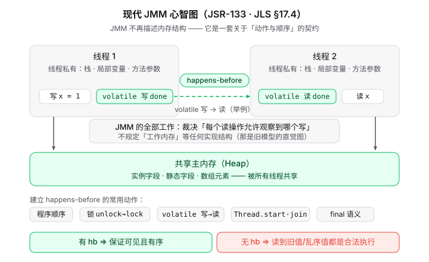

# Java并发编程的基础理解

## 前言

谈及并发，直接基于线程去阐述比较方便，需要稍加注意的是：区别于进程是资源分配的单位，其线程本身是CPU调度的基本单位。为了占满CPU的时钟周期，多个线程串行执行自然被舍弃，事实上，如果某一时间段只允许线程A在执行，那线程A在IO期间，CPU是空闲的，这是资源浪费；那为了让CPU尽可能多的忙碌起来，给出了并发和并行两种方向。

<br />

## 并发编程&并发计算&并行计算

（参考自维基百科：[并发计算](https://zh.wikipedia.org/wiki/%E5%B9%B6%E5%8F%91%E8%AE%A1%E7%AE%97)）

> 并发计算是一种程序运算的特性，可以被视为是[并行运算](https://zh.wikipedia.org/wiki/%E5%B9%B3%E8%A1%8C%E9%81%8B%E7%AE%97 "并行运算")的进一步[抽象](https://zh.wikipedia.org/wiki/%E6%8A%BD%E8%B1%A1%E5%8C%96_\(%E8%A8%88%E7%AE%97%E6%A9%9F%E7%A7%91%E5%AD%B8\) "抽象化 (计算机科学)")，它包涵了[时间片](https://zh.wikipedia.org/wiki/%E6%97%B6%E9%97%B4%E7%89%87 "时间片")这种可以被用来实现虚拟并行运算（pseudoparallelism）的技术，因此在实际的物理运作中，计算过程可能是[并行](https://zh.wikipedia.org/wiki/%E5%B9%B3%E8%A1%8C%E9%81%8B%E7%AE%97 "并行运算")，或非并行的。
> 并行计算是指，当并发计算的程序，在机器平台上同时被执行的状况，因此，并行计算是一种机器运算的形式之一。[分布式计算](https://zh.wikipedia.org/wiki/%E5%88%86%E6%95%A3%E5%BC%8F%E8%A8%88%E7%AE%97 "分布式计算")（Distributed computing）则是并行计算的一个特例，它采用计算机网络来进行同步。
> 实现[并发](https://zh.wikipedia.org/wiki/%E5%B9%B6%E5%8F%91%E6%80%A7 "并发性")程序有许多方式，依[编程语言](https://zh.wikipedia.org/wiki/%E7%A8%8B%E5%BC%8F%E8%AA%9E%E8%A8%80 "编程语言")与[操作系统](https://zh.wikipedia.org/wiki/%E4%BD%9C%E6%A5%AD%E7%B3%BB%E7%B5%B1 "操作系统")的支持，可以用[行程](https://zh.wikipedia.org/wiki/%E8%A1%8C%E7%A8%8B "行程")，或是[线程](https://zh.wikipedia.org/wiki/%E5%9F%B7%E8%A1%8C%E7%B7%92 "线程")来实现。它可以执行在单一[处理器](https://zh.wikipedia.org/wiki/%E8%99%95%E7%90%86%E5%99%A8 "处理器")上，将不同的执行步骤分散在不同[时间片](https://zh.wikipedia.org/wiki/%E6%97%B6%E9%97%B4%E7%89%87 "时间片")中执行，以非[并行](https://zh.wikipedia.org/wiki/%E5%B9%B3%E8%A1%8C%E9%81%8B%E7%AE%97 "并行运算")方式循序运算；它也可以用[并行计算](https://zh.wikipedia.org/wiki/%E5%B9%B3%E8%A1%8C%E8%A8%88%E7%AE%97 "并行计算")来实现，将每个行程指定给处理器组中的某个处理器，以单片机[多处理器](https://zh.wikipedia.org/wiki/%E5%A4%9A%E8%99%95%E7%90%86%E5%99%A8 "多处理器")平台，或是透过网络链接的[分散](https://zh.wikipedia.org/wiki/%E5%88%86%E5%B8%83%E5%BC%8F%E8%AE%A1%E7%AE%97 "分布式计算")平台来实做。

<br />

（参考自The Java™ Tutorials：[Processes and Threads](https://docs.oracle.com/javase/tutorial/essential/concurrency/procthread.html)）

> In concurrent programming, there are two basic units of execution: *processes* and *threads*. In the Java programming language, concurrent programming is mostly concerned with threads. However, processes are also important.

<br />

综上, 可以有以下理解：

1、并发是一种程序运行的特性。

2、并发计算可以被视为并行运算的进一步抽象，维基百科中给出的解释，我认为偏向说“并行是多个线程/进程在某一个时刻同时运行”， 而并发在兼有并行的特质之上，引入时间片，某一个时刻只有一个线程/进程在执行，宏观感受上是“多个线程/进程同时进行”。

3、线程或者进程是并发程序的具体实现，是两个**最基本的执行单元**。（Java编程语言中更关注的是线程）。

<br />

## 并发执行带来的问题

### 1、原子性：线程之间的干扰

> "Interference happens when two operations, running in different threads, but acting on the same data, interleave ." —— 两个线程的操作作用于同一份数据时发生交错，就会互相干扰。【参考自The Java™ Tutorials：[Thread Interference](https://docs.oracle.com/javase/tutorial/essential/concurrency/interfere.html)】

Case：count++由多个指令完成，并非原子性操作，多个Thread之间的指令交叠，进而造成了输出结果的不确定性

```Java
public class Demo2 { 
    static int count = 0 ; 
    // 两个线程共享的变量 
    public static void main (String[] args) throws Exception { 
        Runnable work = () -> { 
            for ( int i = 0 ; i < 100000 ; i++) {
                count++; // 不是一步完成：读出 count → 加 1 → 写回 }
        }; 
        Thread a = new Thread (work); 
        Thread b = new Thread (work);
        a.start();
        b.start();
        a.join();
        b.join();
        System.out.println( "期望 200000，实际 " + count);
    }
}
```

输出：

```
期望 200000，实际 124125
```

<br />

### 2、可见性问题：内存一致性问题

标题直接翻译自Java官方的原文，见[Memory Consistency Errors](https://docs.oracle.com/javase/tutorial/essential/concurrency/memconsist.html)

抽象的来看，这种不可见最直接的原因是多个线程看到的视图（view）不同，而具体导致“视图不同”的原因，大致有以下：

1、编译器/JIT：寄存器缓存与重读消除

2、编译器/JIT与CPU：指令重排

3、硬件：写缓存与缓存传播延迟

#### 如何解决可见性问题？

在java编程语言层面，强调了**happens-before relationship规范**，同时可以在JUC中看见有大量的基于happens-before relationship规范的实现。这种relationship的实现，在一些地方，是说借鉴了逻辑时钟的思想。我觉得本质是通过规定一种“事件顺序”来保证。比如Synchronized、volatile关键字（JMM规范的一部分）



<br />

### 3、死锁&饥饿和活锁

死锁：两个或多个线程永远阻塞、互相等待

饥饿：线程长期抢不到共享资源，无法推进

活锁：线程没有阻塞，只是忙着互相响应，腾不出手干正事

### 4、成本问题

线程被频繁的创建和销毁，这本身是种浪费，成本开销也会很大。同时，Java的线程是对操作系统线程的封装，**线程数量本身就是稀缺资源**。池化技术（线程池）虽然可以避免启动新线程的开销，但是并不会增加线程总数。虽然虚拟线程可以增加应用程序的吞吐，这种看起来像是让线程资源更廉价，但是针对CPU密集型的任务，虚拟线程并不奏效【[虚拟线程](https://openjdk.org/jeps/444)】
