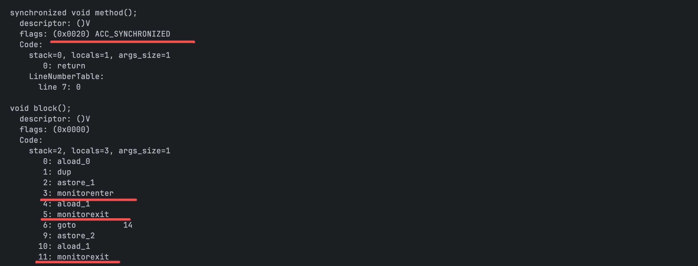
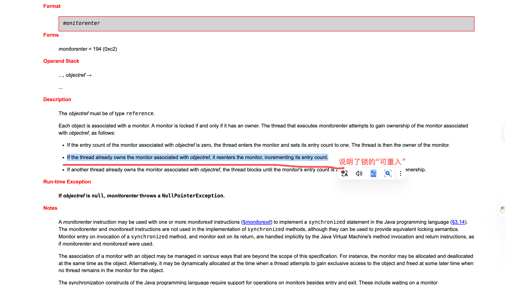
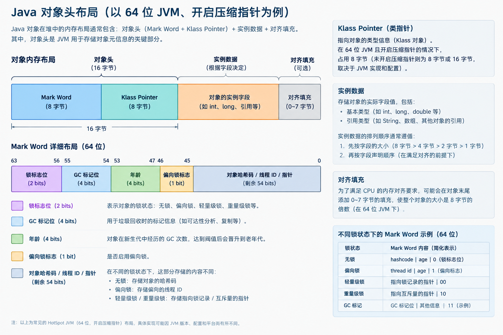

# 线程安全问题和解决

# 一、前言

为了充分利用 CPU 资源，现代程序通常采用多线程等方式实现并发执行。但当多个线程访问同一份共享可变数据时，原本在单线程环境下成立的程序逻辑，就可能因为线程交错执行而失效。线程安全问题由此产生。

<br />

# 二、线程安全问题的产生

> 当多个线程同时访问或操作同一份**共享数据**时，如果**没有正确的并发控制**，程序的执行结果可能不符合预期，或者出现数据不一致、状态异常等问题。

### 2.1 并发执行与线程执行时序

一个简单的类比：多人在线编辑一份共享文档，每个人都要把自己的名字和身份证号填在文档中，如果多个人都在同一行上写，就有可能把别人填写的内容个覆盖掉。这里的问题在于，共享了同一份东西，各自按各自的节奏在改。

具体的case：多个线程执行count++，count++在具体的程序指令中，大致分为“读取count值，对count进行加1，将更新后的值存储到count中”三个步骤，多个线程交错执行同一个count++逻辑就会不可预期的结果。多个线程交错执行的时序是由操作系统决定的，涉及线程切换。

### 2.2 共享可变状态与竞态条件（race codition）

**race condition：如果计算机中的两个线程同时试图修改一个共享内存的内容，在没有并发控制的情况下，最后的结果**依赖于两个线程的执行顺序与时机。而且如果发生了并发访问冲突，则最后的结果是不正确的。（参考wiki：<https://zh.wikipedia.org/wiki/%E7%AB%B6%E7%88%AD%E5%8D%B1%E5%AE%B3>）

具体例子：

```Java
public class RaceConditionDemo {
    // 共享可变状态：两个线程同时读写，没有任何同步
    static int counter = 0;

    public static void main(String[] args) throws InterruptedException {
        Runnable task = () -> {
            for (int i = 0; i < 100_000; i++) {
                counter++; // 非原子：读 -> 加 1 -> 写回，三步可能交错
            }
        };
        Thread t1 = new Thread(task);
        Thread t2 = new Thread(task);
        t1.start();
        t2.start();
        t1.join();
        t2.join();
        System.out.println("期望值: 200000");
        System.out.println("实际值: " + counter);
    }
}
```

输出：

```
=== 第 1 次 ===
期望值: 200000
实际值: 120467
=== 第 2 次 ===
期望值: 200000
实际值: 108210
=== 第 3 次 ===
期望值: 200000
实际值: 139986
```

多次执行结果并不符合预期，`javap -c` 反编译会发现上面count++逻辑会发现count++是多步骤的：

```Textile
 8: getstatic     #36                 // Field counter:I   <- 第 1 步：读
11: iconst_1
12: iadd                              <- 第 2 步：加 1
13: putstatic     #36                 // Field counter:I   <- 第 3 步：写回
```

可以想象到，存在读到“旧值”的情况：

```
时间轴 ──────────────────────────────────────────────────►
线程 A： 读 counter(=100) ── 加 1 得 101 ─────── 写回 101
线程 B：        读 counter(=100) ────── 加 1 得 101 ── 写回 101
                     ▲
                     └─ 两个线程都读到 100，B 的写回覆盖了 A
```

以上执行时序图可以说明：**B 的"读"发生在 A 的"读"之后、"写回"之前，所以 B 读到的也是 100。**

要解决count++的问题，我们要对count++的“读、计算、写回”这三个步骤稍加控制，避免单个线程在执行的时候被另外一个线程插队，执行步骤被打破。

<br />

### 2.3 原子性、可见性与有序性

进一步理解，可以认为并发程序的线程安全问题的产生，在于没有对“原子性、可见性与有序性”进行有效控制

| 问题  | 含义                                 | <br /> |
| :-- | :--------------------------------- | :----- |
| 原子性 | 一个操作从其他线程看来要么完全执行完，要么完全没执行，不存在中间状态 | <br /> |
| 可见性 | 一个线程的写，其他线程能否及时读到                  | <br /> |
| 有序性 | 一个线程观察另一个线程的执行顺序，可能与代码顺序不一致        | <br /> |

**原子性的破坏**，就是上文count++的例子

**可见性的破坏**，代码示例如下：

```Java
public class VisibilityDemo {
    // 故意不加 volatile：主线程对 flag 的写，工作线程可能永远看不到
    static boolean flag = true;

    public static void main(String[] args) throws InterruptedException {
        Thread worker = new Thread(() -> {
            while (flag) {
                // JIT 可能把这个空循环优化成 while(true)，
                // 因为它没有观察到 flag 被其他线程修改的同步动作
            }
            System.out.println("worker: 观察到 flag=false，退出循环");
        });
        worker.start();
        Thread.sleep(1000);
        System.out.println("main: 设置 flag=false");
        flag = false;
        worker.join(2000);
        if (worker.isAlive()) {
            System.out.println("main: 2 秒后 worker 仍在运行 —— flag 的修改对它不可见");
            System.exit(0);
        }
    }
}
```

实际运行输出：

```
main: 设置 flag=false
main: 2 秒后 worker 仍在运行 —— flag 的修改对它不可见
```

\*\*结论：\*\*worker线程看不到共享变量flag更新后的值

**有序性的破坏**，这块是由于指令重排所致（CPU指令流水线也是一个原因），不同的平台优化可能不一致，需要注意的是，Java语言规范允许重排，但要求程序员在适当的地方，稍加控制——参考：<https://docs.oracle.com/javase/specs/jls/se21/html/jls-17.html#jls-17.4>

<br />

# 三、不同“层次”如何表达并发控制

**操作系统**提供"原子指令 + 阻塞唤醒"的原料，**管程**把原料抽象成"互斥 + 条件等待"的模型，J**VM** 把管程绑定到每个 Java 对象上，**Java 语法**再把这一切以 `synchronized`/`volatile` 等关键字的形式交给开发者。

并发控制的脉络，应该这样分层去看：

```
┌──────────────────────────────────────────────────────────────┐
│ Java 语法层   synchronized / volatile / wait-notify           │  ← 声明的入口
├──────────────────────────────────────────────────────────────┤
│ JVM 层        monitor / monitorenter / monitorexit           │  ← 把管程落到对象上
├──────────────────────────────────────────────────────────────┤
│ 管程模型      互斥入口 + 条件变量（wait / signal）                │  ← 1960s 的抽象
├──────────────────────────────────────────────────────────────┤
│ 操作系统层    线程调度 / 原子指令 / futex 阻塞唤醒                 │  ← 物理基础
└──────────────────────────────────────────────────────────────┘
        ▲
        │  JMM：贯穿四层的“语义合同”
        │  不规定怎么实现，只规定“每次读允许看到哪个写”
        └─ 约束 Java 语法、JVM、monitor，乃至 JIT/CPU 的重排
└─────────────────────────────────────────────────────┘
```

<br />

### 3.1 操作系统：线程调度和底层同步能力

操作系统提供了线程调度和同步能力：

1、线程调度：把线程挂起 / 唤醒的能力

2、同步能力：在硬件原子指令的基础上，提供互斥锁、信号量、条件变量、futex 等同步原语（无竞争时主要靠硬件原子指令快速完成，有竞争时借助挂起/唤醒避免空转）

> "The Linux kernel provides futexes ("Fast user-space mutexes") as a building block for fast user-space locking and semaphores. Futexes are very basic and lend themselves well for building higher-level locking abstractions such as mutexes, condition variables, read-write locks, barriers, and semaphores."
> （Linux 内核提供 futex（"快速用户空间互斥量"）作为快速用户态锁和信号量的构建基石。futex 非常基础，适合用来构建更高层的锁抽象，如互斥锁、条件变量、读写锁、屏障和信号量。）
> —— futex(7) man page，【官方文档】，[链接](https://man7.org/linux/man-pages/man7/futex.7.html)

<br />

### 3.2 管程：互斥与条件同步的抽象模型

操作系统提供了阻塞唤醒+原子指令，出于易用性，Dijkstra提出信号量机制（P/V操作），但其痛点明显：**加锁和解锁是两个独立的手工调用**，散落在每一处访问共享资源的代码里。漏掉一个 P 或一个 V，就是死锁或竞态。

由此，在信号量的基础上，进一步有了“管程”这一抽象模型——**把共享资源和操作它的全部过程封装成一个模块，互斥由模块本身隐式保证**

> "This paper develops Brinch-Hansen's concept of a monitor as a method of structuring an operating system. It introduces a form of synchronization, describes a possible method of implementation in terms of semaphores and gives a suitable proof rule."
> （本文将 Brinch-Hansen 的管程概念发展为一种组织操作系统的方法。它引入了一种同步形式，描述了一种基于信号量的可行实现方式，并给出了相应的证明规则。）
> —— Hoare, "Monitors: an operating system structuring concept", CACM 17(10):549-557, 1974，【论文/作者言论】，[ACM DOI](https://dl.acm.org/doi/10.1145/355620.361161)

<br />

管程可以这样去看：

1. 互斥入口：任一时刻最多一个线程在管程内执行过程——这就是"互斥（mutual exclusion）"。关键在于它由管程机制隐式保证，不需要调用者做对任何事；
2. 条件变量与 wait/signal：线程在管程内发现"条件不满足"（比如缓冲区满了），可以主动释放管程进入等待队列，等别的线程执行 signal 后再回来——这就是"条件同步"，解决"锁拿到了，但条件还没就绪"的问题。

（todo：补一张模型图）

### 3.3 JVM：对象监视器与同步机制的实现

JVMS中对Synchronization的描述中有这样一句话：

> The Java Virtual Machine supports synchronization of both methods and sequences of instructions within a method by a single synchronization construct: the *monitor*.\
> The Java Virtual Machine supplies the monitorenter and monitorexit instructions to support such language constructs
>
> —— JVMS §2.11.10，【规范】，[链接](https://docs.oracle.com/javase/specs/jvms/se21/html/jvms-2.html#jvms-2.11.10)

JLS中也有规范，承诺“每个对象都有一个监视器”：

> "The Java programming language provides multiple mechanisms for communicating between threads. The most basic of these methods is synchronization, **which is implemented using monitors**. Each object in Java is associated with a monitor, which a thread can lock or unlock. Only one thread at a time may hold a lock on a monitor."
> （Java 语言提供多种线程间通信机制，其中最基本的是同步，它用管程实现。Java 中**每个对象都关联一个管程**，线程可以对它加锁或解锁。同一时刻只有一个线程可以持有该管程的锁。）
> —— JLS §17.1，【规范】，[链接](https://docs.oracle.com/javase/specs/jls/se21/html/jls-17.html#jls-17.1)

总结JVM规范和Java语言层规范，就可以理解为：**JLS 承诺"每个对象关联一个管程"的语言语义，JVMS 规定 JVM 用 monitor 构造来落实这个语义。**

<br />

那么 JVM 内部这个 monitor 长什么样、存在哪里？

- **规范只说"每个对象关联一个 monitor"，没有规定怎么实现**。常见的实现是把锁状态记录在对象头的 Mark Word 里，争用严重时膨胀为独立的 ObjectMonitor 结构（C++ 实现，见 [objectMonitor.cpp](https://github.com/openjdk/jdk/blob/master/src/hotspot/share/runtime/objectMonitor.cpp)）——**这是 HotSpot 的实现选择，规范不保证**（【实现细节】）。
- 曾经著名的"偏向锁"优化（无竞争时几乎零成本加锁），由于维护成本高于收益，JDK 15 起**默认禁用并废弃**（JEP 374，【官方文档】，[链接](https://openjdk.org/jeps/374)）。这也是"实现细节不可依赖"的例子。

### 3.4 JMM：跨线程内存访问的语义

**JMM 是一份语义合同——它不提供新的同步工具，而是用 happens-before 规定 monitor、volatile、final、start/join 等动作在什么条件下保证可见性与有序性；没有 HB 边，读可以合法地看到旧值。**

可以这样梳理：硬件提供原子指令，操作系统提供调度与阻塞原语，管程把互斥和条件等待抽象出来，JVM 把管程绑定到对象上。**但互斥只保证临界区不交错，它本身不保证一个线程的写对另一个线程可见，也不保证跨线程观察到的顺序。** `synchronized` 同时具备互斥和可见性，是因为 JMM 给 monitor 的解锁/加锁赋予了 HB 语义；互斥只负责前者。

JMM 不是“堆/栈/方法区怎么划分”的内存模型，也不规定“主内存/工作内存”如何搬运数据；它只规定**多线程访问共享变量时，哪些执行是合法的**。核心工具是 happens-before（HB）：

- 若写 w HB 读 r，r 不能看到 w 之前的旧写；
- 若 w 与 r 之间没有 HB 边，JMM 允许 r 看到旧值——这正是 2.3 节可见性 bug 的规范根源；
- HB 是偏序，不是物理时间先后；跨线程的 HB 由程序顺序、锁、volatile、start/join 等规则组合而成。

最常用的规则（JLS §17.4.5）：

1. **程序顺序**：同一线程中，前面的动作 HB 后面的动作；
2. **监视器锁**：同一监视器的解锁 HB 后续加锁；
3. **volatile**：对同一 volatile 字段的写 HB 后续读；
4. **线程启动/终止**：start() HB 新线程中的动作；线程中的所有动作 HB 其他线程从 join() 成功返回；
5. **传递性**：A HB B 且 B HB C，则 A HB C。

这些是最常用的 HB 规则（传递性是 HB 的性质，不是一条独立的同步规则）。此外，final 字段有 §17.5 的安全发布语义；JMM 还规定 volatile long/double 的原子性等，本节不展开。

注意：程序顺序规则约束的是 HB 关系，不保证 CPU 一定按代码顺序执行；只要可观察结果合法，编译器仍可重排。

这些规则不是“禁止一切重排”。JMM 允许编译器/JIT/CPU 在不越出合法执行集合的前提下重排；实现层用编译器屏障、CPU 内存屏障/原子指令、缓存一致性来兑现（后文讲 HotSpot 与 volatile 时展开）。所以不要把 JMM 理解成“禁止重排序”，它约束的是**可观察结果**，不是指令顺序。

<br />

### 3.5 Java语法：并发控制给到开发者

`synchronized`、`volatile`、`wait()/notify()` 是 JVM 把管程与JMM能力“翻译”给开发者的关键字。

| 语法                | 具体实现                                                          |
| :---------------- | :------------------------------------------------------------ |
| synchronized      | 代码块 → `monitorenter`/`monitorexit`；方法 → `ACC_SYNCHRONIZED` 标志 |
| volatile          | 字段访问带上 volatile 写-读的 happens-before 语义；实现层插入屏障                |
| wait() / notify() | 管程条件变量的 wait/signal；调用前必须持有 monitor                           |

<br />

## 四、语言层方案一：synchronzed

### 4.1 synchronized的基本用法

`synchronized` 有三种写法——同步实例方法（锁 `this`）、同步静态方法（锁 `Class` 对象）、同步代码块（锁指定对象），本质都是抢同一个对象的监视器锁。

代码验证（与 2.2 节 `RaceConditionDemo` 唯一的区别是 `counter++` 被 `synchronized` 包住）：

```Java
public class SynchronizedDemo {
    static int counter = 0;

    // 用 synchronized 把“读-改-写”变成原子操作
    static synchronized void increment() {
        counter++;
    }

    public static void main(String[] args) throws InterruptedException {
        Runnable task = () -> {
            for (int i = 0; i < 100_000; i++) {
                increment();
            }
        };
        Thread t1 = new Thread(task);
        Thread t2 = new Thread(task);
        t1.start();
        t2.start();
        t1.join();
        t2.join();
        System.out.println("期望值: 200000");
        System.out.println("实际值: " + counter);
    }
}
```

输出结果：

```Textile
=== 第 1 次 ===
期望值: 200000
实际值: 200000
=== 第 2 次 ===
期望值: 200000
实际值: 200000
```

### 4.2 synchronized的同步范围与锁对象

| 用法                                | 锁对象             |
| :-------------------------------- | :-------------- |
| synchronized void method()        | 当前实例this        |
| static synchronized void method() | 类对象，如Demo.class |
| synchronized (obj) {...}          | 显示指定的obj        |

<br />

### 4.3 对象监视器与monitorenter、monitorexit

同步代码块在字节码里就是monitorenter/monitorexit指令对；同步方法则由方法上的 ACC\_SYNCHRONIZED 标志隐式处理。(<https://docs.oracle.com/javase/specs/jvms/se21/html/jvms-2.html#jvms-2.11.10>)

```Java
public class SyncBytecode {
    // 同步方法：JVM 层面靠方法的 ACC_SYNCHRONIZED 标志隐式加锁
    synchronized void method() {}

    // 同步代码块：字节码层面显式出现 monitorenter / monitorexit
    void block() {
        synchronized (this) {
        }
    }
}
```

对应的字节码：
出现**两个** `monitorexit`：一个在正常路径，一个在异常路径——保证异常也会释放锁。

还有一个“**可重入**”的知识点：（[monitorenter](https://docs.oracle.com/javase/specs/jvms/se21/html/jvms-6.html#jvms-6.5.monitorenter)）



### 4.4 HotSpot锁实现

HotSpot把**锁状态编码载对象头的Mark Word里**，根据竞争程序，有一条升级链：无锁->偏向锁（默认开启）->轻量级锁（栈上Lock Record + CAS）->重量级锁（ObjectMonitor + 操作系统阻塞）


锁的升级链条：

```
  无锁 (biased_lock=0, lock=01)
    │ 第一个线程 CAS 写入自己的 JavaThread*
    ▼
  偏向锁 (biased_lock=1, lock=01) ── 同一线程再进入：只比线程 ID
    │ 另一个线程竞争：safepoint 撤销偏向
    ▼
  轻量级锁 (lock=00) ── 栈上 Lock Record + CAS
    │ CAS 失败（真有竞争）
    ▼
  重量级锁 (lock=10) ── ObjectMonitor + OS 阻塞
```

<br />

### 4.5 synchronized保证互斥与内存同步

互斥靠锁本身，可见性和有序性靠“解锁 happens-before 下一次加锁”规则（JMM规定）

具体而言：线程 A 在 `synchronized` 块内做的**所有**写操作（即使是被重排的），在它释放锁之前都会“提交”；线程 B 随后抢到同一把锁，就能看到 A 的全部修改

<br />

## 五、语言层方案二：volatile

### 5.1 volatile解决什么问题？

`volatile` 解决“可见性”和“有序性”两个问题，但不解决“复合操作的原子性”。

2.3的Dome，

```Java
public class VisibilityDemo {
    // 故意不加 volatile：主线程对 flag 的写，工作线程可能永远看不到
    static volatile boolean  flag = true;

    public static void main(String[] args) throws InterruptedException {
        Thread worker = new Thread(() -> {
            while (flag) {
                // JIT 可能把这个空循环优化成 while(true)，
                // 因为它没有观察到 flag 被其他线程修改的同步动作
            }
            System.out.println("worker: 观察到 flag=false，退出循环");
        });
        worker.start();
        Thread.sleep(1000);
        System.out.println("main: 设置 flag=false");
        flag = false;
        worker.join(2000);
        if (worker.isAlive()) {
            System.out.println("main: 2 秒后 worker 仍在运行 —— flag 的修改对它不可见");
            System.exit(0);
        }
    }
}
```

输出的结果是：

```
main: 设置 flag=false
worker: 观察到 flag=false，退出循环
```

<br />

### 5.2 volatile的可见性与有序性

`volatile` 的可见性与有序性来自 JMM 的一条 happens-before 规则——volatile 写 happens-before 后续的 volatile 读；

编译器和 JVM 负责在指令层面兑现它。

**有序性：**volatile 写之前的所有普通写，对 volatile 读之后的所有普通读可见。实践中它常被用作“标志位”——比如把某个对象先完整构造好，最后才 volatile 写一个引用（发布模式）。

**指令层面怎么实现**（内存屏障、x86 上的 `lock` 前缀指令等）属于各 JVM/各 CPU 的实现细节，规范不规定（【实现细节】）。

<br />

### 5.3 volatile不能保证复合操作的原子性

volatile被设计成对单个共享变量的可见性，多个复合操作就走到临界区的概念了（synchronized保证）

不能保证复合操作的Case：

```Java
public class VolatileNoAtomicDemo {
    // volatile 保证可见性和有序性，但不保证复合操作的原子性
    static volatile int counter = 0;

    public static void main(String[] args) throws InterruptedException {
        Runnable task = () -> {
            for (int i = 0; i < 100_000; i++) {
                counter++; // volatile 修饰，但 ++ 仍是“读-改-写”三步
            }
        };
        Thread t1 = new Thread(task);
        Thread t2 = new Thread(task);
        t1.start();
        t2.start();
        t1.join();
        t2.join();
        System.out.println("期望值: 200000");
        System.out.println("实际值: " + counter);
    }
}
```

输出结果：

```
=== 第 1 次 ===
期望值: 200000
实际值: 154266
=== 第 2 次 ===
期望值: 200000
实际值: 147844
```

输出结果表明了存在丢失更新，读旧值的情况。

<br />

### 5.4 volatile与synchronized的区别

| 维度   | volatile                 | synchronized               |
| :--- | :----------------------- | :------------------------- |
| 原子性  | 仅单次读/写原子                 | 整个临界区原子                    |
| 可见性  | 保证（写 happens-before 后续读） | 保证（解锁 happens-before 后续加锁） |
| 有序性  | 禁止相关重排                   | 保证                         |
| 阻塞   | 不阻塞线程                    | 竞争时阻塞                      |
| 适用场景 | 单个变量                     | 一段代码 / 多个变量                |
| 典型场景 | 状态标志位、单次发布（如 DCL）        | 读-改-写、复合操作、需要条件等待          |

<br />

## 六、不共享——ThreadLocal与不可变对象

### 6.1 三条策略优先级

如果解决同步问题呢？  ——>不同步也是一种方案，拆开看就是不进行共享/共享不可变。

从并发模型来看，线程之间的通信有两种方式：

1、基于共享（Java中堆的存在天然共享，本质上是同一JVM进程中共享）

2、消息传递（这是一种不同步的方案）

基于共享，出现问题的情况是：可变的共享变量， 那另一解决同步的的方案是：共享不可变。

<br />

综合前文的描述，依据开销代码从低到高来排序，依次是：

- **不共享**：没有共享状态，就没有竞态；代价是改变设计（每线程一份、消息传递）。
- **共享不可变**：状态只读，天然线程安全；代价是每次变更都要创建新对象。
- **同步**：保留共享可变状态，用锁/原子类保护；代价是竞争、阻塞、死锁风险。

<br />

### 6.2 线程封闭：栈封闭与ThreadLocal

栈中的属性私有：方法里的局部变量、形参、异常处理器参数，永远不会在线程之间共享。

ThreadLocal的封闭方式：变量本人是共享的（同一个ThreadLoacl）

<br />

<br />

## 七、类库方案一：锁与原子类

JUC（java.util.concurrent）解决 `synchronized` 的三个不够用——功能不够用（tryLock/公平性/可中断）、性能不够用（无锁 CAS）、表达力不够用（各种同步器与原子类）。

### 7.1 Lock与ReentrantLock

`ReentrantLock` 提供 `synchronized` （隐式锁）的全部语义（互斥、可重入、内存可见性），并额外提供 `tryLock`（尝试拿锁不阻塞）、可中断加锁、公平锁和多个条件变量。

Lock接口的定位：

> "Lock implementations provide more extensive locking operations than can be obtained using synchronized methods and statements. They allow more flexible structuring, may have quite different properties, and may support multiple associated Condition objects."
> （Lock 实现比 synchronized 方法与语句提供更丰富的锁操作，允许更灵活的结构，可能具有相当不同的属性，并支持多个相关联的 Condition 对象。）
> —— `Lock` javadoc，JDK 21，【官方文档】，[链接](https://docs.oracle.com/en/java/javase/21/docs/api/java.base/java/util/concurrent/locks/Lock.html)

再看 `ReentrantLock`：

> "A reentrant mutual exclusion Lock with the same basic behavior and semantics as the implicit monitor lock accessed using synchronized methods and statements, but with extended capabilities. ... When set true, under contention, locks favor granting access to the longest-waiting thread."
> （可重入互斥锁，基本行为与语义和 synchronized 隐式监视器锁相同，但具有扩展能力……构造时 fairness 参数设为 true，有竞争时优先把锁授予等待最久的线程。）
> —— `ReentrantLock` javadoc，JDK 21，【官方文档】，[链接](https://docs.oracle.com/en/java/javase/21/docs/api/java.base/java/util/concurrent/locks/ReentrantLock.html)

<br />

### 7.2 CAS与原子类

CAS（Compare-And-Swap）是一条“期望值还是旧的才更新”的原子指令；JUC 原子类用它实现无锁的原子操作，代价是只适合单变量、且要注意 ABA 问题。

```Java
import java.util.concurrent.atomic.AtomicInteger;

public class CasDemo {
    public static void main(String[] args) {
        AtomicInteger n = new AtomicInteger(5);
        // 期望值是 5，当前确实是 5 -> CAS 成功
        System.out.println("cas(5->10) 返回: " + n.compareAndSet(5, 10));
        System.out.println("当前值: " + n.get());
        // 期望值是 5，当前是 10 -> CAS 失败，什么都不做
        System.out.println("cas(5->20) 返回: " + n.compareAndSet(5, 20));
        System.out.println("当前值: " + n.get());
    }
}
```

输出结果：

```
cas(5->10) 返回: true
当前值: 10
cas(5->20) 返回: false
当前值: 10
```

AtomicInteger对自己的定位：

> "An int value that may be updated atomically. See the VarHandle specification for descriptions of the properties of atomic accesses. An AtomicInteger is used in applications such as atomically incremented counters..."
> （一个可以被原子更新的 int 值……AtomicInteger 用于诸如原子递增计数器之类的场景。）
> —— `AtomicInteger` javadoc，JDK 21，【官方文档】，\[链接]\(<https://docs.oracle.com/en/java/javase/21/docs/api/java.base/java/util/concurrent/atomic/AtomicInteger.html>

<br />

CAS 的两个边界：

1. **只适合单变量**。要原子地更新两个变量，CAS 无能为力，还得用锁（或把两个变量装进一个对象用 `AtomicReference`）。
2. **ABA 问题**。CAS 只对比“值”，值从 A 变成 B 又变回 A，CAS 感知不到中间的变化。多数计数场景无所谓，但涉及“按状态做条件操作”的场景要用 `AtomicStampedReference` 这类带版本号的工具（【经验/社区共识】）。

<br />

AQS 的 javadoc 一句话讲清了它的设计：

AQS（AbstractQueuedSynchronizer）是 JUC 大部分同步器的公共骨架——“一个 int 状态 + CAS 改状态 + 一个 FIFO 等待队列”，锁的具体含义由子类定义。

> "Provides a framework for implementing blocking locks and related synchronizers (semaphores, events, etc) that rely on first-in-first-out (FIFO) wait queues. This class is designed to be a useful basis for most kinds of synchronizers that rely on a single atomic int value to represent state. ... Subclasses can maintain other state fields, but only the atomically updated int value manipulated using methods getState(), setState(int) and compareAndSetState(int, int) is tracked with respect to synchronization."
>
> （为依赖 FIFO 等待队列的阻塞锁及相关同步器（信号量、事件等）提供一个框架。本类被设计为大多数依赖单个原子 int 值表示状态的同步器的有用基础……子类只通过 getState()/setState()/compareAndSetState() 原子操纵的 int 状态参与同步。）
> —— `AbstractQueuedSynchronizer` javadoc，JDK 21，【官方文档】，\[链接]\(<https://docs.oracle.com/en/java/javase/21/docs/api/java.base/java/util/concurrent/locks/AbstractQueuedSynchronizer.html>

**状态（int）是“账本”，CAS 是“记账方式”，FIFO 队列是“排队规则”**。`ReentrantLock` 里 state 表示“被重入了几次”；`Semaphore` 里表示“剩余许可数”。`ReentrantLock`、`Semaphore`、`CountDownLatch` 等都构建在 AQS 之上。

ps:设计者 Doug Lea 的论文 *The java.util.concurrent Synchronizer Framework*（[PDF](http://gee.cs.oswego.edu/dl/papers/aqs.pdf)）

<br />

### 7.4 选型：锁与原子类的内部分工

单变量、低竞争优先 CAS/原子类；复合操作、多变量、需要高级功能才上锁。

| 场景                    | 推荐                         | 理由                           |
| :-------------------- | :------------------------- | :--------------------------- |
| 单变量计数/累加（低竞争）         | `AtomicInteger/AtomicLong` | 无锁，CAS 快路径                   |
| 单变量统计累加（高竞争）          | `LongAdder`                | 分散热点，javadoc 明示优于 AtomicLong |
| 复合操作、多变量、不变式          | `synchronized`             | 简单直观，JVM 持续优化                |
| 需要 tryLock/可中断/公平/多条件 | `ReentrantLock`            | synchronized 做不到             |

<br />

