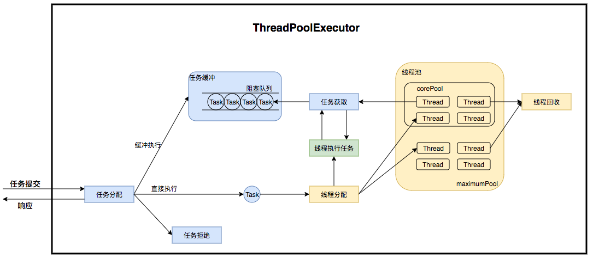
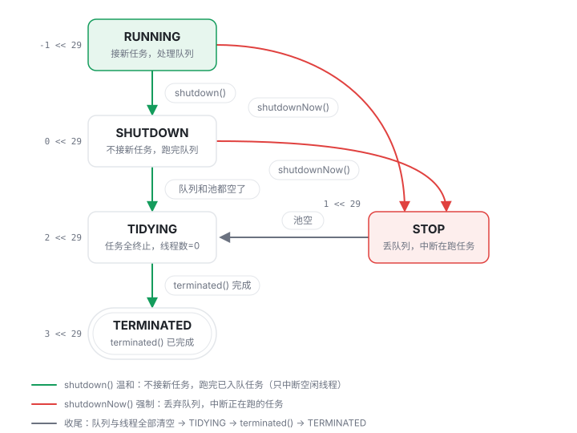
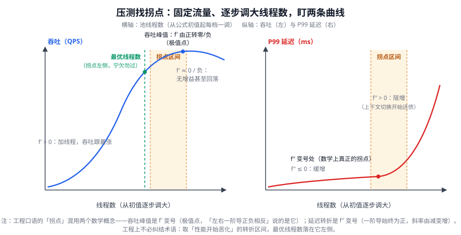
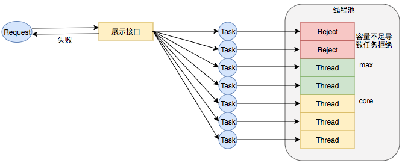
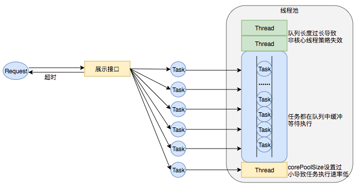
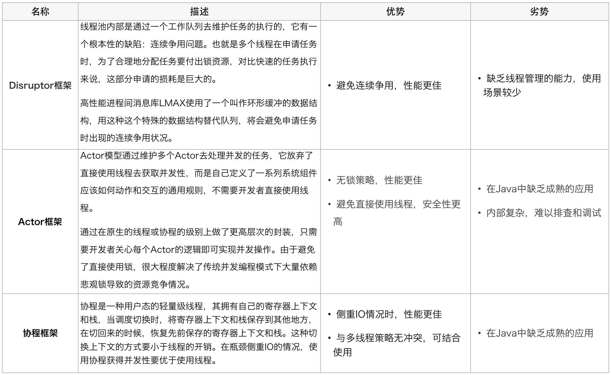
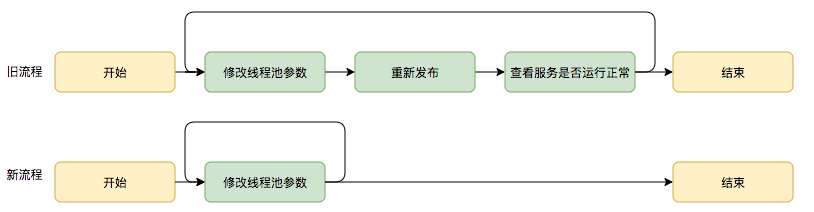
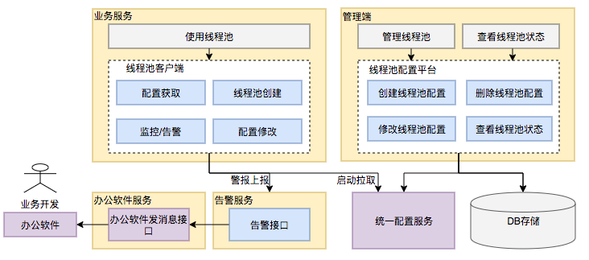
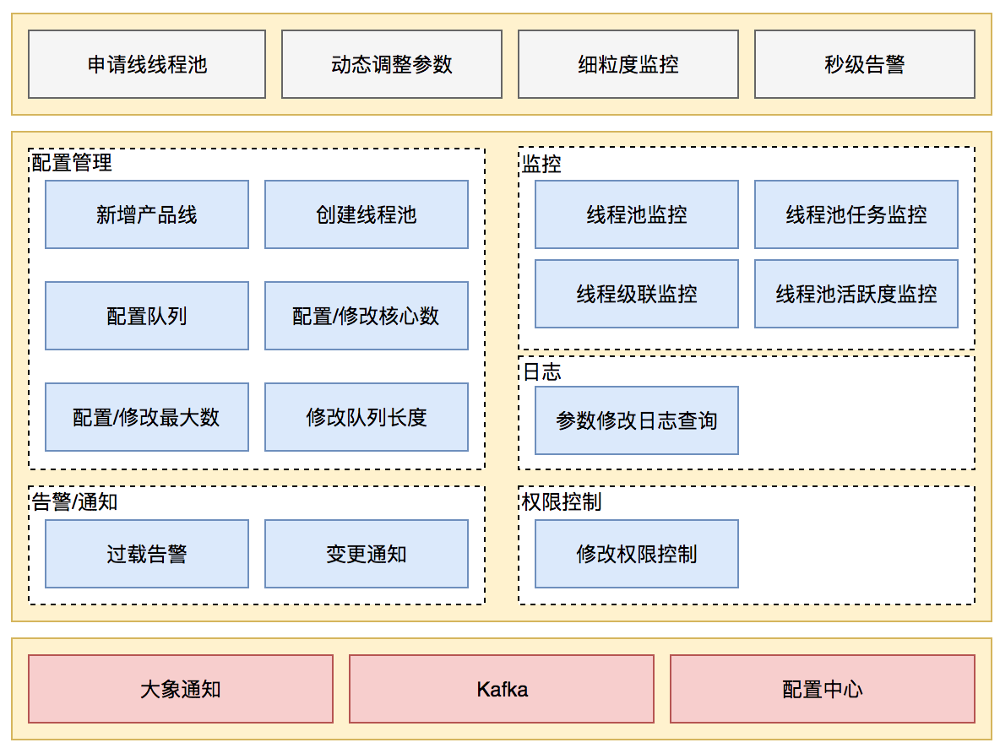
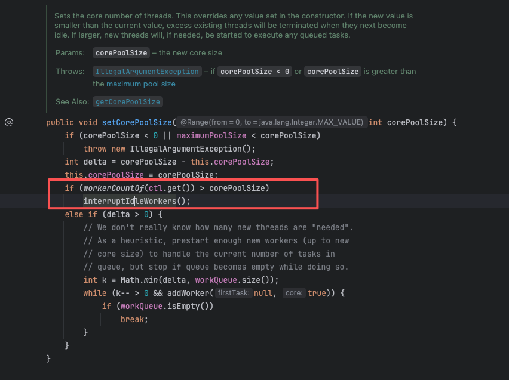

# 线程池方方面面

## 1、为什么需要线程池？

### 1.1 问题引出

在《Java多线程创建原理》一篇中，已经指出“线程创建和销毁的开销”是代价高的，可以想象下有一个Web服务器，每收到一个请求就`new Thread(task).start()`。
若其QPS达到1000，会发生什么？大致是：线程创建本身在耗CPU（用户态/内核态的切换）、线程总量不可控、对线程的状态未可知。再换一个角度想，我们想要充分利用线程资源，
就应该让线程的时间都尽可能的来执行任务，而不是去做其他事情——比如说：创建完了就销毁，但是下一个请求过来我又去创建。

### 1.2 解决方案 —— 池化技术

线程池复用已创建的线程来执行不断到来的任务，从而避免每个任务都付出线程创建/销毁的开销，并让线程总数受控于预设定的上限。

> An ExecutorService that executes each submitted task using one of possibly several pooled threads, normally configured using Executors factory methods.
> ExecutorService 使用多个线程池中的一个来执行每个提交的任务，通常使用 Executor 工厂方法进行配置。
> Thread pools address two different problems: they usually provide improved performance when executing large numbers of asynchronous tasks, due to reduced per-task invocation overhead, and they provide a means of bounding and managing the resources, including threads, consumed when executing a collection of tasks. Each ThreadPoolExecutor also maintains some basic statistics, such as the number of completed tasks.
> 线程池解决了两个不同的问题：由于减少了每个任务的调用开销，它们通常在执行大量异步任务时能提供更高的性能；它们还提供了一种方法来限制和管理执行一系列任务时消耗的资源，包括线程。每个 ThreadPoolExecutor 还维护一些基本统计信息，例如已完成的任务数量。

出处：【官方文档】[ThreadPoolExecutor Javadoc（Java SE 21）](https://docs.oracle.com/en/java/javase/21/docs/api/java.base/java/util/concurrent/ThreadPoolExecutor.html)

Java中线程池特指 `ThreadPoolExecutor`类。运行机制图：


### 1.3 线程池解决了哪些问题？

#### 1.3.1 裸线程模式的三个问题

**问题一：创建和销毁不是免费的。** 每次 `new Thread()` 都要向操作系统申请一个线程（内核栈、调度登记），任务做完线程就销毁，下次再建。任务来得越密，这笔重复开销越大。Goetz（后来《Java Concurrency in Practice》的作者、JSR-166 参与者）在 2002 年的 IBM 文章中即以"服务器为每个请求建线程的开销"作为引入线程池的动机（【作者言论，转述】原文见 [Java theory and practice: Thread pools and work queues（IBM developerWorks 原文存档）](https://web.archive.org/web/20190702145540/https://www.ibm.com/developerworks/library/j-jtp0730/index.html)；

**问题二：线程数没有上限。** 裸线程模式下线程数 = 并发任务数。1000 QPS × 每任务 50ms，稳态就是约 50 个并发线程，看起来还行；但只要任务变慢（慢 SQL、下游超时），延迟升到 5 秒，稳态并发立刻变成 5000 个线程——每个线程默认栈 1MB（-Xss 默认值，64 位 HotSpot），仅栈内存就是约 5GB，再加上调度开销，进程先于业务崩溃。【经验/推断——数量级基于 HotSpot 默认栈大小推算，具体行为请自行验证】

**问题三：没有管理面。** 业务代码无法回答"现在有多少个线程在跑？队列里压了多少任务？负载高峰时该限流还是扩容？"——因为这些信息没有集中的持有者，没有“中间人”。

#### 1.3.2 池化如何解决这三个问题

| 裸线程的问题  | 线程池的对应机制                               |
| ------- | -------------------------------------- |
| 创建/销毁开销 | 线程建好后不销毁，执行完任务回到池里等下一个任务（复用）           |
| 数量失控    | 上限由 `maximumPoolSize` 预先钉死，超出的任务排队或被拒绝 |
| 无法管理    | 池是集中管理者：提供线程数、队列长度、活跃度等查询，以及关闭流程       |

设计动机原出处：JSR-166（Doug Lea 主持的 java.util.concurrent 规范）。Doug Lea 对 util.concurrent 的总体设计说明（含 Executor 一节的动机陈述）见其个人页面【作者言论】[util.concurrent documentation（oswego）](http://gee.cs.oswego.edu/dl/classes/EDU/oswego/cs/dl/util/concurrent/intro.html)。

#### 1.3.3 具体的线程池是什么

```
Executor                —— 只有一个方法 execute(Runnable)：体现了“将任务提交和任务执行进行解耦”的思想
   ↑ 继承
ExecutorService         —— 加生命周期（shutdown）+ 可取结果的提交（submit）
   ↑ 骨架实现
AbstractExecutorService —— 抽象类：基于 execute() 搭出 submit/invokeAll 等方法
   ↑ 继承
ThreadPoolExecutor      —— 真正的池：七参数、队列、拒绝策略（后续章节）
```

**为什么中间要垫一个抽象类？
\*\*** **`AbstractExecutorService`** **的分工（【官方文档】[AbstractExecutorService Javadoc](https://docs.oracle.com/en/java/javase/21/docs/api/java.base/java/util/concurrent/AbstractExecutorService.html)）：它自己**不执行任何任务\*\*，只负责把 `submit`/`invokeAll`/`invokeAny` 这些"带结果的提交"翻译成对 `execute()` 的调用（翻译产物是 `FutureTask`，内部把结果和异常都存进 Future）。于是 `ThreadPoolExecutor` 只需专注实现 `execute()` 本身和池的管理——**"提交的语法"与"执行的机制"在源码层面就是解耦的**。这也埋下第 5 章的一个伏笔：正因为 `submit` 走的是 Future 这条翻译通道，任务抛出的异常不会当场冒出来，而是被存进 Future——**submit 会吞异常**。

**Executor 接口**的 Javadoc 开宗明义（【官方文档】[Executor Javadoc](https://docs.oracle.com/en/java/javase/21/docs/api/java.base/java/util/concurrent/Executor.html)）：

> "Executes the given task at some time in the future... The Executor interface does not strictly require that execution be asynchronous."
> （在将来的某个时刻执行给定任务……Executor 接口并不严格要求异步执行。）

这句话是理解整个框架的钥匙：**Executor 只承诺"会执行"，不承诺"怎么执行、什么时候执行"**。同一个 `executor.execute(task)` 调用，背后可以是新起线程、调用者线程、池中线程、甚至串行执行。任务提交方写一次代码，执行策略随便换——"任务提交与执行解耦"。

#### 1.3.4 解耦的行为验证

##### 1.3.4.1 同一个接口，两种执行策略的差异

Executor 的 Javadoc 自带 `DirectExecutor` 和 `ThreadPerTaskExecutor` 两个策略示例（【官方文档】[Executor Javadoc](https://docs.oracle.com/en/java/javase/21/docs/api/java.base/java/util/concurrent/Executor.html)）。以下把它改造成**完整可运行**的验证程序，带 main 和 CountDownLatch 等同步工具：

```java
import java.util.concurrent.*;

public class ExecutorDecoupleDemo {
    // 策略一：裸线程模式
    static class ThreadPerTaskExecutor implements Executor {
        @Override 
        public void execute(Runnable r) { new Thread(r).start(); }
    }
    // 策略二：调用者线程直接执行（零新线程、完全同步）
    static class DirectExecutor implements Executor {
        @Override 
        public void execute(Runnable r) { r.run(); }
    }

    public static void main(String[] args) throws Exception {
        // —— DirectExecutor 验证：提交 10 个任务，0 个新线程 ——
        System.out.println("=== DirectExecutor（策略二） ===");
        Executor direct = new DirectExecutor();
        for (int i = 1; i <= 5; i++) {
            final int id = i;
            direct.execute(() -> System.out.println("  task-" + id + " runs in: "
                    + Thread.currentThread().getName()));
        }
        System.out.println("  → 新线程数 = 0，全部在 main 线程同步执行\n");

        // —— ThreadPerTaskExecutor 验证：提交 5 个任务，5 个新线程 ——
        System.out.println("=== ThreadPerTaskExecutor（策略一） ===");
        CountDownLatch latch = new CountDownLatch(5);
        Executor tpt = new ThreadPerTaskExecutor();
        for (int i = 1; i <= 5; i++) {
            tpt.execute(() -> {
                System.out.println("  task-X runs in: " + Thread.currentThread().getName());
                latch.countDown();
            });
        }
        latch.await(); // 等所有线程结束再看最终输出
        System.out.println("  → 新线程数 = 5，每个任务一个线程（裸线程模式）");
    }
}
```

输出结果

```text
=== DirectExecutor（策略二） ===
  task-1 runs in: main
  task-2 runs in: main
  task-3 runs in: main
  task-4 runs in: main
  task-5 runs in: main
  → 新线程数 = 0，全部在 main 线程同步执行

=== ThreadPerTaskExecutor（策略一） ===
  task-X runs in: Thread-0
  task-X runs in: Thread-2
  task-X runs in: Thread-1
  task-X runs in: Thread-3
  task-X runs in: Thread-4
  → 新线程数 = 5，每个任务一个线程（裸线程模式）
```

**输出解读**：提交方代码都是 `executor.execute(task)`，但 DirectExecutor 让调用者线程自己跑（零异步），ThreadPerTaskExecutor 让每个任务一个新线程（裸线程模式）——**提交代码不写第二次，执行策略随便换**，这就是解耦的物理含义。注意第二段的 `task-X` 顺序是乱序、线程名也不连续，这正说明它们在并行跑；第一段严格按 1→5 顺序且全是 `main`，说明是同步串行。

##### 1.3.4.2 线程池跑模拟网络服务

ThreadPoolExecutor Javadoc 的 `NetworkService` 示例（【官方文档】[ThreadPoolExecutor Javadoc](https://docs.oracle.com/en/java/javase/21/docs/api/java.base/java/util/concurrent/ThreadPoolExecutor.html)）包含真实 `ServerSocket` 监听，无法直接跑。以下改造成**离线模拟版**：用循环计数模拟 accept 到连接，省去网络 IO：

```java
import java.util.concurrent.*;
import java.util.concurrent.atomic.AtomicInteger;

public class SimulatedNetworkService {
    private final ExecutorService pool;
    private final AtomicInteger accepted = new AtomicInteger(0);

    public SimulatedNetworkService(int poolSize) {
        // 注意：这只是演示结构。生产中不应用 newFixedThreadPool，见第 4 章。
        this.pool = Executors.newFixedThreadPool(poolSize);
    }

    // 模拟"主线程 accept → 提交 → 立即回到 accept"的解耦结构
    public void startSimulation(int totalRequests, long taskCostMs) {
        System.out.println("=== 模拟网络服务：提交者 vs 执行者解耦 ===");
        for (int i = 0; i < totalRequests; i++) {
            accepted.incrementAndGet();
            final int reqId = i + 1;
            pool.execute(() -> {
                // 模拟连接处理耗时
                try { Thread.sleep(taskCostMs); } catch (InterruptedException e) {
                    Thread.currentThread().interrupt();
                }
                System.out.println("  处理请求-" + reqId + "，线程="
                        + Thread.currentThread().getName());
            });
        }
        System.out.println("  主线程提交完 " + totalRequests + " 个请求，"
                + "已接受计数=" + accepted.get() + "（立即返回，不等待执行）");
    }

    public void shutdown() throws Exception {
        pool.shutdown();
        pool.awaitTermination(5, TimeUnit.SECONDS);
    }

    public static void main(String[] args) throws Exception {
        SimulatedNetworkService svc = new SimulatedNetworkService(2);
        svc.startSimulation(4, 200); // 4 个请求，每个处理 200ms
        svc.shutdown();
    }
}
```

输出结果：

```text
=== 模拟网络服务：提交者 vs 执行者解耦 ===
  主线程提交完 4 个请求，已接受计数=4（立即返回，不等待执行）
  处理请求-1，线程=pool-1-thread-1
  处理请求-2，线程=pool-1-thread-2
  处理请求-3，线程=pool-1-thread-1
  处理请求-4，线程=pool-1-thread-2
```

输出解读：

1. 主线程的 `for` 循环瞬间跑完 4 次提交——**不等待任何任务执行完**（"提交"与"执行"解耦）。
2. 2 个工作线程复用处理 4 个请求（线程池的"复用"），不会为每个请求建新线程。处理任务的线程数也不会超过 2

#### 1.3.5 一次任务提交的旅程

说明"提交之后任务在三个位置之间流转"的全景：

```text
        提交方（业务线程）
              │ executor.execute(task)
              ▼
   ┌─────────────────────────┐
   │      ThreadPoolExecutor  │
   │                          │
   │  工作队列 workQueue       │ ←── 任务排队处（等待被执行）
   │  （第5章细讲）            │
   │                          │
   │  Worker#1  Worker#2 ... │ ←── 工作线程（复用：做完一个任务
   │   线程     线程           │     回到队列取下一个）
   └─────────────────────────┘
```

Worker 是 ThreadPoolExecutor 的内部类，一个 Worker 持有一个线程——后续章节沿用"工作线程"这个名字。

“池”相当于中间人：**任务从提交到执行必须经过"池"这个中间人，所以池才有机会做排队、限流、复用**——裸线程没有中间人，所以什么管控都没有。

#### 1.3.6 场景验证

某线上服务用裸线程模式处理请求（每收到一个请求就 `new Thread(task).start()`，任务做完线程销毁，见 3.1 节）。平时流量平稳：每秒稳定到达 200 个请求，每个任务平均耗时 10ms。
某天数据库出现慢查询，任务平均耗时恶化到 2s——但流量没变，服务也还没崩。
**问：恶化前后，任意时刻系统里大约同时存活多少个线程？**（提示：稳态下，同一时刻的存活线程数只取决于两件事——每秒新起多少个线程、每个线程活多久）

稳态并发 ≈ QPS × 平均耗时（Little's Law 的直觉形式）。10ms 时约 200 × 0.01 = 2 个线程；2s 时约 200 × 2 = 400 个线程。线程数膨胀 200 倍而业务没涨——**数量失控**

验证代码（模拟 Little's Law，用睡眠放大延迟观察线程数变化）：

```java
import java.util.concurrent.CountDownLatch;
import java.util.concurrent.atomic.AtomicInteger;

public class Q2Verify {
    public static void main(String[] args) throws Exception {
        int qps = 200;
        int durationMs = 10_000; // 模拟 10 秒的请求窗口

        // 场景 A：任务耗时 10ms → 稳态线程 ≈ 2
        runScenario("10ms 任务", qps, 10, durationMs);
        // 场景 B：任务耗时 2000ms → 稳态线程 ≈ 400
        runScenario("2s 任务", qps, 2000, durationMs);
    }

    static void runScenario(String name, int qps, int taskMs, int windowMs) throws Exception {
        AtomicInteger maxConcurrent = new AtomicInteger(0);
        AtomicInteger current = new AtomicInteger(0);
        int totalTasks = qps * windowMs / 1000;
        CountDownLatch done = new CountDownLatch(totalTasks);

        System.out.println("\n=== " + name + " ===");
        // 均匀到达：按绝对时间点提交（第 t 个任务应在 start + t*interval 时刻到达），
        // 用目标时刻而非固定 sleep，避免 sleep 精度损失累积成到达率漂移
        long intervalNs = 1_000_000_000L / qps;
        long start = System.nanoTime();
        for (int t = 0; t < totalTasks; t++) {
            new Thread(() -> {
                int c = current.incrementAndGet();
                maxConcurrent.accumulateAndGet(c, Math::max);
                try { Thread.sleep(taskMs); } catch (InterruptedException e) {
                    Thread.currentThread().interrupt();
                }
                current.decrementAndGet();
                done.countDown();
            }).start();
            long target = start + (t + 1) * intervalNs;
            long sleepNs = target - System.nanoTime();
            if (sleepNs > 0) Thread.sleep(sleepNs / 1_000_000, (int) (sleepNs % 1_000_000));
        }
        done.await();
        System.out.println("  峰值线程数 ≈ " + maxConcurrent.get()
                + "（按 Little's Law: " + qps + " × " + (taskMs / 1000.0) + " ≈ "
                + String.format("%.1f", qps * taskMs / 1000.0) + "）");
    }
}
```

输出结果：

```text
=== 10ms 任务 ===
  峰值线程数 ≈ 3（按 Little's Law: 200 × 0.01 ≈ 2.0）

=== 2s 任务 ===
  峰值线程数 ≈ 403（按 Little's Law: 200 × 2.0 ≈ 400.0）
```

上面的实验验证了裸线程会随延迟膨胀；现在把完全相同的负载（QPS=200、10 秒窗口、均匀到达、同样的 10ms / 2s 两种耗时）交给一个固定 3 线程的池——两个版本唯一的变量就是执行策略。 以下是 对照组：**同一份负载交给线程池**。

```java
import java.util.concurrent.*;
import java.util.concurrent.atomic.AtomicInteger;

public class Q2PoolVerify {
    public static void main(String[] args) throws Exception {
        int qps = 200;
        int durationMs = 10_000; // 与 Q2Verify 完全相同的负载参数

        // 场景 A：任务耗时 10ms
        runScenario("10ms 任务", qps, 10, durationMs);
        // 场景 B：任务耗时 2000ms
        runScenario("2s 任务", qps, 2000, durationMs);
    }

    static void runScenario(String name, int qps, int taskMs, int windowMs) throws Exception {
        // 与裸线程版唯一的差别：任务交给固定 3 线程的池，而不是 new Thread
        ThreadPoolExecutor pool = new ThreadPoolExecutor(3, 3, 0, TimeUnit.SECONDS,
                new LinkedBlockingQueue<>());
        AtomicInteger maxConcurrent = new AtomicInteger(0);
        AtomicInteger current = new AtomicInteger(0);
        int totalTasks = qps * windowMs / 1000;

        System.out.println("\n=== " + name + " ===");
        long intervalNs = 1_000_000_000L / qps;
        long start = System.nanoTime();
        for (int t = 0; t < totalTasks; t++) {
            pool.execute(() -> {
                int c = current.incrementAndGet();
                maxConcurrent.accumulateAndGet(c, Math::max);
                try { Thread.sleep(taskMs); } catch (InterruptedException e) {
                    Thread.currentThread().interrupt();
                }
                current.decrementAndGet();
            });
            long target = start + (t + 1) * intervalNs;
            long sleepNs = target - System.nanoTime();
            if (sleepNs > 0) Thread.sleep(sleepNs / 1_000_000, (int) (sleepNs % 1_000_000));
        }
        // 提交窗口结束，读池的管理信息（裸线程模式下没有这些数据可查）
        System.out.println("  峰值并发执行线程 = " + maxConcurrent.get()
                + "，poolSize = " + pool.getPoolSize()
                + "，queueSize = " + pool.getQueue().size()
                + "，completed = " + pool.getCompletedTaskCount());
        // 场景 B 的积压按 3 线程 × 2s/个 的消化速度要 20+ 分钟才能跑完，演示直接中断收尾
        pool.shutdownNow();
    }
}
```

输出结果：

```text

=== 10ms 任务 ===
  峰值并发执行线程 = 3，poolSize = 3，queueSize = 0，completed = 1998

=== 2s 任务 ===
  峰值并发执行线程 = 3，poolSize = 3，queueSize = 1985，completed = 12
```

**对照解读**（左右两列来自两次实验，负载完全相同）：

| <br />        | 裸线程版（Q2Verify）               | 线程池版（Q2PoolVerify）                         |
| ------------- | ---------------------------- | ------------------------------------------ |
| 场景 A（10ms）    | 峰值 ≈ 3 个线程                   | 峰值 3，队列 0，1998/2000 完成                     |
| 场景 B（2s）      | 峰值 ≈ **403 个线程**（栈内存约 400MB） | 峰值仍 **3**，积压排队 1985 个                      |
| 延迟恶化 200 倍时   | 线程数跟着膨胀 200 倍（**数量失控**）      | 线程数纹丝不动，压力转移到队列（**缓冲**）                    |
| 事后可否问"现在什么状态" | 不能（**没有直接指标观测**）             | 能：poolSize / queueSize / completed 都是现成的方法 |

## 2 七个核心参数

### 2.1 问题引入

第 1 章对照组的池容量是构造时写死的 3——按 Little's Law 对着当时的流量刚好够用。但真实流量不是常数：白天高峰可能要 30 个线程才够消化，深夜可能一个任务都没有。容量写死成 3，高峰就排队积压；写死成 30，深夜就养着一池闲线程。**一个数字不够，池需要一组策略：常备几个线程？最多扩到几个？多余的闲多久回收？装不下的任务放哪？**

### 2.2 解决方案

Java给出的方案全部蕴含在 `ThreadPoolExecutor` 构造器的七个参数里，这七个参数利于更好的管理线程资源。

决策顺序：

1. 线程数 < corePoolSize 就直接建核心线程（即使有空闲线程）—— （笔者推论：预热思想）
2. 否则入队；
3. 队列满了且线程数 < maximumPoolSize 才建非核心线程；
4. 线程数也到顶了就执行拒绝策略

### 2.3 七个参数分析

```java
public ThreadPoolExecutor(int corePoolSize,
                          int maximumPoolSize,
                          long keepAliveTime,
                          TimeUnit unit,
                          BlockingQueue<Runnable> workQueue,
                          ThreadFactory threadFactory,
                          RejectedExecutionHandler handler)
```

| # | 参数                | 一句话语义                             | 默认/常见取法             |
| - | ----------------- | --------------------------------- | ------------------- |
| 1 | `corePoolSize`    | 池愿意保持的最少线程数；低于它时新任务直接建线程，**不看空闲** | 按 CPU 核数或压测定（第 7 章） |
| 2 | `maximumPoolSize` | 线程数硬上限；超出即进入拒绝判定                  | 过载上限的"保险丝"          |
| 3 | `keepAliveTime`   | 线程数 > core 时，多余线程空闲多久后被回收         | 60s 常见              |
| 4 | `unit`            | 参数 3 的时间单位                        | 秒、毫秒等               |
| 5 | `workQueue`       | 存放待执行任务的阻塞队列                      | 有界队列（第 5 章）         |
| 6 | `threadFactory`   | 建线程的工厂，定制名字、守护标记                  | 命名工厂（第 4 章）         |
| 7 | `handler`         | 拒绝策略                              | 显式选择（第 5 章）         |

**workQueue 常见选择速览**（选型逻辑详见第 5 章）：

| 队列                      | 容量             | 出队顺序   | 一句话定位                                         |
| ----------------------- | -------------- | ------ | --------------------------------------------- |
| `SynchronousQueue`      | 0（不存任务）        | ——     | 直接交接：恰好有空闲线程在等就交接，否则视同"队列满"                   |
| `ArrayBlockingQueue(n)` | 有界             | FIFO   | 生产服务的默认选择                                     |
| `LinkedBlockingQueue`   | 默认无界（传 n 可变有界） | FIFO   | `newFixedThreadPool` 的坑就在默认无界（第 4 章）          |
| `PriorityBlockingQueue` | 无界             | 按优先级   | 任务有轻重之别时用；注意仍是无界                              |
| `DelayQueue`            | 无界             | 到期才能出队 | 延时任务场景；`ScheduledThreadPoolExecutor` 内部用它的定制版 |

无界队列永远不会满 → 非核心线程永远不会被建（max线程数失效）；`SynchronousQueue` 视同"永远满" → 一超 core 就扩线程直到 max（`newCachedThreadPool` 就是 core=0 + `SynchronousQueue`）。

#### 2.3.1 keepAliveTime 与回收

Javadoc（同上页面，Keep-alive times 节）：

> "If the pool currently has more than corePoolSize threads, excess threads will be terminated if they have been idle for more than the keepAliveTime."
> （若池中线程多于 corePoolSize，多余的线程空闲超过 keepAliveTime 后将被终止。）

两条边界规则（同节文档承诺）：

- **回收只发生在"超出核心数"的线程上**；核心线程默认一直活着等任务（哪怕闲着）。
- 例外方法：`allowCoreThreadTimeOut(true)` 让核心线程也参与超时回收

**设计动机：核心线程是"常备军"（避免负载回升时再付建线程成本），非核心线程是"临时工"（高峰扩出来的，峰过就散）。**"常备军/临时工"这个比喻是转述，但它背后的权衡在前身库的原始设计文档里有明文表达——Doug Lea 的 util.concurrent `PooledExecutor`（JSR-166 之前身，`minimumPoolSize`/`maximumPoolSize` 就是 core/max 的原名）类文档 Keep-alive time 节："threads are simply allowed to terminate and thus be GCable if they have been idle for the given keep-alive time. The value of this parameter represents a trade-off between GCability and construction time."（空闲线程允许终止以便被 GC，该参数是"可回收性"与"重建开销"的权衡）；同节还写道 "To establish worker threads permanently, use a negative argument to setKeepAliveTime"（永久线程 = 负 keepAlive，即"常备"的原形）。出处：【作者言论】[PooledExecutor 文档（oswego）](https://gee.cs.oswego.edu/dl/classes/EDU/oswego/cs/dl/util/concurrent/PooledExecutor.html)。

#### 2.3.2 threadFactory

池创建的每一个线程都过这个工厂。不定制时用 `Executors.defaultThreadFactory()`，线程名是 `pool-N-thread-M`——**出事故看线程 dump 时，你分不清哪个池是自己业务的**。命名实践见第 4 章。

#### 2.3.3 handler

"池满且队列满"是正常运营状态（就是过载），总要有人决定：抛异常？让提交者自己跑？丢弃？这是业务决策不是技术决策，所以 JDK 把它做成可插拔参数。四个内置实现第 5 章展开。

### 2.4 验证“队列满后建非核心线程”

一个很天然的想法是：当线程不够用的时候再将任务进行排队（插入到队列中）。 但事实顺序是**核心线程满后，新任务先排队；队列也满了，才建非核心线程**

```java
import java.util.concurrent.*;

public class CoreMaxQueueDemo {
    public static void main(String[] args) throws Exception {
        // 配置：core=2, max=4, queue=2（有界）
        ThreadPoolExecutor pool = new ThreadPoolExecutor(
                2, 4, 60, TimeUnit.SECONDS,
                new ArrayBlockingQueue<>(2),
                r -> new Thread(r, "demo-pool"),
                new ThreadPoolExecutor.AbortPolicy());

        // 每个任务卡 3 秒：让"建线程 or 入队"的中间态可观察
        Runnable slow = () -> {
            try { Thread.sleep(3000); } catch (InterruptedException e) {
                Thread.currentThread().interrupt();
            }
        };

        // 观察线程：每秒打印 poolSize 和 queueSize
        Thread observer = new Thread(() -> {
            for (int i = 0; i < 6; i++) {
                System.out.printf("[t=%ds] poolSize=%d, queueSize=%d%n",
                        i, pool.getPoolSize(), pool.getQueue().size());
                try { Thread.sleep(1000); } catch (InterruptedException ignored) {}
            }
        }, "observer");
        observer.setDaemon(true);
        observer.start();

        // 提交 7 个任务，每个配一个注释说明它应该去哪
        // 任务 1-2: < core=2 → 建核心线程
        // 任务 3-4: 不建线程 → 入队（队列 1/2 → 2/2）
        // 任务 5-6: 队列满 + < max=4 → 建非核心线程（3 → 4）
        // 任务 7: 队列满 + 线程数 = max → 拒绝（AbortPolicy）
        for (int i = 1; i <= 7; i++) {
            try {
                pool.execute(slow);
                System.out.println("提交任务 " + i + " → 成功");
            } catch (RejectedExecutionException e) {
                System.out.println("提交任务 " + i + " → 被拒绝 (RejectedExecutionException)");
            }
        }

        Thread.sleep(5000); // 等观察窗口
        pool.shutdown();
        pool.awaitTermination(3, TimeUnit.SECONDS);
    }
}
```

输出结果：

```text
[t=0s] poolSize=1, queueSize=0
提交任务 1 → 成功
提交任务 2 → 成功
提交任务 3 → 成功
提交任务 4 → 成功
提交任务 5 → 成功
提交任务 6 → 成功
提交任务 7 → 被拒绝 (RejectedExecutionException)
[t=1s] poolSize=4, queueSize=2     ← 关键：4 线程 = max，2 任务在队列
[t=2s] poolSize=4, queueSize=2
[t=3s] poolSize=4, queueSize=0     ← 队列里的 2 个被消费完毕
[t=4s] poolSize=4, queueSize=0
[t=5s] poolSize=4, queueSize=0
```

### 2.5 一次提交的决策树

```text
                 executor.execute(task)
                        │
                 线程数 < corePoolSize?
                  │yes          │no
                  ▼             ▼
            建核心线程      workQueue.offer(task)
                  │          │成功           │失败（队列满）
                  │          ▼              ▼
                  │      任务排队等待    线程数 < maximumPoolSize?
                  │                          │yes        │no
                  │                          ▼           ▼
                  │                    建非核心线程   handler.rejected
                  ▼                          │        （第5章）
              执行任务                      ▼
                                      执行任务
```

线程池中“创建线程“的核心结论：
1、核心线程看“线程数够不够”
2、非核心线程看“队列满不满” —— “先排队、后扩编”

### 2.6 “坑”总结

- **坑 1：以为任务多就会开到 max。** `new ThreadPoolExecutor(2, 4, ..., new LinkedBlockingQueue<>())`——无参 LinkedBlockingQueue 容量近乎无限，队列**永远不满**，线程数**永远停在 2**。maximumPoolSize 形同虚设。这是第 4 章的入口。
- **坑 2：core > max 的配置。** 构造器会抛 `IllegalArgumentException`（Javadoc @throws 明文）。
- **坑 3：keepAliveTime 对核心线程默认无效**（见 3.1），夜里"线程没回收"不是泄漏。

### 2.7 场景验证

1. core=5, max=10, queue=100。瞬间涌入 50 个耗时任务：线程数到多少？队列里压了几个？
   答：没有触达queue=100的上限，线程数会在5，队列堆积45个任务数
2. 同一配置，队列换成 `new SynchronousQueue<>()`（容量 0），同样 50 个任务：线程数到多少？什么发生剩余 40 个？
3. 为什么 `allowCoreThreadTimeOut(true)` 必须满足 core ≤ max 且 keepAliveTime > 0 才有意义？

## 3 任务提交流程与生命周期（源码视角）

### 3.1 问题：如何保证线程池的“决策链”安全？

第 2 节的决策树是 Javadoc 的行为承诺，但这棵树在源码里不是一堆 `if` 完事——它要**并发安全地**回答"现在有几个线程、池子还活着吗"，还得让"关池"这件事不打断正在跑的任务。

### 3.2 解决方案

> 方案均由javadoc反推

1、线程数和运行状态压缩进一个字段`AtomicInteger ctl` —— 一次CAS就可以改，且并发安全（相较于synchronized更好,因为线程数和线程池状态相对来说变更会频繁些）

2、语义状态机：


### 3.3 代码分析

#### 3.3.1 ctl与五状态

```java
// 以下引用自 ThreadPoolExecutor.java（OpenJDK 8，jdk8u 仓库，略去部分注释）。
// 版本说明：ctl 打包与 execute() 三分支在 JDK 8 与当前 master 逐字一致，本章结论与 JDK 版本无关。
private final AtomicInteger ctl = new AtomicInteger(ctlOf(RUNNING, 0));

private static final int COUNT_BITS = Integer.SIZE - 3;   // 29 位给线程数
private static final int COUNT_MASK = (1 << COUNT_BITS) - 1;

// runState is stored in the high-order bits
private static final int RUNNING    = -1 << COUNT_BITS;   // 高 3 位存状态
private static final int SHUTDOWN   =  0 << COUNT_BITS;
private static final int STOP       =  1 << COUNT_BITS;
private static final int TIDYING    =  2 << COUNT_BITS;
private static final int TERMINATED =  3 << COUNT_BITS;

private static int workerCountOf(int c)  { return c & COUNT_MASK; }
private static int ctlOf(int rs, int wc) { return rs | wc; }
```

- 低 29 位：线程数（上限约 5 亿，实际受 max 限制远小于此）。
- 高 3 位：状态。RUNNING 是负数（-1 左移），所以 `ctl < 0` ⇔ 池活着——一个比较就完成"还在运行吗"的判断。

状态转换表（同注释）：

```
RUNNING   → SHUTDOWN    ：调用 shutdown()
RUNNING/SHUTDOWN → STOP ：调用 shutdownNow()
SHUTDOWN  → TIDYING     ：队列和池都空了
STOP      → TIDYING     ：池空了
TIDYING   → TERMINATED  ：terminated() 钩子执行完毕
```

STOP 用的是 interrupt（试图打断），不是"强杀"——线程什么时候真的停，取决于任务代码怎么响应中断。

#### 3.3.2 execute() 逐行解析

```java
// 以下引用自 ThreadPoolExecutor.java（OpenJDK 8，jdk8u 仓库）
public void execute(Runnable command) {
    if (command == null)
        throw new NullPointerException();
    int c = ctl.get();

    // ── 分支一：少于 core，直接建核心线程（不看队列、不看空闲） ──
    if (workerCountOf(c) < corePoolSize) {
        if (addWorker(command, true))      // true = 这是核心线程
            return;
        c = ctl.get();                     // 建失败（如已到 core），重读状态再走下面
    }

    // ── 分支二：入队 + 二次检查 ──
    if (isRunning(c) && workQueue.offer(command)) {
        int recheck = ctl.get();           // offer 成功 ≠ 高枕无忧
        if (! isRunning(recheck) && remove(command))   // ① 池可能在入队间隙被关了
            reject(command);               //    → 撤回任务并拒绝
        else if (workerCountOf(recheck) == 0)          // ② 极端：唯一线程刚死光
            addWorker(null, false);        //    → 补一个线程来消费队列（null=不捎任务）
    }

    // ── 分支三：队列满，尝试建非核心线程；失败（到 max 或已关）→ 拒绝 ──
    else if (!addWorker(command, false))   // false = 这是非核心线程
        reject(command);
}
```

### 3.4 任务的生命周期

**图前说明**：这是状态图 × 流程的组合图，上半是池的五个状态，下半是一个任务从提交到完成的路径，虚线表示"跨越状态边界的检查"。

```text
  池状态：RUNNING ──shutdown()──▶ SHUTDOWN ──队列空&池空──▶ TIDYING ──▶ TERMINATED
              └────shutdownNow()───────────▶ STOP ────池空────▶ TIDYING

  任务： execute(task)
          │
          ▼
   [ctl: 线程数<core?] ──yes──▶ addWorker(task,core) ──▶ Worker.runWorker 执行
          │no
   [offer 入队] ──失败──▶ [addWorker(task,非core)] ──失败──▶ reject(task)
          │ok                        │ok
          ▼                          ▼
      队列等待 ◀──── getTask() 取走（复用的线程在这里循环）
```

<br />

## 4 Executors 的坑与正确创建

`Executors.newFixedThreadPool(10)` 一行就能建池，为什么《阿里巴巴 Java 开发手册》把它列为强制禁令？

> "【强制】线程池不允许使用 Executors 去创建，而是通过 ThreadPoolExecutor 的方式创建，这样的处理方式让写的同学能更加明确线程池的运行规则，规避资源耗尽的风险。"
> 其"说明"部分点名两个后果：FixedThreadPool/SingleThreadPool 的请求队列长度为 Integer.MAX\_VALUE，可能堆积大量请求导致 OOM；CachedThreadPool 的创建线程数为 Integer.MAX\_VALUE，可能创建大量线程导致 OOM。

四个工厂方法如下：

```java
// 引用自 OpenJDK Executors.java —— “s”结尾，说明这个类是工具类，里面都是静态方法
public static ExecutorService newFixedThreadPool(int nThreads) {
    return new ThreadPoolExecutor(nThreads, nThreads,
                                  0L, TimeUnit.MILLISECONDS,
                                  new LinkedBlockingQueue<Runnable>());
}

public static ExecutorService newSingleThreadExecutor() {
    return new ThreadPoolExecutor(1, 1,
                                  0L, TimeUnit.MILLISECONDS,
                                  new LinkedBlockingQueue<Runnable>());
}

public static ExecutorService newCachedThreadPool() {
    return new ThreadPoolExecutor(0, Integer.MAX_VALUE,
                                  60L, TimeUnit.SECONDS,
                                  new SynchronousQueue<Runnable>());
}

public static ScheduledExecutorService newScheduledThreadPool(int corePoolSize) {
    return new ScheduledThreadPoolExecutor(corePoolSize);
}
```

逐个分析：
**newFixedThreadPool(n)** — core = max = n，队列 = 无参 LinkedBlockingQueue。无参构造的容量是多少？
LinkedBlockingQueue 文档（【官方文档】[LinkedBlockingQueue Javadoc](https://docs.oracle.com/en/java/javase/21/docs/api/java.base/java/util/concurrent/LinkedBlockingQueue.html)）：

> "Creates a LinkedBlockingQueue with a capacity of Integer.MAX\_VALUE."
> （创建一个容量为 Integer.MAX\_VALUE 的 LinkedBlockingQueue。）

源码结论代入：队列永远不满 → `addWorker(command, false)` 永远不执行 → **线程数永远 = n，多出来的任务全部在队列里排队**。任务的生产速度超过消费速度时，队列无限膨胀，最终 `OutOfMemoryError: Java heap space`。触发路径：**队列积压 → 堆 OOM**。也就是说任务慢一点（慢 SQL、下游抖动）就可以触发OOM。

**newSingleThreadExecutor** — 同上，n=1。队列同样无界，且单线程一旦卡死，队列膨胀得更快。

**newCachedThreadPool** — core=0, max=Integer.MAX\_VALUE（约 21 亿），队列 = SynchronousQueue（容量 0，见第 5 章）。代入规则：队列永远"满"（offer 立即失败）→ 每个任务都尝试建线程 → **来多少并发建多少线程**。突发 10 万并发就是 10 万个线程，每个默认 1MB 栈，触发 `OutOfMemoryError: unable to create new native thread` 或把 OS 打死。触发路径：**线程爆炸 → 栈 OOM / OS 拒绝建线程**。

**newScheduledThreadPool** — 底层是 ScheduledThreadPoolExecutor（ThreadPoolExecutor 子类），队列是DelayedWorkQueue（按触发时间排序的无界队列）——**又是无界队列**，风险同 newFixedThreadPool。

## 4.1 线程池的正确使用

\*\*生产实践中直接 `new ThreadPoolExecutor(...)`，把 7 个参数逐一显式声明，而不是调用 `Executors.newFixedThreadPool`
对照检查清单（每一项都对应一个工厂方法埋掉的雷）：

| 检查项       | 为什么          | 对应的坑                        |
| --------- | ------------ | --------------------------- |
| 队列有明确容量   | 堆 OOM 的唯一防线  | fixed/single 的无界队列          |
| max 有明确上限 | 线程 OOM 的唯一防线 | cached 的 Integer.MAX\_VALUE |
| 线程有业务前缀名  | 线程 dump 可归因  | 默认 pool-N-thread-M          |
| 拒绝策略显式写出  | 过载行为是业务决策    | 默认 Abort 只抛异常，可能无人接         |
| 代码case：   | <br />       | <br />                      |

```java
import java.util.concurrent.*;
import java.util.concurrent.atomic.AtomicInteger;

public class ManualPoolTemplate {
    public static void main(String[] args) throws Exception {
        // ===== 模板本体：7 个参数全部显式声明（生产中可整段抄走） =====
        ThreadPoolExecutor pool = new ThreadPoolExecutor(
                4,                                          // corePoolSize：常态并发
                8,                                          // maximumPoolSize：过载时线程上限
                60L, TimeUnit.SECONDS,                      // 空闲线程回收
                new ArrayBlockingQueue<>(10),               // 有界队列：堆 OOM 的防线
                new ThreadFactory() {                       // 命名工厂：线程 dump 可归因
                    private final AtomicInteger seq = new AtomicInteger(1);
                    @Override public Thread newThread(Runnable r) {
                        Thread t = new Thread(r, "order-pool-" + seq.getAndIncrement());
                        t.setDaemon(false);
                        return t;
                    }
                },
                new ThreadPoolExecutor.CallerRunsPolicy()); // 拒绝策略：过载反压

        // ===== 验证仪表（只为取证，抄模板时可整段删除） =====
        AtomicInteger callerRuns = new AtomicInteger(0); // 被反压、在提交线程里执行的任务数
        Runnable task = () -> {
            // CallerRunsPolicy 的物理形态：被拒绝的任务运行在提交线程（main）里
            if ("main".equals(Thread.currentThread().getName())) callerRuns.incrementAndGet();
            try { Thread.sleep(50); } catch (InterruptedException e) { Thread.currentThread().interrupt(); }
        };

        System.out.println("=== 手动池三层防线验证 ===");
        System.out.println("配置: core=4, max=8, queue=10, handler=CallerRunsPolicy");
        System.out.println("提交 25 个 50ms 任务（池容量 = 8 线程位 + 10 队列位 = 18，超出 7 个）");

        long t0 = System.nanoTime();
        for (int i = 0; i < 25; i++) pool.execute(task);
        long submitMs = (System.nanoTime() - t0) / 1_000_000;

        Thread.sleep(300); // 等池内任务跑完，再读终态

        System.out.println("\n--- 实测结果（结论全部由数字推出，不是打印前写死的） ---");
        System.out.printf("largestPoolSize=%d  → 线程层扩到过 max=8 %s（只有队列满才扩非核心，%d 本身就是队列满的证据）%n",
                pool.getLargestPoolSize(), pool.getLargestPoolSize() == 8 ? "✓" : "✗", pool.getLargestPoolSize());
        System.out.printf("提交线程被迫执行=%d 个 → CallerRuns 反压生效 %s（被拒任务运行在 main 里）%n",
                callerRuns.get(), callerRuns.get() > 0 ? "✓" : "✗");
        System.out.printf("提交耗时=%dms（18 次纯入队 <1ms，耗时几乎全部来自被迫执行）%n", submitMs);
        System.out.printf("对账: 池内完成 %d + 提交线程执行 %d = %d / 25 %s%n",
                pool.getCompletedTaskCount(), callerRuns.get(),
                pool.getCompletedTaskCount() + callerRuns.get(),
                pool.getCompletedTaskCount() + callerRuns.get() == 25 ? "✓" : "✗");

        pool.shutdown();
        pool.awaitTermination(3, TimeUnit.SECONDS);
    }
}
```

输出结果：

```text
=== 手动池三层防线验证 ===
配置: core=4, max=8, queue=10, handler=CallerRunsPolicy
提交 25 个 50ms 任务（池容量 = 8 线程位 + 10 队列位 = 18，超出 7 个）

--- 实测结果（结论全部由数字推出，不是打印前写死的） ---
largestPoolSize=8  → 线程层扩到过 max=8 ✓（第3章规则：只有队列满才扩非核心，8 本身就是队列满的证据）
提交线程被迫执行=2 个 → CallerRuns 反压生效 ✓（被拒任务运行在 main 里）
提交耗时=111ms（18 次纯入队 <1ms，耗时几乎全部来自被迫执行）
对账: 池内完成 23 + 提交线程执行 2 = 25 / 25 ✓
```

## 4.3 工厂方法 vs 手动创建对比

```text
任务洪峰（瞬间 5000 个）
   │
   ├──▶ newFixedThreadPool(10)          ├──▶ 手动池（如上 case）
   │     线程层：10（锁死）               │     线程层：core=4 → 队列满后扩到 max=8
   │     队列层：无界，来多少收多少        │     队列层：10 上限，满了才扩非核心线程
   │     拒绝层：永远走不到               │     拒绝层：8 线程且队列满 → CallerRuns 反压
   │     结果：4990 个任务在队列里          │     结果：洪峰被三层消化，行为可预期
   │           无限堆积 → 堆 OOM           │
```

## 5 队列与拒绝策略

### 5.1 任务太多，池子装不下？

为了避免对任务队列的滥用（无界队列，积压过多容易导致OOM），我们通常会规定任务队列的大小，比方说：`ArrayBlockingQueue<>(500)`，但是若队列满了，后续到来的任务应该怎么做处理呢？
线程池中的三种队列策略：

| 策略   | 代表实现                                               | 行为                           | 适合                                | 代价                                     |
| ---- | -------------------------------------------------- | ---------------------------- | --------------------------------- | -------------------------------------- |
| 直接交接 | `SynchronousQueue`                                 | 容量 0：任务不落队列，直接交给一个等待中的线程     | 高吞吐、任务不能等的场景（如 Netty 连接处理、RPC 收发） | 无缓冲：没有空闲线程就立刻"建线程或拒绝"，流量毛刺直接传导到线程数/拒绝层 |
| 无界队列 | `LinkedBlockingQueue`（无参）                          | 来多少收多少，永远不满                  | 任务量**确定可控**、可接受延迟的场景              | 第 4 章的堆 OOM 路径；max 失效；拒绝策略死代码          |
| 有界队列 | `ArrayBlockingQueue(n)` / `LinkedBlockingQueue(n)` | 满 500 就是 500，第 501 个触发扩线程→拒绝 | **生产服务的默认选择**                     | 必须回答"满了怎么办"——这正是拒绝策略存在的意义              |

队列满之后的策略：

| 策略                    | 行为承诺（官方原文摘译）                                                                                                            | 适用                            | 出处等级                                                                                                                                                               |
| --------------------- | ----------------------------------------------------------------------------------------------------------------------- | ----------------------------- | ------------------------------------------------------------------------------------------------------------------------------------------------------------------ |
| `AbortPolicy`（默认）     | "throws a runtime RejectedExecutionException"——抛运行时异常                                                                   | 需要**立刻感知**过载并让调用方处理的场景        | 【官方文档】[AbortPolicy Javadoc](https://docs.oracle.com/en/java/javase/21/docs/api/java.base/java/util/concurrent/ThreadPoolExecutor.AbortPolicy.html)                 |
| `CallerRunsPolicy`    | "runs the rejected task directly in the calling thread... unless the executor has been shut down"——提交线程自己执行该任务（池已关闭则丢弃） | **降速优先于丢弃**：用提交者变慢形成天然反压      | 【官方文档】[CallerRunsPolicy Javadoc](https://docs.oracle.com/en/java/javase/21/docs/api/java.base/java/util/concurrent/ThreadPoolExecutor.CallerRunsPolicy.html)       |
| `DiscardPolicy`       | "silently discards the rejected task"——静默丢弃                                                                             | 任务可丢（如 metrics 采样点）**且必须配监控** | 【官方文档】[DiscardPolicy Javadoc](https://docs.oracle.com/en/java/javase/21/docs/api/java.base/java/util/concurrent/ThreadPoolExecutor.DiscardPolicy.html)             |
| `DiscardOldestPolicy` | "discards the oldest unhandled request and then retries execute"——丢队头最老任务、重试提交最新的                                       | 偏好**最新数据**（如实时行情推送，旧的没意义）     | 【官方文档】[DiscardOldestPolicy Javadoc](https://docs.oracle.com/en/java/javase/21/docs/api/java.base/java/util/concurrent/ThreadPoolExecutor.DiscardOldestPolicy.html) |

(ps:还有一种非拒绝策略——动态线程池)

```text
                任务（线程满 & 队列满，触发 rejected）
                    │
   ┌────────┬───────┼────────┬──────────────┐
   ▼        ▼       ▼        ▼              
Abort    CallerRuns Discard  DiscardOldest   
   │        │        │        │              
抛异常    提交线程    静默     丢队头最老任务   
RExEx    亲自执行    丢弃     再重试提交自己   
   │        │        │        │              
调用方   上游被动    无日志   队列被"翻新"     
能感知   降速(反压)  ⚠事故   (留最新)         
```

结论：四种册页的本质区别是“过载任务往哪送”——抛给调用方（Abort）、转化为上游减速（CallerRuns）——背/反压、吞掉（Discard）、换成更新鲜的数据（DiscardOldest）。选型问题其实是业务问题：这个信号你的业务最需要哪种形式？

## 6 execute vs submit 异常处理差异

**execute 路径**：异常沿线程栈向上传播，**当前工作线程死亡**（随后按需补新线程——第 3 章引过 Javadoc："If any thread terminates due to a failure during task execution, a new one will take its place"）。行为可见：默认未捕获异常处理器把堆栈打到 stderr。

**submit 路径**：任务被包成 `FutureTask`，异常被**捕获并存进 Future**，`Future.get()` 时以 `ExecutionException` 抛出。依据（【官方文档】[Future Javadoc](https://docs.oracle.com/en/java/javase/21/docs/api/java.base/java/util/concurrent/Future.html)：get 抛出 ExecutionException——"if the computation threw an exception"，即计算抛了异常时）。**不调 get，异常就无声消失**——既不打日志，也不杀线程，看起来"什么都没发生过"。

**WHY DESIGN？**

submit 把 Runnable/Callable 包成 FutureTask，异常被存进 Future 而不是直接抛出来。为什么？【AI给的合理解释】

1. **异步语义的必然结果**：submit 的返回值是 Future——"一个将来会有结果的东西"。如果任务在子线程里抛了异常，这个异常应该"存"在 Future 里，等调用者 `get()` 时再抛。这和 `CompletableFuture.exceptionally()` 的设计一致。
2. **FutureTask 同时跑 Callable 和 Runnable**：FutureTask 内部统一处理两种提交源。如果 Callable 的异常直接抛出来（不走 Future 包装），那 Callable 的返回值（可能是 null）和异常就无法被同一个 API 消费。统一存进 Future → 统一用 get() 取 → 要么拿到结果要么拿到 ExecutionException。
3. **反例：execute 为什么不吞？** execute 返回 void，没有 Future 包装。任务抛出的异常只能沿工作线程的调用栈向上传播 → 最终被 ThreadPoolExecutor 的 Worker 循环捕获 → 默认 UncaughtExceptionHandler 打 stderr → Worker 死亡 → ThreadPoolExecutor 按需补新线程。这条路径"异常可见但线程会死"。

### 6.1 代码实验（execute vs submit）

```java
import java.util.concurrent.*;

public class ExceptionPathDemo {
    public static void main(String[] args) throws Exception {
        ThreadPoolExecutor pool = new ThreadPoolExecutor(1, 1, 0, TimeUnit.SECONDS,
                new ArrayBlockingQueue<>(1));

        // —— 路径 A: execute ——
        // 异常沿栈向上传播，默认 UncaughtExceptionHandler 打到 stderr
        // 当前 Worker 线程死亡，ThreadPoolExecutor 会按需补新线程
        System.out.println("=== 路径 A: execute ===");
        pool.execute(() -> { throw new RuntimeException("boom-A"); });
        Thread.sleep(500);
        System.out.println("poolSize=" + pool.getPoolSize() + "  (预期 1: 死了会补)");
        System.out.println("→ 你应该能在 stderr 看到堆栈：");

        // —— 路径 B: submit + 不接返回值 ——
        // 异常被 FutureTask 捕获存起来，没人 get 就永远躺在那
        // 控制台零输出、线程不受影响
        System.out.println("\n=== 路径 B: submit（不接 Future） ===");
        pool.submit(() -> { throw new RuntimeException("boom-B"); });
        Thread.sleep(500);
        System.out.println("poolSize=" + pool.getPoolSize() + "  (预期 1: 异常不杀线程)");
        System.out.println("→ 控制台一片安静 —— 异常躺在 Future 里没人取");

        // —— 路径 C: submit + get ——
        // Future.get() 时异常被 ExecutionException 包一层抛出
        System.out.println("\n=== 路径 C: submit 后 get ===");
        Future<?> f = pool.submit(() -> { throw new RuntimeException("boom-C"); });
        try {
            f.get();
        } catch (ExecutionException e) {
            System.out.println("捕获到 ExecutionException，cause=" + e.getCause().getMessage());
        }

        pool.shutdown();
    }
}
```

输出结果：

```text
=== 路径 A: execute ===
Exception in thread "pool-1-thread-1" java.lang.RuntimeException: boom-A
	at com.my.thread.pool.ExceptionPathDemo.lambda$main$0(ExceptionPathDemo.java:14)
	at java.base/java.util.concurrent.ThreadPoolExecutor.runWorker(ThreadPoolExecutor.java:1128)
	at java.base/java.util.concurrent.ThreadPoolExecutor$Worker.run(ThreadPoolExecutor.java:628)
	at java.base/java.lang.Thread.run(Thread.java:829)
poolSize=1  (预期 1: 死了会补)
→ 你应该能在 stderr 看到堆栈：

=== 路径 B: submit（不接 Future） ===
poolSize=1  (预期 1: 异常不杀线程)
→ 控制台一片安静 —— 异常躺在 Future 里没人取

=== 路径 C: submit 后 get ===
捕获到 ExecutionException，cause=boom-C
```

\*\*生产上对于这块异常的正确处理：\*\*异步任务用 submit 提交、返回的 Future 被丢弃（`executor.submit(task);` 不接收返回值）——**任务失败零感知**，故障排查时"日志干净得可怕"。修复姿势：要么调 `future.get()` 并处理异常，要么在任务内部 try-catch 全包并打日志，要么用 execute（让异常至少打出来）。

## 7、优雅关闭

### 7.1 问题：进程退出时，池里的任务怎么办？

进程总要退出：发布重启、`kill -15`、容器缩容——退出那一刻，池里往往还有活儿：队列里排着没跑的，线程上正跑着没完的。这些问题应该怎么处理？
再深层次的追问：

1. 排队还没跑的任务，跑完还是丢掉？
2. 正在跑的任务，等它还是中断它？
3. 关闭发起之后，怎么知道池真的关完了？

ps：上面说的"退出"是**协商退出**——SIGTERM、发布重启、容器缩容，平台发了通知、给了收尾期，进程有机会按自己的节奏走。还有一种**暴毙**：`kill -9`、OOM Killer、断电——没有通知期，任何关闭 API 都无从施展，内存队列连同在跑的任务瞬间蒸发。三件套治理的是前者；后者的"任务不丢"只能靠池外的持久化，3.5 节专门交代这个边界。

### 7.2 看下JDK中如何解决

**行为层：**

**shutdown() 让池停止接新任务、把已入队任务执行完；**

**shutdownNow() 试图中断进行中的任务、丢弃排队任务并返回未开始的任务清单；**

**两者都不等待完成——等待是 awaitTermination 的职责，官方给出了三者组合的标准范式。**

**设计层：三件套的形状源自一条根本约束——池只拥有调度权（决定哪些任务开始），不拥有执行权（任务何时结束由任务代码说了算）。所以 shutdown 对排队任务是硬承诺（不派发就能兑现），shutdownNow 对进行中任务只能软承诺（interrupt 是请求不是命令）；而"发起关闭"与"等待完成"拆成两个方法，是 Thread.start()/join() 的同款设计语言——依据与证据链见 3.1。** 官方原文（【官方文档】[ExecutorService Javadoc（JDK 8）](https://docs.oracle.com/javase/8/docs/api/java/util/concurrent/ExecutorService.html)）

| <br />    | shutdown()  | shutdownNow()              | awaitTermination(timeout) |
| --------- | ----------- | -------------------------- | ------------------------- |
| 角色        | 发起**有序**关闭  | 发起**强制**关闭                 | 等待关闭结果                    |
| 新任务       | 拒绝          | 拒绝                         | —（不关它的事）                  |
| 排队存量      | 继续执行完       | 丢弃并**退还清单**                | —                         |
| 进行中任务     | 不干预，自然跑完    | **试图** interrupt           | —                         |
| 是否等待完成    | 否           | 否                          | **是**（带超时，可中断）            |
| 返回值       | void        | `List<Runnable>`（未开始的任务）   | boolean（期限内是否终止）          |
| 承诺强度（设计层） | 硬承诺：不派发即可兑现 | 软承诺 + 补偿：interrupt 是请求不是命令 | 把"无限等"换成"带预算的等"           |

### 7.2.1 设计思考链条

**① 协作式取消是唯一被官方认可的路（历史约束）。** Thread.stop 会在任意两条字节码之间杀死线程——锁被强制释放、数据结构停在半更新状态，不变量直接打碎，所以从 JDK 1.2（1998）起就被标注为 inherently unsafe。到了本章立足的 JDK 8，官方已经关掉一半入口：带参的 stop(Throwable) 一律抛 UnsupportedOperationException（JDK 8 Javadoc 的弃用理由原文是 "could be used to generate exceptions that the target thread was not prepared to handle"）；无参 stop() 仍保留，调用方会收到 ThreadDeath，但弃用警告写得明明白白——它依然能"杀人"，只是杀完现场没人收拾（【官方文档】[Thread Javadoc（JDK 8）](https://docs.oracle.com/javase/8/docs/api/java/lang/Thread.html#stop--)，参见 [Why are Thread.stop, Thread.suspend and Thread.resume Deprecated?](https://docs.oracle.com/javase/8/docs/technotes/guides/concurrency/threadPrimitiveDeprecation.html)）。既然官方认可的唯一取消方式只剩"请求—响应"：interrupt 是请求，任务代码是唯一响应方，shutdownNow 的 Attempts 就不是谦虚措辞，而是物理现实。后续演进方向与此一致：无参 stop() 在 JDK 18 被终期弃用、JDK 20 起无条件抛 UOE，最终版本已彻底移除（【官方发布说明】[JDK-8368370](https://bugs.openjdk.org/browse/JDK-8368370)）——从 JDK 8 起这条路就只朝一个方向走。

**② 调度权与执行权分离。** 池能承诺"哪些任务开始"（派发权在池），承诺不了"任务何时结束"（线程栈在任务代码手里）：

| <br />      | 池说了算（调度权）     | 池说了不算（执行权）             | 对策                          |
| ----------- | ------------- | ---------------------- | --------------------------- |
| shutdown    | 不派发新任务；存量继续派发 | 在跑任务何时结束               | 不干预，自然跑完 → **硬承诺**          |
| shutdownNow | 不派发；存量也不派发    | 在跑任务收到 interrupt 后何时真停 | 请求 + 退还未开始任务 → **软承诺 + 补偿** |

**③ 发起与等待分离（同属【推断】）。** 为什么没有 shutdown(timeout) 一把梭？因为"等待"的属性——可超时、可中断、可多次调用、可多线程同时等——与"关闭"正交。拆开才能组合：先 shutdown 全部 10 个池、再统一 awaitTermination；或发起关闭后先去做别的清理、回头再等。这与 Thread.start()/join()、submit()/get() 是同一设计语言：**异步发起和同步等待，永远是两个方法**。

**④ 状态单调不可逆（【源码注释】）。** 类头注释明说 "The runState monotonically increases over time, but need not hit each state."（runState 随时间单调递增，但不必经过每个状态——【源码注释】[ThreadPoolExecutor.java，OpenJDK 8](https://github.com/openjdk/jdk8u/blob/master/jdk/src/share/classes/java/util/concurrent/ThreadPoolExecutor.java)）。池是一次性的：关了不能复活，要再用就建新池。为什么不设计成可重启？一旦允许"复活"，正在收尾的 Worker、已被唤醒的 awaitTermination 等待者、已退还的任务清单全部要处理回滚——复杂度巨大，而收益趋近于零（建新池几乎免费）。

**⑤ "先礼后兵"不是 Java 的发明（跨系统同构，【经验，社区通识】）。** OS 层管进程早就是这套：systemd 停服务 = 先发 SIGTERM、等 TimeoutStopSec（默认 90s）、超时再 SIGKILL；nginx 也是 `nginx -s quit`（优雅排水）与 `nginx -s stop`（立即停止）并存。区别在于：OS 层有 supervisor 兜底 SIGKILL，而 JVM 内没有强杀手段（见 ①）——于是"等待→升级→认怂"整套搬进库层，变成调用方的义务。这就是 3.3 节官方范式长成那样的深层原因。

### 7.2.2 "interrupt 不是强杀"：停得快不快，任务说了算

shutdownNow 对每个 Worker 线程调 `Thread.interrupt()`。Java 没有安全的"从外面掐死线程"手段（弃用时间线见 3.1 ①），中断只是**设置一个标志位 + 唤醒阻塞**。任务代码的三种反应决定实际停下的速度：

| 任务代码                                            | 中断后行为                  | 关闭速度                        |
| ----------------------------------------------- | ---------------------- | --------------------------- |
| CPU 密集循环、从不检查中断                                 | 无反应，跑完为止               | 关闭"卡住"（awaitTermination 超时） |
| `sleep / wait / 阻塞IO(部分)`                       | 抛 InterruptedException | 快                           |
| 在循环里检查 `Thread.currentThread().isInterrupted()` | 主动收尾退出                 | 快且干净                        |

所以"优雅关闭"有一半责任在**任务代码要配合中断**（catch 到 InterruptedException 后别吞掉，做清理并恢复/退出）。

### 7.2.3 官方标准关闭范式

ThreadPoolExecutor **没有**给出这段范式；给出它的是父接口 **ExecutorService 的 Javadoc（JDK 8）**，在 Usage Examples 一节点明："The following method shuts down an ExecutorService in two phases, first by calling shutdown to reject incoming tasks, and then calling shutdownNow, if necessary, to cancel any lingering tasks."（下面的方法分两个阶段关闭 ExecutorService：先调 shutdown 拒绝新任务，必要时再调 shutdownNow 取消遗留任务——【官方文档】[ExecutorService Javadoc（JDK 8）](https://docs.oracle.com/javase/8/docs/api/java/util/concurrent/ExecutorService.html)）。原文照录：

```java
// 引用自 ExecutorService Javadoc（JDK 8）Usage Examples 一节，原文照录
void shutdownAndAwaitTermination(ExecutorService pool) {
    pool.shutdown(); // Disable new tasks from being submitted
    try {
        // Wait a while for existing tasks to terminate
        if (!pool.awaitTermination(60, TimeUnit.SECONDS)) {
            pool.shutdownNow(); // Cancel currently executing tasks
            // Wait a while for tasks to respond to being cancelled
            if (!pool.awaitTermination(60, TimeUnit.SECONDS))
                System.err.println("Pool did not terminate");
        }
    } catch (InterruptedException ie) {
        // (Re-)Cancel if current thread also interrupted
        pool.shutdownNow();
        // Preserve interrupt status
        Thread.currentThread().interrupt();
    }
}
```

**先礼（shutdown + 等 60s），后兵（shutdownNow + 再等 60s），留遗书（打印未终止）**。最后那个 catch 块的含义：如果"正在等待的线程"自己被别人中断了，也不要干等，直接升级到 shutdownNow，并且把中断标志恢复给上层（这是处理 InterruptedException 的通用正确姿势：要么往上抛，要么恢复标志位）。

这套范式就是官方原话里的"两阶段关闭"（in two phases）——术语不是社区后来发明的，JDK 8 Javadoc 本身就用了这个词【官方文档】；它在 OS 层的更早先例见 3.1 ⑤。

### 7.3 不关池的问题

**坑 A：main 方法退了，JVM 不退。** 停机原因：池的核心线程默认是非守护线程（threadFactory 没设 daemon 时），JVM 要等所有**非守护线程**结束才退出。核心线程还在 `getTask()` 里阻塞等任务 → main 结束了进程还挂着。出路有二：显式关闭（本章主题），或确认用守护线程建池（`t.setDaemon(true)`——代价是 JVM 退出时任务直接被砍，不优雅）。

下面的示例同一个程序跑两次：`worker` 线程分别建成非守护与守护，观察 JVM 是否退出（看门狗只是为了防止示例永远挂死，真实事故里没有它）：

```java
import java.util.concurrent.*;

public class PitfallJvmHang {
    static final long T0 = System.currentTimeMillis();
    static void log(String s) { System.out.printf("[%5dms] %s%n", System.currentTimeMillis() - T0, s); }

    public static void main(String[] args) throws Exception {
        boolean daemon = args.length > 0 && args[0].equals("daemon");

        // 只为演示不挂死用的守护线程；真实事故里没有它，进程就一直挂着
        Thread watchdog = new Thread(() -> {
            try { Thread.sleep(2000); } catch (InterruptedException ignored) { }
            log("watchdog: main 早已返回，2s 后进程仍存活 —— 池的非守护线程在保活");
            System.exit(0);
        }, "watchdog");
        watchdog.setDaemon(true);
        watchdog.start();

        ThreadPoolExecutor pool = new ThreadPoolExecutor(1, 1, 0, TimeUnit.SECONDS,
                new ArrayBlockingQueue<>(10),
                r -> { 
            Thread t = new Thread(r, "worker"); 
            t.setDaemon(daemon);  //跑守护线程的时候，这里不可以注释掉
            return t; });

        pool.execute(() -> log("worker: 跑一个短任务"));
        Thread.sleep(150);
        log("main: 返回（没有调用 shutdown）");
    }
}
```

守护和非手术的输出结果：

```text
$ java PitfallJvmHang            # worker 是非守护线程
[   42ms] worker: 跑一个短任务
[  196ms] main: 返回（没有调用 shutdown）
[ 2039ms] watchdog: main 早已返回，2s 后进程仍存活 —— 池的非守护线程在保活

$ java PitfallJvmHang daemon     # worker 是守护线程
[   38ms] worker: 跑一个短任务
[  193ms] main: 返回（没有调用 shutdown）
（进程随即退出，watchdog 没机会执行）
```

**坑 B：忘了关，靠 finalization 续命。** ThreadPoolExecutor 不再被引用且无线程残留时会自动 shutdown（JDK 8 Javadoc 的 Finalization 节原文："A pool that is no longer referenced in a program AND has no remaining threads will be shutdown automatically."——【官方文档】[ThreadPoolExecutor Javadoc（JDK 8）](https://docs.oracle.com/javase/8/docs/api/java/util/concurrent/ThreadPoolExecutor.html)）。这句话看着像兜底，其实藏着一个**循环前提**：有核心线程时，"无线程残留"不是"很难达成"，而是**结构上不可能达成**——JDK 8 的 Worker 是池的**非静态**内部类（【源码】[jdk8u ThreadPoolExecutor.java](https://github.com/openjdk/jdk8u/blob/master/jdk/src/share/classes/java/util/concurrent/ThreadPoolExecutor.java)），天然持有外部池的引用，只要还有一个空闲 worker 挂在 `getTask()` 上，池就始终"仍被引用"；GC 不会回收它，`finalize()` 不会执行（JDK 8 里它只有一行 `shutdown()`），自动 shutdown 自然轮不到。反过来，一旦允许核心线程超时（`allowCoreThreadTimeOut(true)`），worker 会在 keepAlive 后自己退出——池到这时才满足"无线程残留"，可它已经没有任务可关、没有线程可停。

所以这是一个**触发条件与待解决问题互斥的假兜底**：需要兜底的时刻（线程还在跑、还在队列上等）它不可能触发；它能触发的时刻已经无事可做。真正的结论是——**关闭必须由调用者显式发起，GC 从来不是生命周期管理器**。下面用 `WeakReference` 把这个前提验证给你看：

```java
import java.lang.ref.WeakReference;
import java.util.concurrent.*;

public class PitfallFinalization {
    static final long T0 = System.currentTimeMillis();
    static void log(String s) { System.out.printf("[%5dms] %s%n", System.currentTimeMillis() - T0, s); }

    /** 在独立方法里创建并"丢失"强引用，避免 main 栈帧残留引用干扰 GC。
     *  keepAliveTime 固定 500ms，唯一变量是 allowCoreThreadTimeOut */
    static WeakReference<ThreadPoolExecutor> leak(String label, boolean allowTimeout) throws Exception {
        ThreadPoolExecutor pool = new ThreadPoolExecutor(1, 1,
                500, TimeUnit.MILLISECONDS, new ArrayBlockingQueue<>(10),
                r -> new Thread(r, "worker-" + label));
        pool.allowCoreThreadTimeOut(allowTimeout);
        pool.execute(() -> log("worker-" + label + ": 任务完成，线程留在 getTask() 里等下一个任务"));
        Thread.sleep(200);
        return new WeakReference<>(pool);
    }

    static boolean alive(String name) {
        for (Thread t : Thread.getAllStackTraces().keySet()) {
            if (t.getName().equals(name) && t.isAlive()) return true;
        }
        return false;
    }

    public static void main(String[] args) throws Exception {
        // 同坑 A：只为避免示例挂死；A 组 worker 永不退出，进程本来不会自己结束
        Thread watchdog = new Thread(() -> {
            try { Thread.sleep(3000); } catch (InterruptedException ignored) { }
            log("watchdog: 进程还活着 → worker-A 仍在保活，finalization 轮不到");
            System.exit(0);
        }, "watchdog");
        watchdog.setDaemon(true);
        watchdog.start();

        // 对照 A：核心线程不超时（默认行为）
        WeakReference<ThreadPoolExecutor> refA = leak("A", false);
        System.gc(); Thread.sleep(300);
        log("A(allowCoreThreadTimeOut=false): worker-A 存活=" + alive("worker-A") + ", pool 被回收=" + (refA.get() == null));

        // 对照 B：允许核心线程超时——keepAliveTime 与 A 完全相同，只翻这一个开关
        WeakReference<ThreadPoolExecutor> refB = leak("B", true);
        Thread.sleep(1200);
        System.gc(); Thread.sleep(200); System.gc(); Thread.sleep(200);
        log("B(allowCoreThreadTimeOut=true): worker-B 存活=" + alive("worker-B") + ", pool 被回收=" + (refB.get() == null));
    }
}
```

输出结果：

```text
[   19ms] worker-A: 任务完成，线程留在 getTask() 里等下一个任务
[  531ms] A(allowCoreThreadTimeOut=false): worker-A 存活=true, pool 被回收=false
[  531ms] worker-B: 任务完成，线程留在 getTask() 里等下一个任务
[ 2381ms] B(allowCoreThreadTimeOut=true): worker-B 存活=false, pool 被回收=true
[ 3006ms] watchdog: 进程还活着 → worker-A 仍在保活，finalization 轮不到
```

ps:finalization 保底在后续 JDK 中已被标记为 deprecated for removal

### 7.4 边界：优雅关闭 != 任务不丢

**进程还活着，并且有人通知它"该退了"**：shutdown() 得有线程去调用它，才会停止派发并兑现排队存量；shutdownNow() 得有线程去调用它，interrupt 才会发出去、退还清单才拿得到；awaitTermination() 更是字面意义上的"活着等"。把第 1 节的退出方式摆进来对照，担保范围一目了然：

| 退出方式                           | 通知期  | 三件套能做什么                                       |
| ------------------------------ | ---- | --------------------------------------------- |
| kill -15 / 发布重启 / 容器缩容（按期完成收尾） | 有，够用 | 全部有效——本章主场                                    |
| kill -15 但收尾超时（平台宽限期先到）        | 有，不够 | awaitTermination 被迫中断，SIGKILL 兜底，等价于下一行       |
| kill -9 / OOM Killer / 断电      | 无    | **什么都做不了**：内存队列、在跑任务、shutdownNow 的退还清单，瞬间全部蒸发 |

结论一句话：**workQueue 在 JVM 内存里，内存是易失介质，易失介质上的队列不构成可靠性承诺。** ThreadPoolExecutor 的角色是"执行器"不是"存储器"——它担保退出过程的**秩序**（先礼后兵、存量兑现），不担保意外死亡的**完整性**。真要"进程死了任务也不丢"，持久化必须建在池外，业界两个主流做法：

1. **消息队列做任务源头**：任务先进 MQ（broker 持久化 + at-least-once 投递），线程池降级为消费端的执行器，消费成功才 ack。进程死了消息还在 broker，重启后继续消费——可靠性契约由 MQ 承担，池只管消费速度。代价：链路变长、必须处理重复投递（消费侧幂等）。
2. **DB 任务表 / 事务发件箱（transactional outbox）**：任务落库与业务写库同事务提交，工作线程抢任务、跑完更新状态；进程死了未完成任务还在表里，重启扫描或对账重跑。适合任务本身就要操作数据库的场景。

### 7.5 企业实践：池是单例资源，关闭权归它的 owner

怎么关一个池，往往没有“谁拥有池、开几个池”更重要。

Spring Boot 场景：Tomcat 为每个请求分配一个 worker 线程（默认上限 `server.tomcat.threads.max=200`），请求方法里写 `new ThreadPoolExecutor(...)`，意味着**每个请求一个新池**——100 个并发请求就是 100 个池；若每池 core=2，进程里同时挂着约 200 个池线程 + 200 个 Tomcat worker。
成本拆开算：

- **内存**：64 位 JVM 的平台线程默认预留约 1MB 栈（`-Xss` 可调），400 个线程光栈就 ≈400MB，还没算池对象和队列；而且方法内建的池往往忘了关（本章坑 A/B 的完整受害者套餐：线程泄漏 + 池不可回收）。
- **调度**：OS 线程数翻倍，上下文切换开销随之上升。
- **语义归零**：池的全部价值——线程复用、排队缓冲、并发上限——都建立在"池活得比任务久"的前提上。每请求一池，等于付了池的成本，买到的是"带队列的一次性线程"。

**正确模型：请求线程只是提交者，池是应用级单例。** Tomcat worker 收到请求后把任务 `submit` 给共享池就返回（或等 Future）；池在应用启动时创建、随进程生灭，全部请求复用同一个池。按用途分**少量几个**池（IO 密集 / CPU 密集 / 故障隔离舱），而不是按请求分。Spring Boot 已经内置这个模型：上下文没有 Executor bean 时自动配置名为 `applicationTaskExecutor` 的 ThreadPoolTaskExecutor（JDK 8 对应 Boot 2.x，默认 core 8、队列无界，可用 `spring.task.execution.*` 调整——无界队列需与 maxPoolSize 一起权衡），@Async 与 MVC 异步请求默认都用它（【官方文档】[Spring Boot: Task Execution and Scheduling](https://docs.spring.io/spring-boot/reference/features/task-execution-and-scheduling.html)）：

```java
@Configuration
@EnableAsync
public class AsyncConfig {
    @Bean("bizExecutor")
    public ThreadPoolTaskExecutor bizExecutor() {
        ThreadPoolTaskExecutor ex = new ThreadPoolTaskExecutor();
        ex.setCorePoolSize(8);
        ex.setMaxPoolSize(16);
        ex.setQueueCapacity(200);
        ex.setThreadNamePrefix("biz-");
        // —— 生命周期托管给容器 ——
        ex.setWaitForTasksToCompleteOnShutdown(true); // 关闭时跑完存量（≈ shutdown）
        ex.setAwaitTerminationSeconds(30);            // 最多等 30s（≈ awaitTermination）
        return ex;
    }
}
```

**谁负责关池：owner 关，使用者不关。** 分层纪律一张表：

| 池的来源                                  | owner / 谁关                        | 关闭时机                                  |
| ------------------------------------- | --------------------------------- | ------------------------------------- |
| Spring bean（ThreadPoolTaskExecutor 等） | 容器，自动                             | ApplicationContext 关闭（正好落在进程的协商退出窗口内） |
| 自建静态单例                                | 应用关闭钩子（`Runtime.addShutdownHook`） | JVM 退出序列                              |
| 方法内临时池                                | 你自己，try/finally 立刻关               | 用完即弃（逃生舱，正常业务不该出现——出现了说明它该升格为单例）      |

容器那条路值得展开一句：ThreadPoolTaskExecutor 实现了 DisposableBean，容器销毁它时执行的就是第 3.3 节那套流程的**参数化版本**——`waitForTasksToCompleteOnShutdown` 决定走 `shutdown()` 还是 `shutdownNow()`，`awaitTerminationSeconds` 决定等待预算（【官方文档】[ExecutorConfigurationSupport Javadoc](https://docs.spring.io/spring-framework/docs/5.3.x/javadoc-api/org/springframework/scheduling/concurrent/ExecutorConfigurationSupport.html)）。两个必踩的坑：**默认** **`waitForTasksToCompleteOnShutdown=false`**，即容器关闭时默认走的是 shutdownNow 语义（中断在跑、丢弃排队）——要"优雅"必须显式设 true；**bean 销毁有顺序**，awaitTermination 的等待发生在容器关闭序列里，任务若还引用着先被销毁的其他 bean 就会出错——这正是 awaitTerminationSeconds 的 Javadoc 提醒的场景（"remaining tasks are likely to need access to other resources that are also managed by the container"），必要时把池 bean 声明为依赖其他 bean（`@DependsOn`）以获得更晚的销毁顺序。

把本节收拢成三句：**不一定要"你来"关池，但每个池必须有且只有一个 owner**；请求线程永远不拥有池；100 个请求共享 1 个池，而不是各开 100 个。后续演进也印证了这个模型——虚拟线程（JEP 436）解决的是"每请求一线程"的栈成本，但"执行器单例化、由容器管生命周期"的纪律不变（【官方发布说明】[JEP 436](https://openjdk.org/jeps/436)）。

### 7.6 shutdown()和shutdownNow()代码实践

#### 7.6.1 场景 A：shutdown() —— 存量任务全部跑完

```java
import java.util.concurrent.*;

public class ShutdownScenarioA {
    public static void main(String[] args) throws Exception {
        ThreadPoolExecutor pool = new ThreadPoolExecutor(2, 2, 0, TimeUnit.SECONDS,
                new ArrayBlockingQueue<>(10));

        for (int i = 1; i <= 4; i++) {
            final int id = i;
            pool.execute(() -> {
                System.out.println("  task-" + id + " start");
                try { Thread.sleep(300); } catch (InterruptedException e) {
                    System.out.println("  task-" + id + " INTERRUPTED");
                    Thread.currentThread().interrupt();
                    return;
                }
                System.out.println("  task-" + id + " done");
            });
        }

        Thread.sleep(100); // 让 2 个任务先起跑
        System.out.println("=== main: 发起 shutdown()（此刻 task-3、task-4 还在队列里），队列中的任务数："+pool.getQueue().size()+";池状态=" + runState(pool));
        pool.shutdown();
        boolean terminated = pool.awaitTermination(3, TimeUnit.SECONDS);
        System.out.println("terminated=" + terminated);
        System.out.println("→ SHUTDOWN 状态下，队列里的 + 正在跑的任务全部执行完");
    }
}
```

输出结果：

```text
  task-2 start
  task-1 start
WARNING: An illegal reflective access operation has occurred
WARNING: Illegal reflective access by com.my.thread.pool.ShutdownScenarioA (file:/Users/Zhuanz/IdeaProjects/Demo/target/classes/) to field java.util.concurrent.ThreadPoolExecutor.ctl
WARNING: Please consider reporting this to the maintainers of com.my.thread.pool.ShutdownScenarioA
WARNING: Use --illegal-access=warn to enable warnings of further illegal reflective access operations
WARNING: All illegal access operations will be denied in a future release
=== main: 发起 shutdown()（此刻 task-3、task-4 还在队列里），队列中的任务数：2;池状态=RUNNING
=== main: shutdown() 返回后，池状态=SHUTDOWN ===
  task-2 done
  task-3 start
  task-1 done
  task-4 start
  task-3 done
  task-4 done
terminated=true，池状态=TERMINATED
→ SHUTDOWN 状态下，队列里的 + 正在跑的任务全部执行完
```

#### 7.6.2 场景 B：shutdownNow() —— 中断 + 返回未开始的任务

```java
import java.lang.reflect.Field;
import java.util.concurrent.*;
import java.util.concurrent.atomic.AtomicInteger;
import java.util.List;

public class ShutdownScenarioB {
    // 同场景 A：反射读 ctl 解码运行状态（JDK 8 无公开读取方法）
    static String runState(ThreadPoolExecutor pool) {
        try {
            Field ctlField = ThreadPoolExecutor.class.getDeclaredField("ctl");
            ctlField.setAccessible(true);
            int rs = ((AtomicInteger) ctlField.get(pool)).get() >>> 29;
            switch (rs) {
                case 7:  return "RUNNING";    // 111
                case 0:  return "SHUTDOWN";   // 000
                case 1:  return "STOP";       // 001
                case 2:  return "TIDYING";    // 010
                default: return "TERMINATED"; // 011
            }
        } catch (Exception e) {
            return "?";
        }
    }

    public static void main(String[] args) throws Exception {
        ThreadPoolExecutor pool = new ThreadPoolExecutor(2, 2, 0, TimeUnit.SECONDS,
                new ArrayBlockingQueue<>(10));

        for (int i = 1; i <= 4; i++) {
            final int id = i;
            pool.execute(() -> {
                System.out.println("  task-" + id + " start");
                try { Thread.sleep(300); } catch (InterruptedException e) {
                    System.out.println("  task-" + id + " INTERRUPTED");
                    Thread.currentThread().interrupt();
                    return;
                }
                System.out.println("  task-" + id + " done");
            });
        }

        Thread.sleep(100);
        System.out.println("=== main: 发起 shutdownNow()（此刻 task-3、task-4 还在队列里），池状态=" + runState(pool) + " ===");
        List<Runnable> neverStarted = pool.shutdownNow(); // 注意返回值！
        System.out.println("=== main: shutdownNow() 返回后，池状态=" + runState(pool) + " ===");
        boolean terminated = pool.awaitTermination(2, TimeUnit.SECONDS);
        System.out.println("terminated=" + terminated + "，池状态=" + runState(pool));
        System.out.println("从未开始的任务数=" + neverStarted.size());
        System.out.println("→ 正在跑的 2 个被中断，队列里的 2 个丢弃后返回给你");
    }
}
```

输出结果：

```text
  task-1 start
  task-2 start
WARNING: An illegal reflective access operation has occurred
WARNING: Illegal reflective access by com.my.thread.pool.ShutdownScenarioB (file:/Users/Zhuanz/IdeaProjects/Demo/target/classes/) to field java.util.concurrent.ThreadPoolExecutor.ctl
WARNING: Please consider reporting this to the maintainers of com.my.thread.pool.ShutdownScenarioB
WARNING: Use --illegal-access=warn to enable warnings of further illegal reflective access operations
WARNING: All illegal access operations will be denied in a future release
=== main: 发起 shutdown()（此刻 task-3、task-4 还在队列里），队列中的任务数：2;池状态=RUNNING
  task-1 INTERRUPTED
  task-2 INTERRUPTED
=== main: shutdownNow() 返回后，池状态=STOP ===
terminated=true，池状态=TERMINATED
从未开始的任务数=2
→ 正在跑的 2 个被中断，队列里的 2 个丢弃后返回给你
```

#### 7.6.3 场景 C：官方推荐关闭范式（完整可运行）

把 JDK 8 ExecutorService Javadoc 给出的"两阶段关闭"范式（【官方文档】[ExecutorService Javadoc（JDK 8）](https://docs.oracle.com/javase/8/docs/api/java/util/concurrent/ExecutorService.html)）改造成完整可运行版本——把原文的 60s 压到 2s 以便观察，并加上中文日志：

```java
import java.util.concurrent.*;

public class GracefulShutdownPattern {
    // 官方范式：先礼（shutdown + 等）→ 后兵（shutdownNow + 再等）→ 留遗书
    static void gracefulShutdown(ExecutorService pool) {
        try {
            pool.shutdown();
            // ① 先等存量任务跑完
            if (!pool.awaitTermination(2, TimeUnit.SECONDS)) {
                System.out.println("  [awaitTermination 第1次超时] → 升级 shutdownNow");
                pool.shutdownNow();
                // ② 中断进行中 + 返回未开始的
                if (!pool.awaitTermination(2, TimeUnit.SECONDS)) {
                    System.err.println("  Pool did not terminate (已尽力，认怂)");
                }
            }
        } catch (InterruptedException ie) {
            // ③ 等待者自己被中断 → 立刻升级
            pool.shutdownNow();
            Thread.currentThread().interrupt(); // 恢复标志位
        }
    }

    public static void main(String[] args) throws Exception {
        ExecutorService pool = Executors.newFixedThreadPool(2);

        // 制造场景：5 个任务，其中 1 个故意不响应中断
        for (int i = 1; i <= 5; i++) {
            final int id = i;
            pool.submit(() -> {
                System.out.println("  task-" + id + " start");
                if (id == 3) {
                    // 不响应中断，会让第一个 awaitTermination 超时
                    try { Thread.sleep(10_000); } catch (InterruptedException ignored) {}
                    System.out.println("  task-" + id + " done（晚）");
                } else {
                    try { Thread.sleep(200); } catch (InterruptedException e) {
                        Thread.currentThread().interrupt();
                        System.out.println("  task-" + id + " interrupted");
                        return;
                    }
                    System.out.println("  task-" + id + " done");
                }
            });
        }

        Thread.sleep(300);
        System.out.println("=== 开始优雅关闭（官方范式） ===");
        gracefulShutdown(pool);
        System.out.println("关闭流程结束");
    }
}
```

输出结果：

```text
  task-2 start
  task-1 start
  task-1 done
  task-2 done
  task-3 start
  task-4 start
=== 开始优雅关闭（官方范式） ===
  task-4 done
  task-5 start
  task-5 done
  [awaitTermination 第1次超时] → 升级 shutdownNow
  task-3 done（晚）
关闭流程结束
```

task-3 不响应中断，睡满 10s，第一次 awaitTermination（2s）必然超时 → 升级 shutdownNow；其余任务对中断有响应（或被正常跑完），所以第二次等待成功。行序同样随调度波动。

### 7.7 关闭流程与状态迁移

```
        RUNNING
           │
    ①shutdown()                ②shutdownNow()（升级或直取）
           ▼                              ▼
        SHUTDOWN                        STOP
   （拒绝新任务，                    （拒绝新任务，
    Worker 继续消费队列）              丢弃队列任务，
           │                           interrupt Worker）
   awaitTermination(60s)               │
    │true         │false               │
    ▼             ▼                    ▼
 TERMINATED   ②shutdownNow()       池空
                  │                  ▼
              awaitTermination(60s) TIDYING
               │true    │false        │
               ▼        ▼             ▼
           TERMINATED  ③打印"Pool did not
                        terminate"→ TERMINATED（或悬挂）
```

## 8 容量规划与监控

我给线程池设置的参数：`core=8, max=16`， 这个数字的依据是什么？随便给行不行？

以《Java Concurrency in Practice》书中的结论，有：
1、对 CPU 密集任务，线程数可取 `Ncpu + 1`；对混合负载，可用公式 `Nthreads = Ncpu × Ucpu × (1 + W/C)`，其中 `Ucpu` 是目标 `CPU 利用率`、`W/C` 是`等待时间`与`计算时间`之比。
2、对响应时间敏感的任务，线程数过大会因内存占用与上下文切换劣化性能——所以，还需要根据具体的运行情况进行调整。

公式变量分析：

| 变量   | 含义            | 怎么取                                                                                                                                                                                                               |
| ---- | ------------- | ----------------------------------------------------------------------------------------------------------------------------------------------------------------------------------------------------------------- |
| Ncpu | CPU 逻辑核数      | `Runtime.getRuntime().availableProcessors()`（【官方文档】[Runtime Javadoc（JDK 8）](https://docs.oracle.com/javase/8/docs/api/java/lang/Runtime.html#availableProcessors--)：返回可用逻辑核数；容器里是否反映 cgroup 限制取决于小版本——8u191 起才完整） |
| Ucpu | 目标 CPU 利用率    | 留余量的取法 0.7\~1.0（你不能要 100%）                                                                                                                                                                                        |
| W/C  | 任务等待时间 / 计算时间 | 等待=IO（DB、HTTP），计算=纯 CPU。初期靠日志埋点，成熟后靠 APM                                                                                                                                                                          |

两个典型端点（公式代入即得）：

- **CPU 密集**（W/C≈0）：N ≈ Ncpu（+1，防止缺页等偶发暂停使 CPU 空转，书上说法）。
- **IO 密集**（W/C≈10，如一次总耗时 200ms 的 HTTP 调用：CPU 真正干活的计算 C≈20ms（拼请求、解析响应），剩下 W≈180ms 在等网络，W/C = 180/20 = 9）：8 核 × 0.8 × (1 + 9) ≈ 64 个线程

然而，以上均是“理想”计算，生产环境的负载并非一尘不变，那最佳的线程数配置也应当有变化

所以，对于具体的线程数的配置思路应该是：**公式 → 初值 → 压测 → 监控数据修正**
（(a) W/C 在生产不是常数——下游变慢，W 涨 10 倍，"最优"线程数跟着变；(b) 线程不是唯一瓶颈——池开 64 个，下游连接池只有 10 个，多出来的 54 个在等连接；(c) 公式没算内存与上下文切换的代价）

还有一点，公式产出的是最优的线程数量，所以一般这个数量就是core的数量，那最大线程数应该怎么估算呢？给出以下表格，作为参考：

| 场景              | core         | max                      | 队列         |
| --------------- | ------------ | ------------------------ | ---------- |
| CPU 密集 / W/C 稳定 | Ncpu + 1     | **= core**（固定池）          | 中等有界，吸收突发  |
| IO 密集、下游会抖      | 公式值（按常态 W/C） | **按悲观 W/C**（如常态翻倍）再代一次公式 | 小而有界       |
| 拿不准             | 公式值          | 公式值 × 1.5 \~ 2           | 小而有界，靠监控回修 |

### 8.1 监控手段

**查询方法**（【官方文档】[ThreadPoolExecutor Javadoc，各方法说明](https://docs.oracle.com/en/java/javase/21/docs/api/java.base/java/util/concurrent/ThreadPoolExecutor.html)）：`getPoolSize()`（当前线程数）、`getActiveCount()`（正在执行任务的近似数）、`getQueue().size()`（积压）、`getCompletedTaskCount()` / `getTaskCount()`（吞吐近似值）、`getLargestPoolSize()`（历史峰值线程数——和 max 一比就知道有没有顶到过上限）。

**监控钩子**：Javadoc 对三个可重写方法的定位原文：

> "beforeExecute(Thread, Runnable) and afterExecute(Runnable, Throwable) methods are invoked in each of these before and after executions... can be used to manipulate the execution environment; for example, reinitializing ThreadLocals, gathering statistics, or adding log entries."
> （beforeExecute 与 afterExecute 在每次执行前后被调用……可用于操纵执行环境，例如重新初始化 ThreadLocal、**收集统计信息**或添加日志条目。）

注意 afterExecute 的第二参数是 `Throwable`——配合第 5 章：**execute 路径的异常会作为该参数传给你**（submit 路径异常在 Future 里，不经过它，Javadoc 有脚注说明此差异）。

代码case：
三个监控钩子**在一个程序里全部走到**，验证三件事——① `beforeExecute`/`afterExecute` 成对触发，能测出每个任务的耗时（ThreadLocal 修复后数值是对的）；② task-3 故意抛异常，验证上一段"execute 路径的异常会作为 `Throwable` 传给 afterExecute"的论断（如果钩子收不到，`failed` 就会是 0）；③ `shutdown()` + `awaitTermination()` 走完关闭流程，触发 `terminated()` 打出汇总指标（完成任务数/失败数/平均耗时）——一个池从运行到终结的完整监控闭环。5 个任务配 core=2/max=4：既有并发（逼出 ThreadLocal 的必要性），又有排队（task-4/5 在队列里等），还有失败（走异常分支），三条路径全覆盖。

```java
import java.util.concurrent.*;
import java.util.concurrent.atomic.AtomicLong;

public class MonitoredPool extends ThreadPoolExecutor {
    // ★ ThreadLocal 隔离：每个任务独立存自己的起始时间，避免并发覆盖
    private final ThreadLocal<Long> taskStart = new ThreadLocal<>();
    private final AtomicLong totalCostMs = new AtomicLong();
    private final AtomicLong failedCount = new AtomicLong();

    public MonitoredPool(int core, int max, BlockingQueue<Runnable> q) {
        super(core, max, 60, TimeUnit.SECONDS, q);
    }

    @Override
    protected void beforeExecute(Thread t, Runnable r) {
        taskStart.set(System.nanoTime());  // 每任务独立写
    }

    @Override
    protected void afterExecute(Runnable r, Throwable t) {
        Long start = taskStart.get();
        if (start != null) {
            long costMs = (System.nanoTime() - start) / 1_000_000;
            totalCostMs.addAndGet(costMs);
            if (t != null) {
                failedCount.incrementAndGet();
                System.out.println("  [监控] 任务失败, costMs=" + costMs + ", error=" + t.getMessage());
            }
            taskStart.remove();  // ThreadLocal 必须清理，否则线程复用时会脏数据
        }
    }

    @Override
    protected void terminated() {
        System.out.println("  [监控] pool terminated, completedTasks=" + getCompletedTaskCount()
                + ", failed=" + failedCount.get()
                + ", avgCostMs=" + (getCompletedTaskCount() > 0 ? totalCostMs.get() / getCompletedTaskCount() : 0));
    }

    // —— main：完整验证 ——
    public static void main(String[] args) throws Exception {
        MonitoredPool pool = new MonitoredPool(2, 4, new ArrayBlockingQueue<>(10));

        for (int i = 1; i <= 5; i++) {
            final int id = i;
            pool.execute(() -> {
                System.out.println("  task-" + id + " start");
                try { Thread.sleep(100); } catch (InterruptedException e) {
                    Thread.currentThread().interrupt();
                    return;
                }
                if (id == 3) throw new RuntimeException("故意失败的id" + id);
                System.out.println("  task-" + id + " done");
            });
        }

        pool.shutdown();
        pool.awaitTermination(3, TimeUnit.SECONDS);
    }
}
```

输出结果：

```text
  task-1 start
  task-2 start
  task-2 done
  task-3 start
  task-1 done
  task-4 start
  task-4 done
  task-5 start
  [监控] 任务失败, costMs=109, error=故意失败的id3
Exception in thread "pool-1-thread-2" java.lang.RuntimeException: 故意失败的id3
	at com.my.thread.pool.MonitoredPool.lambda$main$0(MonitoredPool.java:54)
	at java.base/java.util.concurrent.ThreadPoolExecutor.runWorker(ThreadPoolExecutor.java:1128)
	at java.base/java.util.concurrent.ThreadPoolExecutor$Worker.run(ThreadPoolExecutor.java:628)
	at java.base/java.lang.Thread.run(Thread.java:829)
  task-5 done
  [监控] pool terminated, completedTasks=5, failed=1, avgCostMs=109
```

### 8.2 动态调参

`setCorePoolSize(int)` / `setMaximumPoolSize(int)` 是运行期可调的（【官方文档】同上 Javadoc：setCorePoolSize "Sets the core number of threads... If the new value is smaller than the current value, excess existing threads will be terminated when idle"；调小会在空闲时回收多余线程）。一个简单有效的自适应模式（【经验/推断，模式由社区实践总结】）：监控发现队列持续高位 → 调大 core；CPU 持续打满 → 调小。避免频繁来回震荡（加冷却时间）。



```text
   ┌────────── JCIP 公式给出初值 ──────────┐
   ▼                                      │
 上线前：压测找拐点（吞吐转平 & 延迟上翘处）    │
   ▼                                      │
 上线：监控埋点（钩子 + getter）              │
   ▼                                      │
 指标异常？ ──是──▶ 诊断：队列高？扩 core     │
   │no                  CPU 满？缩 core   │
   ▼                      │              │
 一切正常，持续观察 ◀────────┴──────────────┘
```

需要注意的点：

- **监控频率**：getter 是近似值（如 getActiveCount 的 Javadoc 自述 "Returns the approximate number of threads that are actively executing tasks"），别拿它做精确计费，做趋势判断足够。
- **getTaskCount 的口径**：含已完成 + 在队列 + 在执行的近似总数，Javadoc 自述 approximate——不同版本语义略有差异，别跨版本对比绝对值。
- **别只盯线程数**：池健康 = 线程数 + 队列水位 + 任务耗时分布 + 拒绝次数，四件套一起看（拒绝次数需要自己在 handler 里计数，JDK 不内置）。
- **core=max 的"固定池"**（如 Ncpu+1 的 CPU 密集配置）完全合法——第 4 章反对的是无界队列，不是固定线程数。

### 8.2 场景验证

1. 4 核容器，任务做一次 50ms 的 DB 查询 + 5ms 纯计算，目标 CPU 80%。core 初值？
   代码case：

```java
public class CapacityFormulaDemo {
    public static void main(String[] args) {
        int Ncpu = Runtime.getRuntime().availableProcessors();
        double Ucpu = 0.8;  // 目标 80%
        double W = 50, C = 5; // 50ms 等待 / 5ms 计算
        double WC = W / C;
        double Nthreads = Ncpu * Ucpu * (1 + WC);

        System.out.printf("Ncpu=%d, Ucpu=%.1f, W=%.0fms, C=%.0fms, W/C=%.1f%n", Ncpu, Ucpu, W, C, WC);
        System.out.printf("Nthreads = %d × %.1f × (1 + %.1f) = %.1f → 取 %d%n",
                Ncpu, Ucpu, WC, Nthreads, (int) Math.round(Nthreads));
    }
}
```

输出结果：

```text
Ncpu=10, Ucpu=0.8, W=50ms, C=5ms, W/C=10.0
Nthreads = 10 × 0.8 × (1 + 10.0) = 88.0 → 取 88
```

1. 上线后发现队列水位长期 0、CPU 10%、但下游 DB 报连接不足。这是池的问题吗？
   结论：不是池的问题，是下游DB连接不足，此时如果池的线程数调大会导致更多的线程等DB

<br />

### 8.3 线程池企业最佳实践——动态线程池

> 参考链接：
> 1、[Java线程池实现原理及其在美团业务中的实践](https://tech.meituan.com/2020/04/02/java-pooling-pratice-in-meituan.html)
> 2、[动态线程池思想学习及实践](https://mp.weixin.qq.com/s/baahn3S4U6AcjEsiXA6siA)
> 3、[一次线上线程池任务问题处理历程）](https://xiaomi-info.github.io/2019/12/19/theadpool-rejected-task/)

#### 8.3.1 线程池参数不合理带来的问题

##### 8.3.1.1 2018年XX页面展示接口大量调用降级

\*\*事故描述：\*\*XX页面展示接口产生大量调用降级，数量级在几十到上百。
\*\*事故原因：\*\*该服务展示接口内部逻辑使用线程池做并行计算，由于没有预估好调用的流量，导致最大核心数设置偏小，大量抛出RejectedExecutionException，触发接口降级条件，示意图如下：


##### 8.3.1.2 2018年XX业务服务不可用S2级故障

\*\*事故描述：\*\*XX业务提供的服务执行时间过长，作为上游服务整体超时，大量下游服务调用失败。
\*\*事故原因：\*\*该服务处理请求内部逻辑使用线程池做资源隔离，由于队列设置过长，最大线程数设置失效，导致请求数量增加时，大量任务堆积在队列中，任务执行时间过长，最终导致下游服务的大量调用超时失败。示意图如下：


##### 8.3.1.3 广告主大批量删除物料后异步清理附属表出现任务积压

**事故描述：** 广告主批量删除计划物料后，对应物料附属表数据未及时删除，导致广告主关键词等物料数上限得不到释放而影响创建新物料，引发线上客诉。
**事故原因：** 广告主删除计划物料后，系统会同步删除计划物料主表信息，然后通过线程池的方式异步删除计划物料附属表数据。临近大促广告主物料增删频率及单次批量操作的物料数量都有明显增加，由于核心线程设置较小同时队列设置过长，导致计划主表同步删除后异步删除附属表的任务出现队列积压，对应的关键词等物料数上限得不到释放而影响新物料创建，引发线上客诉。

总结：流量突增导致预估和实际情况偏差较大，同时由于未能及时感知并解决积压情况，最终引发客诉。

##### 8.3.1.4 线程池拒绝具有随机性，当拒绝时长较短时，难以定位问题原因

**事故描述：** 业务接口内部计算逻辑较多，且存在多处外部接口调用逻辑，上线后不定时出现线程池拒绝异常，由于持续时间不长，问题发生后无法通过jstack去获取问题发生时现场的线程堆栈, 很难定位是什么原因导致了线程池拒绝；由于没有较好的排查手段，只能通过逐步搂日志的方式排查，而排查过程又可能因为日志较多或者日志不全出现问题定位时间长或者是根本无法定位的情况。
\*\*事故原因：\*\*某外部某接口不稳定，在性能较差且流量较大时就容易把调用线程池打满，导致可用率下降。

<br />

#### 8.3.2 替代线程池方案路之难

> 这节后续需要再详细讨论下替代线程池的方案，可能要单独起一个文档
> 线程池参数不合理会带来严重的生产问题，基于此，我们应该讨论下**有没有技术手段可以替代线程池？**
> 以下是美团20年的文章《Java线程池实现原理及其在美团业务中的实践》，给出的方案对比：
> 
> 对于这些方案，文中指出“这些新的方案都能在某种情况下提升并行任务的性能，然而本次重点解决的问题是**如何更简易、更安全地获得的并发性**。”
> 然后，回到线程池本身的作用，线程池的作用是在于“增加吞吐量”，池的队列在一些条件下也起着对下游“限流”的作用。那简单来看，就是需要有解决“吞吐”和“限流”能力的技术，在26年，理论上“虚拟线程+限流组件”是一种可行的方案。但目前市场上大部分的应用应当都处在JDK8版本，少量JDK11。还有一点是，虚拟线程是面向IO密集的，对于这点也应该要单独考虑和衡量。

#### 8.3.3 朝着动态线程池出发

自此，经过以上的一些分析，我们难以替代线程池，同时我们也明确知道复杂现实世界系统的上下游流量是不确定的，线程池的最优参数配置会依据实际情况而变化。为了应对这种变化，最终提出了“动态线程池”，其思考点是“将修改线程池参数的成本降下来”。

动态线程池的设计（这里放美团文中的图）：


以上，一个动态线程池，它根据实际情况动态调整线程数，队列大小，拒绝策略等参数，以适应不同的场景。

<br />

## 9 面试题梳理

### 1、调整参数的时候减少了核心线程数，会不会导致正在运行的任务出问题？

结论：正在运行的任务不会被中断。

<br />

<br />

## 10 术语表

| 术语                             | 定义                                                                                       | 首次出现  |
| ------------------------------ | ---------------------------------------------------------------------------------------- | ----- |
| 任务（task）                       | 一个实现了 `Runnable`（或 `Callable`）的对象，表示一段待执行的工作。任务本身不是线程。                                   | 第 1 章 |
| 线程（thread）                     | 操作系统调度的执行单元。执行任务的是线程。                                                                    | 第 1 章 |
| 裸线程模式                          | 每来一个任务就 `new Thread(task).start()`、执行完即丢弃的使用方式（本教程自造词，用于与池化对照）。                          | 第 1 章 |
| 池化（pooling）                    | 预先创建一组资源并复用，避免反复创建销毁。线程池即线程的池化。                                                          | 第 1 章 |
| Executor                       | JDK 中最基础的执行器接口，只有一个方法 `execute(Runnable)`，把"提交任务"和"怎么执行任务"解耦。【官方文档】                      | 第 1 章 |
| ExecutorService                | 扩展了 Executor 的接口，增加生命周期管理（shutdown 等）与可返回结果的提交方法（submit）。                                | 第 1 章 |
| ThreadPoolExecutor             | ExecutorService 的标准实现类，本教程的主角，七参数决定其行为。                                                  | 第 1 章 |
| 提交（submit / execute）           | 把任务交给执行器的动作。execute 是底层原语，submit 是带 Future 返回值的封装。                                       | 第 1 章 |
| Worker                         | ThreadPoolExecutor 内部类，一个 Worker 对象持有一个工作线程和一个任务队列的取活循环。工作线程 = 池里的线程。                    | 第 3 章 |
| 核心线程数（corePoolSize）            | 池愿意保持的最少线程数；少于它时新任务直接触发建线程（即使有空闲线程）。                                                     | 第 2 章 |
| 最大线程数（maximumPoolSize）         | 池允许同时存在的线程上限。                                                                            | 第 2 章 |
| 空闲存活时间（keepAliveTime）          | 超出核心数的线程在无任务时最多空闲多久后被回收。                                                                 | 第 2 章 |
| 工作队列（workQueue）                | 存放等待执行任务的阻塞队列（BlockingQueue）。                                                            | 第 2 章 |
| 线程工厂（ThreadFactory）            | 池创建新线程时调用的工厂接口，用于定制线程名、优先级、守护标记等。                                                        | 第 2 章 |
| 拒绝（rejected）                   | 池无法接受任务的情形：已关闭，或线程满且队列满。此时调用拒绝策略。                                                        | 第 2 章 |
| 拒绝策略（RejectedExecutionHandler） | 任务被拒绝时的处置回调，四个内置实现：AbortPolicy / CallerRunsPolicy / DiscardPolicy / DiscardOldestPolicy。 | 第 5 章 |
| 有界队列                           | 有容量上限的队列，如 `new LinkedBlockingQueue<>(100)`。                                             | 第 5 章 |
| 无界队列                           | 容量近乎无限（`Integer.MAX_VALUE`）的队列，如未指定容量的 LinkedBlockingQueue。                              | 第 4 章 |
| 直接交接队列                         | 容量为 0 的 SynchronousQueue：任务不落队列，直接交给一个线程。                                                | 第 5 章 |
| 生命周期状态（runState）               | 池自身的五种状态：RUNNING / SHUTDOWN / STOP / TIDYING / TERMINATED，与线程数打包存在 ctl 字段里。              | 第 3 章 |
| 优雅关闭                           | 先停止接新任务、让已提交任务跑完再退出的关闭方式（shutdown + awaitTermination）。                                   | 第 6 章 |
| Future                         | submit 返回的凭据，可查询任务状态、阻塞取结果；任务抛出的异常被封装其中，get 时以 ExecutionException 抛出。                    | 第 5 章 |
| 容量公式                           | JCIP 给出的线程数初值估算：Nthreads = Ncpu × Ucpu × (1 + W/C)。经验性质，需压测修正。                           | 第 7 章 |
| 监控钩子                           | ThreadPoolExecutor 提供的 beforeExecute / afterExecute / terminated 三个可重写方法，用于埋点统计。         | 第 7 章 |
| 反压（backpressure）               | 让上游感知下游过载并减速的机制。CallerRunsPolicy 的拒绝行为是一种反压。【经验/推断，通用术语】                                 | 第 5 章 |

## 10 参考汇总

1. [Java线程池实现原理及其在美团业务中的实践](https://tech.meituan.com/2020/04/02/java-pooling-pratice-in-meituan.html)
2. [动态线程池思想学习及实践](https://mp.weixin.qq.com/s/baahn3S4U6AcjEsiXA6siA)
3. [深度解读 java 线程池设计思想及源码实现](https://javadoop.com/post/java-thread-pool/)
4. [ThreadPoolExecutor](https://docs.oracle.com/javase/8/docs/api/java/util/concurrent/ThreadPoolExecutor.html)

