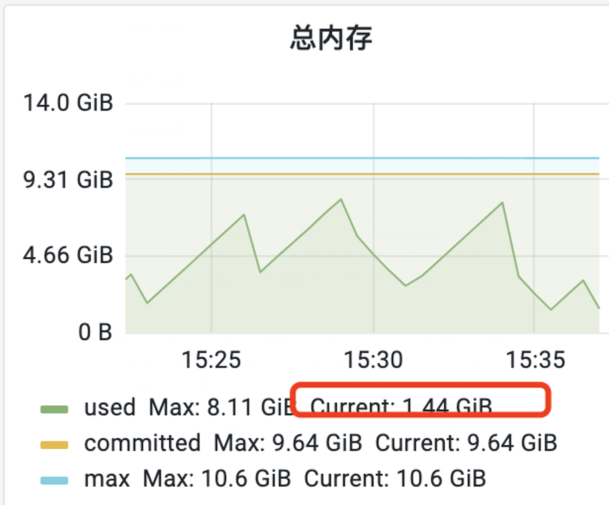
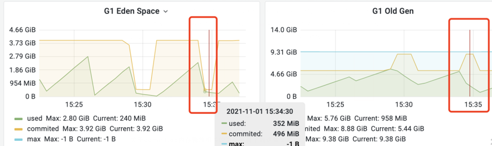
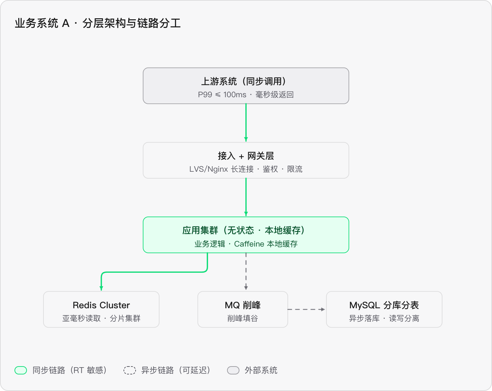
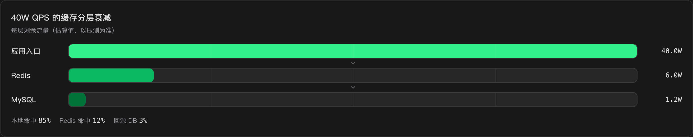

# 线上问题的一些梳理
## 1、压测内存不降问题

几轮压测后，服务内存一直居高不下，从监控看趋势，是慢慢往上升的。在垃圾回收后，内存也没有降下来，**初步判断是内存泄漏了**。

**案例：**静态集合只加不删、ThreadLocal 未 remove、无界队列

**解决方案：**

1）止血手段：重启大部分机器（缓解线上），留一两台做排查

2）dump下问题机器的内存进行MAT（Memory Analyzer Tool）分析，大概就可以定位到某个占用内存高的类

## 2、机器内存占用过高，超70%

先看机器水位的影响：

```plain
70% → 85%+：page cache 被挤掉，磁盘 IO 开始变慢 —— IO变慢影响日志打印，现在都是异步日志，会导致日志队列堆积
     → 90%+：内核启动 swap，JVM 的堆页被换出
     → GC 时要把它换回来（page fault），STW 从几十 ms 飙到几百 ms 甚至秒级
     → 95%+：OOM killer 介入，通常直接杀掉最大的进程 —— Java 进程
```

JVM堆内存图如下：


| 线                     | 含义                            |
| --------------------- | ----------------------------- |
| max（蓝线）10.6 GiB       | JVM 堆的上限，即 -Xmx（可能还叠加了少量堆外区域） |
| committed（黄线）9.64 GiB | JVM 实际向操作系统申请到的内存             |
| used（绿线）              | 堆内存活对象实际占用的内存                 |
| Current               | used的当前时刻值                    |

绿齿解读：

● 爬升：业务运行，对象不断分配（Eden 区填满 → 存活对象晋升）。

● 骤降：发生 GC，死对象被回收，used 断崖式下跌。

● 锯齿周期约 2\~3 分钟一次，回落幅度大（8G → 2G 左右），说明单次回收能释放大量内存，大概率是 Young GC / G1 的 young+mixed 回收在正常工作，而不是内存泄漏。泄漏的形态是“锯齿底部逐次抬升”，这张图底部基本稳定在 1.5\~4G，没有抬升趋势。

健康度判断：

```plain
used 峰值 8.11 GiB  <  committed 9.64 GiB  <  max 10.6 GiB
```

used 从未顶到 committed/max → 没有触发堆扩容，也没打满，离 OOM 很远。

峰值爬到 8G 才回落，如果那是 Old 区涨到阈值触发的并发回收（CMS/G1 Initiating Heap Occupancy），属于正常阈值触发；



| 左图                                                                                                                                                                    | 右图                                                                                                            |
| --------------------------------------------------------------------------------------------------------------------------------------------------------------------- | ------------------------------------------------------------------------------------------------------------- |
| **绿线 used 的密集小锯齿**：Eden 满了 → Young GC → 存活对象晋升/复制走 → used 掉回低位。锯齿越密说明 Young GC 越频繁，这张图周期大约 1\~2 分钟一次，正常。                                                              | **绿线 used 呈“缓慢爬坡 → 阶梯回落”**：老年代靠晋升慢慢涨，涨到阈值后由 **Mixed GC**（回收 Young + 一批 Old region）清下去。底部没有逐次抬升，没有泄漏迹象。        |
| **黄线 committed 阶梯变化（3.73 GiB → 骤降到 \~600 MiB → 又涨回来）**：这是 G1 特有的**自适应分代调参**。G1 会根据暂停时间目标（`-XX:MaxGCPauseMillis`）动态扩大/收缩年轻代大小——流量低时把 Eden 缩小以控制单次 GC 耗时，流量上来再扩回去。不是异常。 | **黄线 committed 的平台形状**同样是 G1 动态调整 Old 区大小，Max 8.88 / Current 5.44 GiB。                                        |
| **max: -1 B**：`-1` 是 JMX 里“未设置上限”的意思。G1 的年轻代没有固定 max（由 GC 动态决定），所以显示 -1 B，不是 bug。                                                                                     | **蓝线 max 9.38 GiB ≈ 10 GB → 这就是** **`-Xmx10g`**，和上一张图对上了：总内存 max 10.6 GiB ≈ 堆 10GB + 元空间/CodeCache 等 \~600MB。 |

解决方案：

1. 扩容机器内存，由16G扩到32G，不过目前堆内存也够用，只是触发了告警的阀值而已。（成本高）
2. 限制最大堆内存，目前为9600M, 也就是committed最大申请值为9600M，可以调小点，这样就不会预先申请那么多，也不会触发告警。
3. 调整监控阀值比例为80%，目前是70%，经过验证内存水位一致保持在80%以下，并且堆内存也能正常垃圾回收。

## 3、接口的RT高的问题

接口RT高，大多数是和外部服务有关（中间件、RPC和DB）， 因为这块网络开销大

**案例：**接口内有个从Redis获取数据的动作，同时它是一个大Key， QPS高的时候严重影响RT，因为网络带宽容易被打满

**解决方向：**1）key的合理性   2）本地缓存的可行性

## 4、RPC同步调用报TimeoutException

**keywords:** 同步调用、10W QPS，低延迟

\----->本质是：「高并发 + 低延迟 + 同步调用」

**排查思路（初步-按时间线）：**

1）确定下是不是业务流量上涨（CPU 水位、机器 load ）—— **流量激增问题**

2）看下网络开销的操作（数据库、中间件、外部系统）—— **外部服务瓶颈**

3）排查下是否有分布式锁逻辑，因为等待所致 —— **并发锁问题**

4）频繁GC和GC耗时 —— GC暂停时所有请求都将暂停处理（**STW**）

**解决方案：**

1）如果影响比较大，可以先扩容

2）同步接口内的逻辑，可以异步执行的就异步执行

3）GC调整，让大对象更早的进老年代（避免频繁young gc）

### 4.1、如何设计一个响应快的接口？

#### 一些名词解释：

| 名词   | 解释                                                                                     | 说明                                         |
| ---- | -------------------------------------------------------------------------------------- | ------------------------------------------ |
| P99  | 第 99 百分位耗时。把一段时间内**所有请求的耗时从小到大排序**，取排在**第 99% 位置的那个值**。含义：**99% 的请求比它快，最慢的 1% 请求比它慢**。 | 例如 P99 = 200ms，表示每 100 个请求里只有 1 个超过 200ms。 |
| GSLB | GSLB = Global Server Load Balancing（**全局服务器负载均衡**）                                     | 是为了解决：**一个用户请求，到底应该被调度到哪个机房 / 数据中心？**      |

#### 场景设定：

用户在 APP 点开一个商品 → 导购聚合服务收到请求 → **同步 RPC 调用商品详情服务 （要价格、库存、标题、主图、促销标签）**→ 聚合并渲染页面。用户就盯着那个 loading 圈，所以详情服务的 RT 直接等于页面打开速度。

#### 数值分析

| **纬度** | **数值**                         | **对设计影响**                |
| ------ | ------------------------------ | ------------------------ |
| 日常QPS  | 10W                            | 基线容量                     |
| 大促峰值   | 40W（约4倍）                       | 需冗余 + 削峰 + 预案            |
| RT 目标  | P99 ≤ 100ms / P999 ≤ 200ms     | P99是尾部指标，不是均值            |
| SKU总量  | 1 亿（含变体），单条约 2KB               | 全量约 **200GB**，单机绝无可能全量缓存 |
| 日更 SKU | 数十万                            | 缓存失效是高频事件                |
| 流量分布   | 头部 1% SKU 占 80% 流量             | 热点缓存是主战场                 |
| 读写比    | 读 99.9% : 写 0.1%               | 设计重心全在读路径                |
| 一致性    | 价格/库存可容忍秒级延迟，但**不允许错误价格** （资损） | 决定缓存失效方案                 |

200GB 全量装不下 → 必须热点缓存；
头部 1% 撑 80% → 命中率是第一 KPI；
读写 999:1 → 同步链路只服务读。

**RT 预算：**

RT拆解：网络 ≤5ms + 网关 ≤2ms + 应用逻辑 ≤5ms + 缓存 ≤1ms + 序列化返回 ≤2ms ≈ 15ms

异常消耗：剩下 85ms 是抗抖动的缓冲——GC 停顿、下游毛刺、尖峰都靠它吸收。

#### 架构分层：

整体上应该大致拆成如下结构

本质上就三句话：**用缓存换 RT，用异步换吞吐，用冗余和降级换稳定**

<br />

##### 第一层：接入层（GSLB → LVS → Nginx）

1、就近接入、四层/七层负载、TLS 卸载、连接复用、静态资源分流。

1）**GSLB 就近接入：**把用户调度到最近机房（同城双活）。跨机房 RTT 是 20\~40ms，本地机房是 0.5\~2ms。 这几十毫秒是白送的损失，必须省。

2）**LVS（DR 模式）：**四层转发只改 MAC 不改包内容，单机几十万 QPS。40W 峰值用几台 + Keepalived 就够，这层不是瓶颈。（机房内）

3）**Nginx/OpenResty 的四个动作：**TrTLS 卸载 + HTTP/2 + keep-alive 长连接 。这是本层最重要的一条：短连接每次要 1\~3 个 RTT 建 TCP+TLS，几十毫秒就没了。开启连接复用后， 单机 QPS 从 3\~5W 提到 10\~20W，等于同等的钱多扛 3 倍流量。
静态资源（图片/JS/CSS）全走 CDN ，详情服务只出数据、不出富文本。40W QPS 里如果有 30% 是图片请求，那是纯粹的浪费。
连接数限流 + IP 维度限流挡爬虫。

4）容量 ：40W ÷ 15W ≈ 30 台（含冗余），完全无状态可水平扩。

<br />

##### 第二层：网关层

网关可以有的能力：

鉴权、限流、路由、灰度、日志

<br />

##### 第三层：应用服务层（Detail Service）

1、无状态设计，让其可横向扩展（**相反案例：会话粘滞——依赖某个机器的本地数据**）

2、**本地缓存是第一优先级**

\- **只缓存热点 SKU** ，不是全量。但算一下：头部 1% = 100W SKU × 2KB = 2GB ，分布式装在 100 台集群里，每台只要 20MB 就够—— 这个数字说明热点全量本地化是可行的，这是本设计成立的前提。

\- **淘汰算法用W-TinyLFU** （Caffeine 默认）。相比 LRU，它同时考虑访问频率和最近性，能抗扫描型流量， 这是命中率从 70% 提到 85% 的关键 ，不是可选项。

\- 容量：单机 512MB\~1GB，能存 25W\~50W 条，100 台聚合覆盖全站热点绰绰有余。

\- **TTL 3\~10s（主动失效 + 短 TTL 双保险）**。太长会脏读价格，太短会击穿回源。

3、资源隔离核心字段（价格/库存/标题/主图）与非核心字段（推荐、评价数、销量）走 **不同线程池**或信号量 ，非核心超时 20ms 直接返回空。 一个非核心下游抖动，如果共用线程池，会把整个详情接口拖死——这是线上最常见的事故形态。

4、序列化JSON 换 Protobuf/FlatBuffers 。单次序列化 0.2ms 看着不多，但乘 40W QPS 就是 80 个 CPU 核的消耗，同时体积降到 30\~50%，出口带宽砍半

<br />

##### 第四层：缓存层

只有3%的请求会碰DB，如果本地命中率从 85% 掉到 70%，DB 承受的 QPS 会从 1.2W 涨到 6W， 直接打挂主库 。所以 缓存命中率必须和 P99 同级别监控 。
一致性设计：「 Binlog 主动失效广播 + 短 TTL 兜底 」
● 运营改价 → 同步写 MySQL 主库（事务内）
● Binlog → Canal → Kafkaproduct_change topic
● 各实例消费（ 广播模式 ）→ 删除本地 Caffeine key + 更新 Redis
● 兜底：本地 TTL 3~10s，广播全丢最坏也只脏 10s

**不用延迟双删的理由：**
双删解决的是「并发读写导致旧值回填」，它只覆盖 Redis， 而 85% 的流量在本地缓存，本地缓存根本没有双删的机会 。这是这道题最容易答错的地方——很多人会背双删，但在本地缓存主导的架构里它是无效的。

**超级热Key：**
 单个爆款 40W QPS 全打到一个分片 = 分片直接挂。三道防线：本地缓存先扛掉 85%；仍不够就给热点 key 做 逻辑分片`detail:123:1` ~`detail:123:8` 随机读；再不够用 Redis 只读副本 分担。

<br />

## 5、大报文问题

\*\*问题定义：\*\*不同的系统通过网络进行数据交互时payload size过大导致的系统可用性下降问题。

线上因素很多不可控，比如人工导单，一次性导太多（内部订正工具没有加限制，本来是技术人员使用，后面流出给了产品或者业务方）

危害点：

1、\*\*对生产方的危害：\*\*过大的报文在序列化时消耗更多内存和CPU，在传输时(JSF/MQ)可能超过中间件的大小限制导致传输失败

**2、对消费方的危害：过大的报文在反序列化时会**产生大对象，消耗更多的内存和CPU，容易触发FullGC甚至OOM，而在处理过程中要遍历的内容更多，造成响应变慢，如果涉及数据库操作容易产生大事务、慢SQL，这些容易触发超时，如果客户端有重试机制，会进一步加重大报文消费方负载，严重时导致服务集群整体不可用。

3、如果日志记录了原始报文，也可能磁盘打满和响应变慢。

4、由于大报文与小报文是在一个接口上完成的，使用相同的UMP key，它会导致监控失真，报警阈值无效
